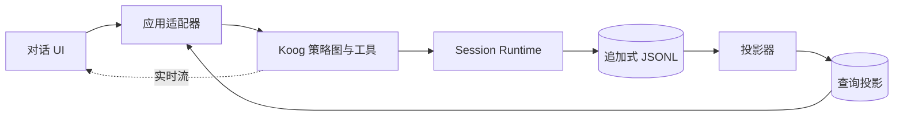
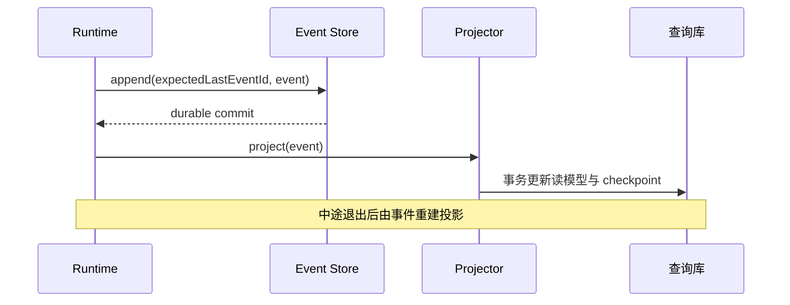
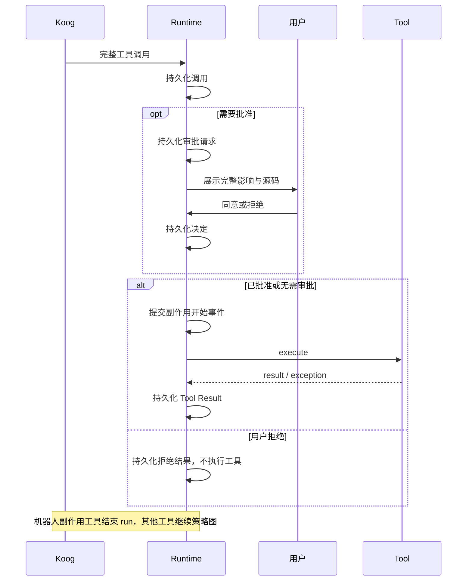

# Hanppie 智能体运行时设计

本文维护 Session、耐久事件、查询投影与副作用恢复的设计契约。当前模块、实现和验证范围见[技术架构](./architecture.md)；产品交互见[对话体验](./conversation-product-requirements.md)，工具授权见[智能体产品设计](./conversation-agent-product-design.md)。

## 数据与职责

Agent Session 承载多次 Koog agent run、消息、工具调用与审批。“对话记录”是它的产品名称。运行时拥有事件目录和独立查询库；脚本库由应用另行管理，两者不共享事务或存储生命周期。

JSONL 是耐久事实来源，SQLite 是可删除、可重建的读模型。UI 不直接写事件或查询表；投影器是更新读模型的唯一入口。代码目录、锁粒度与数据库表结构以技术架构和实现为准。

## 类型与标识

直接复用 Koog `Message`、`MessagePart`、`Prompt`、`LLModel`、`LLMCapability`、`ToolRegistry` 和 `AgentExecutionInfo`。自有类型只补充 Session 元数据、用户审批、工具副作用开始等 Koog 没有的事实，不维护平行消息或工具 DTO。

| 标识 | 契约 |
| --- | --- |
| `sessionId` | 可重新打开、继续工作的 Session |
| `runId` | 一次 Koog agent run，在事件、日志与投影中关联 |
| `eventId` | 耐久事件 ID，用于幂等与追加游标 |
| `toolCallId` | 沿用 Koog 工具调用 ID，审批、开始与结果使用同一值 |
| 消息 ID | 沿用 Koog `Message.id`，持久化前保证稳定 |

事件顺序采用文件行顺序，追加通过 `expectedLastEventId` 校验，不另造序号或 hash 链。工具完成直接保存包含 `MessagePart.Tool.Result` 的完整消息。

## 耐久记录

接受用户消息与开始 run 在同一次提交中完成，提交成功后才能清空输入。消息完成、审批请求与决定、工具开始、run 完成/失败/取消均留下耐久事实。

SSE、token delta、keepalive 和 `StreamFrame` 只用于实时反馈，不进入事件日志。进程退出可以丢失尚未完成的流式片段，不能丢失已接受输入、审批或副作用开始事实。

追加需要满足：

1. 在并发保护内重新检查末事件游标，禁止陈旧写入。
2. 同一事件 ID 与相同内容可幂等重试；同 ID 不同内容立即报冲突。
3. 一个完整 UTF-8 JSON 对象占一行，换行作为提交边界，提交后同步到磁盘。
4. 未换行尾部隔离后截断；已提交坏行、空行、重复 ID 和非法字段明确拒绝。
5. 删除 Session 与写入使用同一并发边界，不删除仍可能被其他参与者使用的锁文件。

不为假设历史增加双写、未知事件降级或兼容读取。需要变更已发布数据格式时，依据真实历史 fixture 明确迁移并验证。

API Key、Authorization、Cookie、HTTP envelope 和完整供应商响应 body 不进入事件或投影。事件允许包含任务需要的对话、脚本和工具结果，导出按单 Session 的隐私规则处理。

## 查询投影

查询库服务列表、完整 Koog 消息、run 状态和错误详情，不成为第二份事实来源。

checkpoint 与事件不一致时重建对应 Session；删除查询库后仍可恢复列表、消息与终态。不能用破坏性数据库迁移冒充事件迁移，也不能跨脚本库和事件源制造伪原子性。

## 工具与运行

编排采用显式 Koog 策略图，工具由应用组合为一个 `ToolRegistry` 并注入。工具串行执行，机器人副作用工具作为 run 终止点，返回后不继续让模型规划动作。模型请求次数有明确上限，达到上限报告失败，不能把最后工具输出当成最终答复。

副作用前先提交开始事件。拒绝是完整的审批结果，程序异常是失败；两者不混写。模型请求与工具执行分别限时，人工等待可取消，不计入执行超时。命令发送或首个流式片段不能作为 run 完成证据。

单一可观察运行状态同时控制命令准入与 UI，不另建隐藏的“正在运行”布尔值。拒绝发送或管理操作时返回明确原因。错误保留原始异常链与 traceback，记录前确保凭据不泄露。

## 恢复与停止

- 未决定且未开始的审批安全拒绝，不恢复成已批准。
- 开始事件没有匹配 Tool Result 时，补记结果未知，禁止调用工具重放。
- 未结束 run 记录进程中断与失败，恢复提示只用于 UI，不污染后续模型上下文。
- 尚未开始副作用的模型请求可以重试；工具开始后不能一键重跑整个 run。
- 取消 run 不表示机内脚本停止，停止由独立设备入口完成。停止尝试不能被存储故障阻断。

审批跨重启继续、增量事件读取、历史分页和 graph checkpoint 是独立扩展，不改变上述契约。引入前应明确实际需求；checkpoint 不能代替跨 run 的 Session 历史。

## 模型服务边界

供应商配置、目录发现与配置测试由 provider 层负责，不属于 Session 启动依赖。目录按用户操作请求，失败不后台重试。运行使用启动时的模型快照；目录成功、文本成功与工具成功分别报告，不从模型名称推测能力。

## 验证契约

重点保护事件已提交而投影未提交的恢复、陈旧游标、ID 冲突、坏行拒绝、尾部隔离和独立重建。工具开始后崩溃只能产生结果未知，不重放副作用；实时帧和凭据不进入耐久历史。离线、平台、真实供应商和实机验证分别记录，命令入口见[开发指南](./development.md#验证)。
