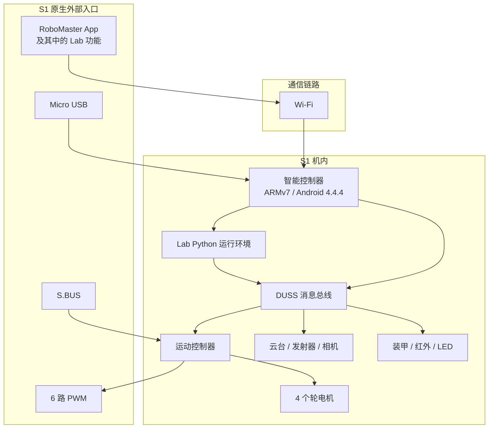
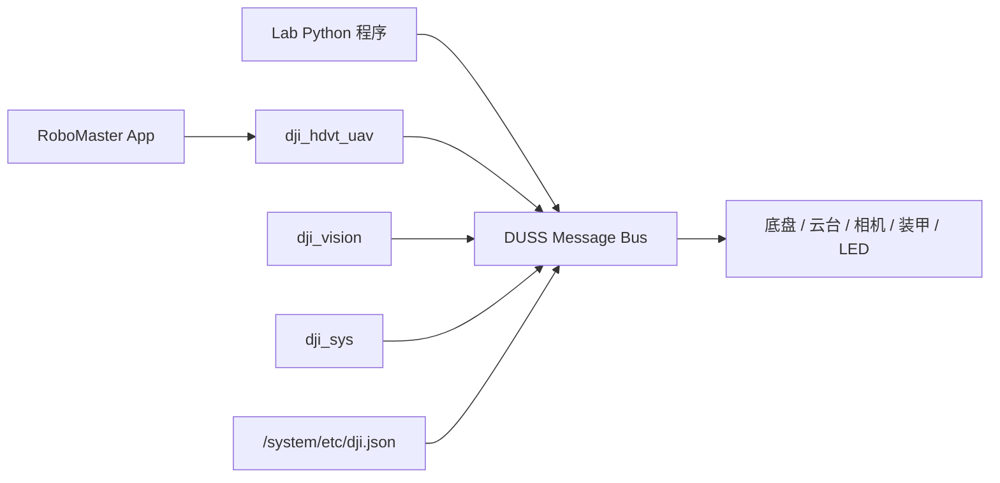
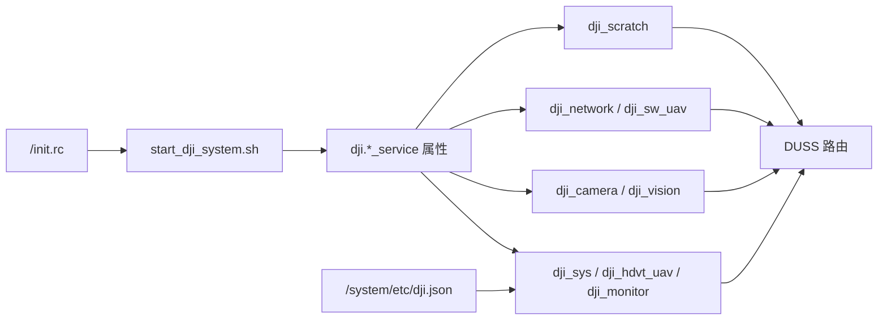
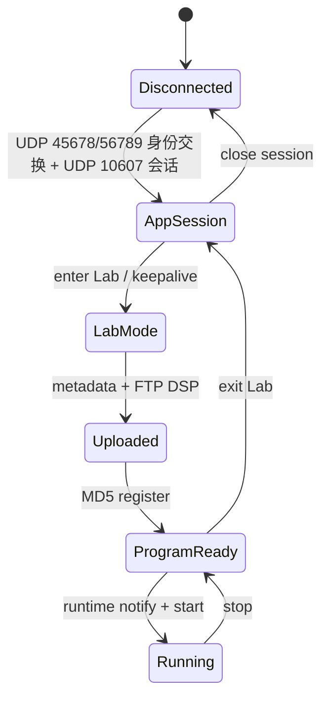
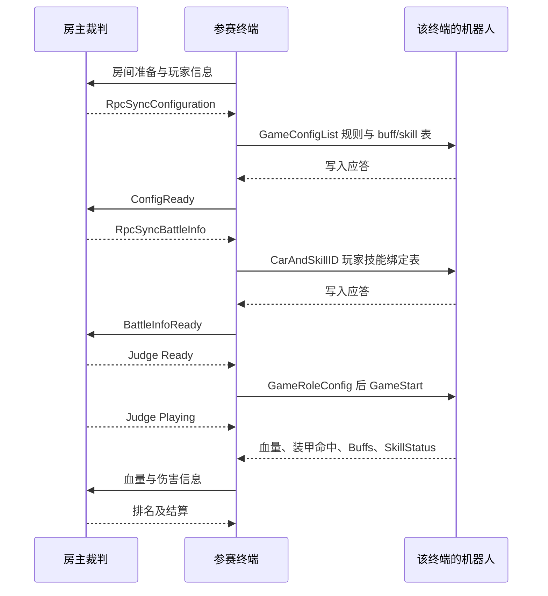
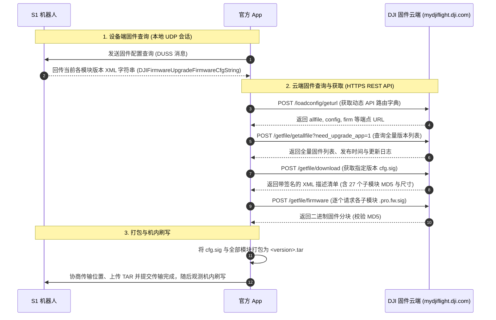

# RoboMaster S1 原生架构、协议与调查

> 文档性质：RoboMaster S1 原生硬件、固件、协议与外部生态的长期技术事实源。<br>
> 最后更新：2026-09-13<br>
> 已验证固件：RoboMaster S1 `00.06.0521`

本文只记录 RoboMaster S1 的当前固有架构、通信、协议调查和外部扩展边界。Hanppie 当前增加的主机能力、代码结构、安全策略和验证状态统一维护在 [Hanppie 技术架构](./architecture.md)。已被替代的方案、旧命令、迁移过程和开发取舍不进入正文，由日期化调研、联调记录与 Git 历史保存。

## 文档所有权

| 信息类型 | 权威位置 |
| --- | --- |
| S1 原生硬件、固件服务、DUSS、App/Lab 机制、媒体链路和外部生态 | 本文 |
| Hanppie 代码结构、实现机制、能力矩阵和安全边界 | [`architecture.md`](./architecture.md) |
| 安装、CLI 参数和开发命令 | 中英文 README、`pyproject.toml` 和 `Taskfile.yml` |
| 单次实机命令、原始输出、故障和测量值 | 日期化联调记录 |
| 内置 SDK fork 来源 | [`src/robomaster/UPSTREAM.md`](../src/robomaster/UPSTREAM.md) |

## 证据标记

本文复用 [Hanppie 技术架构中的证据等级](./architecture.md#证据标记)，不在此复制第二份定义。原生能力和协议调查同样必须区分接口存在、命令被接受、遥测变化与物理效果。

## 1. 文档范围与归属

本文使用以下归属，章节中的“原生”“外部”和“项目”均按此定义：

| 归属 | 含义 | 主要章节 |
| --- | --- | --- |
| **S1 原生** | 出厂硬件、固件服务、DUSS、RoboMaster App、Lab 功能和机内 Python；即使没有 Hanppie 也存在 | 第 2～5 章 |
| **外部生态** | S.BUS 接收机、SocketCAN/vcan、ROS 2、DJI EP SDK 等可与 S1 相关但不属于 Hanppie 的技术 | 第 6 章 |
| **Hanppie 项目** | 本仓库增加、恢复、组合或规划的主机代码、机内载荷、临时补丁和安全策略 | [Hanppie 技术架构](./architecture.md) |

“仓库中保存了原机文件”不表示该文件由 Hanppie 创建；`assets/s1-system/` 中的恢复内容是分析 S1 的证据。原机参考文件已按系统原始绝对路径归档；初期探索阶段的 Lab Bridge 与 ADB 载荷已随原生直控协议的完备而彻底移除。PyAV 媒体兼容层为项目增量，不能写成 S1 出厂能力。

### 1.1 术语来源与实际对象

本文同时涉及 DJI 产品名称、原厂程序、逆向得到的网络封包和 Hanppie 自有组件。它们不是同一层概念：

| 名称 | 名称来源 | 本文实际指向 |
| --- | --- | --- |
| RoboMaster App | DJI 产品名称 | 手机/macOS 应用；与 S1 的身份交换使用 Host UDP `45678` 和 S1 UDP `56789`，后续数据会话通常使用 Host UDP `10609` 和 S1 UDP `10607` |
| RoboMaster Lab | DJI App 中的功能名称 | 创建和运行 `.dsp` 程序；机内由 `/data/dji_scratch/bin/dji_scratch.py` 管理，文件经 FTP `21` 上传，生命周期命令通过 DUSS 发送 |
| `AppEnvelope` | Hanppie 代码名称，不是 DJI 官方术语 | [`protocol.py`](../src/hanppie/protocol.py) 对 UDP `10607` 报文中、位于 DUSS 或媒体数据之外的 session、tick、direct/control channel 等字段的封装；字段来自固定 App 抓包并经实机互操作验证 |
| DUSS | 原厂代码和协议常量中的名称 | 具有 sender、receiver、sequence、command set、command id、payload 和 CRC 的消息；机内由 Unix Datagram Socket 路由，并可经 UART 或 UDP `10607` 外层封包承载 |
| Lab Python 控制对象 | 本文对机内对象的统称，不是独立协议名称 | Lab 程序上下文中的 `robot_ctrl`、`chassis_ctrl`、`gimbal_ctrl`、`led_ctrl`、`media_ctrl` 等对象；对应恢复的 `rm_ctrl.py` 高层类 |
| Hanppie Lab Bridge（已废弃） | Hanppie 早期项目名称 | 早期探索时上传到 `/data/ftp/python/python_raw.dsp` 的过渡程序；现已彻底移除，由原生 App UDP 直控取代 |
| DJI 官方 Python SDK | DJI 发布的软件包 | 电脑上的 `robomaster` 包；`Robot.initialize()` 依赖机器人端 EP SDK 服务，详细边界见第 6.3 节 |

`App/Lab` 和 `App UDP` 都不代表一套协议或一个进程。本文描述具体链路时直接写 RoboMaster App、Lab 功能、机内程序、传输协议和端口；“外层封包”只表示 `AppEnvelope` 对应的 UDP `10607` 报文结构。

## 2. S1 原生整机架构

S1 不是一个由电脑直接驱动电机的外设。它内部已经包含智能控制器、运动控制器、云台/相机和多个执行器/传感模块；出厂软件通过 RoboMaster App、Lab 功能、Wi-Fi 和机内服务控制这些模块。



图中只画出 S1 出厂存在的入口和模块，不包含 Hanppie、官方 EP SDK 兼容补丁或计划中的远程控制器。Hanppie 如何接入这些入口见 [Hanppie 技术架构](./architecture.md#1-hanppie-项目实现与机制)。

## 3. S1 原生硬件架构

### 3.1 主要模块

| 模块 | 主要职责 | 证据 |
| --- | --- | --- |
| 智能控制器 | Wi-Fi、USB、视频、视觉、RoboMaster App、Lab Python 运行环境和固件内网络服务 | **实测/代码** |
| 运动控制器 | 底盘运动、电源和外部 PWM/S.BUS 接口 | **官方/代码** |
| 两轴云台 | 俯仰、偏航和工作模式 | **官方/代码** |
| 相机与媒体链路 | 720p H.264 图传，音频链路使用 Opus | **实测/官方 SDK 代码** |
| 四轮底盘 | M3508I 电机与麦克纳姆轮运动 | **官方** |
| 装甲与红外 | 击打、红外事件和灯效 | **官方/代码 + 实机**：光学帧结构与命中事件已实测并验证重放（见 5.5） |
| 智能电池 | 供电、电量和状态管理 | **官方；外部 SDK 电量值不可信** |

### 3.2 智能控制器

已连接设备显示智能控制器使用 ARMv7 平台，运行 Android 4.4.4/API 19，构建类型为 `userdebug`、`test-keys`。设备包含 Python、DJI 服务、BusyBox、ADB 相关脚本和 DUSS 路由配置。**实测/代码**

这解释了几个关键现象：

1. RoboMaster Lab 的 Python 实际运行在机器人内部，而不是手机或电脑上；
2. 机内 Python 可以通过本地 DUSS 总线调用底盘、云台、灯光等模块；
3. S1 与 EP 的底层模块高度复用，但对外开放的服务集合不同；
4. 外部电脑能否使用某套 DUSS 客户端，还取决于机内是否开放对应的会话和转发入口。

### 3.3 外部接口

| 接口 | 原生用途 | 原生边界 |
| --- | --- | --- |
| 智能控制器 Micro USB | RNDIS、Mass Storage、Bulk、ACM 等复合 USB；固件也包含 ADB 组件 | 量产启动后不保证开放 ADB |
| Wi-Fi AP/Station | RoboMaster App、Lab 功能、媒体和机内网络服务 | S1 原厂不开放完整 EP SDK 入口 |
| S.BUS | 单向底盘、云台、模式和扭矩控制 | 没有相机和完整遥测 |
| 6 路 PWM | 外部执行器扩展 | 只提供 PWM 输出能力 |
| 模块 CAN/UART | 运动控制器、云台、装甲等内部模块互连 | 不是官方消费级扩展 API |
| 保留 UART/USB | 固件或硬件内部用途 | 官方没有提供稳定扩展契约 |

S.BUS 信号、5 V 和 GND 的方向必须按机身丝印和手册确认。内部 CAN 不是面向普通用户的即插即用接口；接线、供电、终端电阻和主动发帧均可能损坏硬件。

### 3.4 原生网络连接模式

S1 智能中控的物理连接模式开关选择 Wi-Fi AP 或 Station 拓扑。DJI 中文界面将两者称为“直连模式”和“路由器模式”：直连模式由手机或电脑加入机器人机身标签所示的热点，适用于无路由器环境；路由器模式由 RoboMaster App 根据当前网络生成二维码，用户短按连接按键后让机器人扫码加入路由器。官方说明还指出路由器网络必须允许设备间通信，且不能依赖网页二次认证。**官方**

RoboMaster macOS `1.1.5` 的静态实现与该流程一致：连接页先选择 AP/Station 面板，AP 面板只引导打开系统 Wi-Fi 设置；Station 面板读取终端当前 SSID、再次取得密码并生成二维码。连接控制器长期保存 AppID 和“当前 SSID + 机器人 MAC”的设备标识，Wi-Fi 变化时先把目标重置为直连默认地址 `192.168.2.1`，并始终监听 UDP `45678`；收到广播后实际使用 UDP 来源地址连接，而不是依赖报文内嵌 IP。App 在连接后读取 `DJIWiFiLinkMode` 判断 AP 或 Station，而 UDP App 数据会话仍使用同一套连接服务。此处的 AP/Station 是网络拓扑，不能与 Hanppie 主机侧名为 `DirectRobot` 的协议后端混为一谈。**代码/官方**

仓库内保留的 DJI RoboMaster SDK 给出了可独立实现的 Station 配网格式：两字节小端字段编码 SSID 与密码长度，随后依次写入 8 字节 AppID、两字节国家码、SSID 和密码，对整段数据执行滚动异或并 Base64 编码为二维码文本。扫码后机器人向 UDP `45678` 发送带 IP、MAC 和 AppID 的配对广播，控制端向来源端点回送同一 AppID 完成确认。官方 App 的连接控制器进一步表明其顺序是：首次配对广播触发数据会话连接；确认数据会话已连接后，下一次配对广播才从 Host UDP `45678` 向来源 IP/端口回送 `BitConverter.GetBytes(AppID)`。Hanppie 按这一顺序在本地生成二维码、建立会话并确认，不需要运行原厂 App；实现来源记录和向量测试分别见 `RouterProvisioning`、`AppSession` 与对应测试。**代码/官方 SDK**

S1 直连热点的初始密码是 `12341234`；在直连模式下长按连接按键 5 秒可重置忘记的 Wi-Fi 密码。热点名应以机身标签为准，不应由第三方客户端根据型号或历史记录猜测。**官方**

## 4. S1 原生机内软件架构



### 4.1 系统信息快照

下表只记录已经从真机、ADB 输出或固件文件确认的内容；没有把社区同型号信息当作本机事实。

| 信息项 | 固件 `00.06.0521` 的记录 | 证据 |
| --- | --- | --- |
| CPU/ABI | ARMv7，机内关键二进制为 ARM32 EABI5 | **实测/文件审计** |
| 操作系统 | Android `4.4.4`，API 19 | **实测** |
| 型号/产品 | `L1860` / `full_xw607_dz_ap0002_v4` | **实测** |
| DJI 平台 | `XW0607_1860AC01` | **代码：`dji.json`** |
| 构建 | `userdebug`、`test-keys`，构建日期 2022-10-27 | **实测** |
| 系统属性 | `ro.secure=1`、`ro.debuggable=1`；DJI init 服务以 root 用户运行 | **代码/实测** |
| Shell/基础工具 | Android `mksh`、BusyBox，包含 ADB 脚本和 `adbd` | **代码/实测** |
| Lab 解释器 | `/data/python_files/bin/python`，Python `3.6.6`，GCC 4.8.3 构建 | **实测** |
| 运行环境 | `DEVICE_TYPE=UAV`，DJI 启动脚本设置 `HOME=/data`，init 设置固定 `PYTHONPATH` | **代码** |
| 主要网络接口 | `iwlan0`；`usb0` 固定为 `192.168.1.10`；`rndis0` 固定为 `192.168.42.2` | **代码；Wi-Fi Station 实测** |
| USB 复合功能 | 原厂路径使用 RNDIS、Mass Storage、Bulk、ACM；调试路径额外加入 ADB | **代码/实测** |

`default.prop` 中出现 ADB 配置不表示量产启动后一定能连接 ADB。`start_dji_system.sh` 会根据启动参数和白名单决定是否执行 `adb_en.sh`；本机正常重启后 ADB 不可见。**代码/实测**

### 4.2 启动链与系统服务

机内使用 Android init 的属性触发模型：`/init.rc` 在启动阶段运行一次 `/system/bin/start_dji_system.sh`；该脚本完成分区检查、Wi-Fi/SDR 选择、USB 和网络配置、FTP 启动、音频配置、日志目录准备，再设置 `dji.*_service` 属性。init 根据属性启动或停止对应进程。**代码**



| init 服务 | 启动程序 | 启动条件与职责 | 证据 |
| --- | --- | --- | --- |
| `start_dji_system` | `/system/bin/start_dji_system.sh` | 启动阶段一次性编排 DJI 系统 | **代码** |
| `dji_monitor` | `/system/bin/dji_monitor -m` | 监控 DJI 进程；启动脚本把它与 `dji_sys`、`dji_hdvt_uav` 作为关键存活检查 | **代码** |
| `dji_sys` | `/system/bin/dji_sys` | 系统服务和 DUSS 路由核心之一 | **代码/推断** |
| `dji_hdvt_uav` | `/system/bin/dji_hdvt_uav -g` | App 网络会话、DUSS 外部传输和媒体相关入口 | **代码/实测** |
| `dji_hdvt_cls` | `/system/bin/dji_hdvt_uav` | 同一二进制的另一启动形态，原厂启动脚本设为关闭 | **代码** |
| `dji_camera` | `/system/bin/dji_camera` | 相机与媒体服务 | **代码/推断** |
| `dji_vision` | `/system/bin/dji_vision` | 视觉处理服务，原厂启动脚本启用 | **代码** |
| `dji_network` | `/system/bin/dji_network -t wifi -i 10 -t sdr -i 5` | 网络路由；Wi-Fi 模式启用、SDR 模式关闭 | **代码** |
| `dji_sw_uav` | `/system/bin/dji_sw_uav` | Wi-Fi 模式的软件传输服务 | **代码/推断** |
| `dji_scratch` | `/data/python_files/bin/python /data/dji_scratch/bin/dji_scratch.py` | 常驻 Lab/Scratch 管理器，接收程序、控制执行并转发日志 | **代码** |
| `dji_blackbox` | `/system/bin/dji_blackbox` | 黑匣子与日志归档 | **代码** |
| `dji_perception` | `/system/bin/dji_perception` | 可选感知服务；原厂启动脚本默认未启用 | **代码** |

这些 init 服务均声明为 `disabled`，含义是“不随 Android service class 自动启动”，不是永久禁用；它们由 `dji.*` 属性显式启动。**代码/实测**

启动脚本还启动匿名可写 FTP：`busybox tcpsvd -vE 0 21 busybox ftpd -w /ftp`。`/ftp` 是指向 `/data/ftp` 的符号链接，因此 FTP 21 暴露的是持久数据分区。实机根目录包含 `blackbox`、`flyctrl`、`python`、`upgrade`、`v2` 和 `workspace` 等内部服务数据，不是用户媒体库；服务没有应用层认证，只应在可信隔离网络使用。实机 `FEAT` 只报告 `EPSV`、`PASV`、`REST STREAM`、`MDTM` 和 `SIZE`，不支持 UTF-8，非 ASCII 名称会退化为问号。Hanppie 的内部文件页只把这个 FTP chroot 表现为 `/`，不会把它映射成 Android `/system`、完整 `/data` 或任意 root 文件系统。**代码/实测**

RoboMaster macOS 1.1.5 客户端中的媒体库由 `DJILocalAlbumController` 管理主机本地照片和视频，不是 FTP 根目录浏览器；黑匣子导出则会先向 S1 发送带 `isDecrypt=true` 的准备请求，再进入 FTP 下载。实机也确认普通 FTP 对非空上传进行了确定性的分组变换：输入长度 `1/15/16/17/31/32/33/46` 字节时，回读长度分别为 `16/16/32/32/32/48/48/48` 字节，相同明文得到相同回读内容。公开 DSP 容器密钥不能解开该结果。因此裸 FTP 只提供内部数据搬运，不提供原厂工作流中的通用解密语义；Hanppie 可以浏览、传输和把原始数据交给系统应用，但不能承诺这些数据可直接作为普通音频、视频或日志打开。**客户端静态分析/实测**

### 4.3 关键程序与文件

| 路径 | 原机职责 | 原生状态 |
| --- | --- | --- |
| `/init.rc` | DJI 服务定义、属性触发器、Lab 解释器入口、全局环境变量 | 系统启动配置 |
| `/system/bin/start_dji_system.sh` | DJI 系统启动编排、FTP/网络/USB/音频/日志初始化 | 原厂启动脚本 |
| `/system/etc/dji.json` | 平台、HAL、DUSS 服务及路由表 | 原厂路由配置 |
| `/system/bin/dji_hdvt_uav` | App 网络会话、DUSS 外部传输和媒体相关入口 | 原厂二进制 |
| `/system/bin/dji_sys`、`dji_vision`、`dji_camera` | 系统、视觉和媒体关键进程 | 原厂二进制 |
| `/data/dji_scratch/bin/dji_scratch.py` | init 实际启动的 Lab/Scratch 常驻管理器 | 持久数据分区中的原厂程序 |
| `/data/dji_scratch/src/robomaster/` | 机内 `rm_ctrl`、`rm_module`、DUSS 客户端等 Python 运行库 | Lab 原生运行库 |
| `/data/python_files/bin/python` | Lab/Scratch 固定 Python 解释器 | 固件随附解释器 |
| `/data/ftp/python/python_raw.dsp` | RoboMaster Lab 上传的 DSP 程序容器 | 每次上传覆盖；文件存在不代表正在运行 |
| `/system/bin/adb_en.sh`、`/sbin/adbd` | 原厂调试脚本和 ADB daemon | 固件包含，量产启动后不一定启用 |

备份中还保存了 `/data/dji/dji_scratch.py`，其内容是 Lab/Scratch 管理器实现；但 init 中确认的实际服务入口是 `/data/dji_scratch/bin/dji_scratch.py`，在没有进一步 inode/符号链接证据前，不把两者写成同一个活动文件。**代码，关系待验证**

### 4.4 DUSS 路由与模块

恢复的 [`event_client.py`](../assets/s1-system/data/dji_scratch/src/robomaster/event_client.py) 使用 Android 抽象 Unix Datagram Socket，例如 `\0/duss/mb/0x...`。[`dji.json`](../assets/s1-system/system/etc/dji.json) 描述服务、模块和路由关系。**代码**

Lab 系统客户端和用户脚本分别绑定类似 `\0/duss/mb/0x905`、`\0/duss/mb/0x906` 的本地地址，未命中专用路由时把消息发往默认代理 `\0/duss/mb/0x900`。路由器再按 receiver 映射到相机、视觉、系统或 `vt_air` 等本地进程。底盘、云台、电池、ESC、装甲和发射器等模块在原厂 `dji.json` 中主要经 `/dev/ttyS3`、`921600 baud` 的 DUSS V1 路由连接。**代码**

[`rm_module.py`](../assets/s1-system/data/dji_scratch/src/robomaster/rm_module.py) 把底盘、云台、灯光、相机、视觉、声音、装甲等能力封装为 DUSS 消息；[`rm_ctrl.py`](../assets/s1-system/data/dji_scratch/src/robomaster/rm_ctrl.py) 再提供面向 Lab 程序的高层控制对象。**代码**

仓库中的 `assets/s1-system` 是从原机恢复并按系统原始路径整理的分析副本，不是桌面 SDK，也不随 `hanppie` 打包，更不是 Hanppie 重新设计的协议实现。对这些副本所做的必要整理见 [Hanppie 技术架构](./architecture.md#18-内置-sdk-fork-的边界)。

这说明“DUSS 总线”不是单根物理总线：在智能控制器内它表现为 Unix Datagram Socket 和消息路由，在控制器到下级模块之间又可以映射为 UART 等传输。内部 CAN 研究是另一层硬件路径，不能与这里的机内 DUSS 路由直接画等号。

### 4.5 S1 与 EP 的产品边界

DJI 官方 Python SDK 以 EP/EP Core 为正式对象。S1 拥有大量相同的 DUSS 命令和模块，但原厂状态没有对电脑开放完整的 EP SDK 代理。**官方/代码/实测**

实机重启后的原厂状态中，DJI 服务正常运行，但 UDP 30030 不监听，官方 SDK 握手超时。**实测** 这是 S1 的原厂能力边界；项目后端选择见 [Hanppie 技术架构 1.3.3 节](./architecture.md#133-为什么官方-sdk-不是当前控制后端)。

## 5. S1 原生通信机制

本章只描述原厂固件、RoboMaster App、Lab 功能和机内模块已经具备的机制。Hanppie 对这些机制的复用方式见 [Hanppie 技术架构](./architecture.md)。

### 5.1 DUSS 二进制消息

从机内运行库恢复的 DUSS V1 消息结构如下：

| 字段 | 作用 |
| --- | --- |
| `0x55` | 帧起始标记 |
| 版本与长度 | 表示协议版本和整帧长度 |
| CRC8 | 保护消息头 |
| sender / receiver | 编码后的模块地址 |
| sequence | 请求与响应关联 |
| command type | 请求、响应、是否需要 ACK |
| command set / command id | 能力类别与具体命令 |
| payload | 参数或遥测数据 |
| CRC16 | 保护完整消息 |

恢复的 [`duss_event_msg.py`](../assets/s1-system/data/dji_scratch/src/robomaster/duss_event_msg.py) 负责打包和解包，[`duml_crc.py`](../assets/s1-system/data/dji_scratch/src/robomaster/duml_crc.py) 实现 CRC8/CRC16。**代码**

DUSS 是多个传输上的共同消息语义，不等同于某个固定网口：智能控制器内使用抽象 Unix Datagram Socket，智能控制器与部分下级模块之间映射到 UART 等链路，App 会话又可在外层报文中承载 DUSS。

S1 的 Wi-Fi 侧没有在原厂路由表中暴露一个接受“裸 DUSS V1 帧”的通用网络 socket。原厂 `dji.json` 把 `iwlan0` UDP `10607` 配置为 `target=mobile`、`protocol=sw_v2_proto` 的服务路由；`dji_hdvt_uav` 是这条外部传输链中的关键原厂进程，但当前证据没有把每个 socket fd 逐一归属到具体 PID。客户端先完成 UDP `45678/56789` 的 AppID 身份交换，再在 UDP `10609/10607` 上维护 session 和 tick，把完整 DUSS 帧放入 direct channel。Hanppie 将这层非官方公开的封包命名为 `AppEnvelope`。因此“电脑直接与 DUSS 通信”在工程上可以实现，但准确链路是“Host → UDP `10607` 外层封包中的 DUSS → 机内 DUSS 路由”，不是“Host → 裸 DUSS 端口”。同一会话还有用于连续底盘控制的 control channel，不能假设所有能力都只需调用同一种 `send_duss()`。**代码/外部实现/实测**

因此可以把结论概括为：**DUSS 是 S1 模块控制面的核心协议，但“能构造一帧 DUSS”不等于已经获得完整的电脑控制能力。**

| DUSS 已解决的部分 | 仍需额外解决的部分 |
| --- | --- |
| 模块地址、命令集/命令 ID、请求与 ACK、任务进度、遥测事件 | 外部客户端如何发现并占用会话 |
| 底盘、云台、灯光、装甲、相机配置等模块消息 | 外层 session、tick、sequence、channel 和 keepalive |
| 机内服务和下级模块之间的统一消息语义 | 工作模式切换、初始化序列、连续控制与失联停车 |
| 同一命令在不同物理传输上的路由基础 | DSP/音频文件传输、H.264/Opus 媒体数据和解码 |
| 用任意语言重新实现编解码的可能性 | 未公开 payload 的语义、固件差异和物理安全验证 |

Python 不是 DUSS 的组成部分。只要实现帧格式、CRC、地址、序列、ACK/任务状态和相应生命周期，就可以用 C、C++、Rust、Go 等语言收发 DUSS。Python 只是 RoboMaster Lab 和现有主机 SDK 采用的一种实现语言。

### 5.2 原生网络通道与端口

| 通道 | 连接/端口 | 原生作用 | 本机证据 |
| --- | --- | --- | --- |
| RoboMaster App 身份交换 | Host UDP `45678` ↔ S1 UDP `56789` | 发现机器人、声明 8 字节 AppID | **实测可用；处理进程待 fd 级确认** |
| UDP `10607` 数据会话 | Host 默认 UDP `10609` ↔ S1 UDP `10607` | 用 `AppEnvelope` 所指的外层字段包裹 DUSS、控制帧和媒体数据，维护 session/tick | **实测可用；原厂路由见 `dji.json`** |
| Lab 程序文件 | 匿名 FTP/TCP `21` | 上传 DSP 到 `/python/python_raw.dsp` | **实测可用** |
| 视频/音频 | 复用 UDP `10609` ↔ `10607` | 视频 channel `0x02`；音频 DUSS `0x3F/0x1D`；H.264 / Opus | **视频与音频均实测可用** |
| 通用裸 DUSS 网络入口 | 未发现 | 原厂路由配置没有把机内抽象 Unix Datagram Socket 或 UART DUSS 路由直接暴露给网络客户端 | **代码** |
| ADB 组件 | USB 或 TCP `5555` | 固件维护和调试 | **固件存在；原厂正常重启后未开放** |

原厂 `dji.json` 还包含以下内部或条件路由。它们用于系统盘点，不应直接当作可访问 API：

| 配置端口 | 路由用途 | 配置状态/边界 |
| --- | --- | --- |
| TCP `9001` | `camera_sdr` 的 DMP 通道 | 路由启用，当前 Wi-Fi/App 会话是否直接使用待抓包确认 |
| TCP `20002` | `download_service` 到相机的下载通道 | Wi-Fi 路由启用 |
| `20000` / `20001` | `usb0` 上相机/下载内部通道 | 原厂表中相关路由关闭 |
| TCP `22350` | system service 到 PC 的通道 | 原厂表中关闭 |
| UDT `5555` | 相机/下载到固定 mobile/glass 地址的 UDT 通道 | 与 TCP 5555 ADB 无关 |
| `8905`–`8916`、`8919`、`8925` | 各 DJI 进程的 blackbox output port | 配置字段，未逐端口验证监听状态 |

端口号必须连同传输协议、会话角色和服务状态理解；端口出现在配置中不表示原厂启动后一定监听。

#### Wi-Fi AP 配置与无线重启

固定 macOS 1.1.5/build 239 的 `RobomasterWiFiLink` 构造请求发往 Wi-Fi 节点 `0x07`，使用命令集 `07`、需要应答的属性。下表来自原生构造函数，不是从桥接 key ID 拆解。**原生代码**

| 操作 | cmdset:id / 载荷 | 原生入口 |
| --- | --- | --- |
| 查询模式 | `07:39`，空 | GetMode `0x6e7030` |
| 查询 SSID | `07:07`，空 | GetSSID `0x6e7550` |
| 写 SSID | `07:08`，uint8 UTF-8 字节长度 + 内容，不含 NUL | SetSSID `0x6e7a10` |
| 查询 AP 密码 | `07:0e`，空 | GetPassword `0x6e7fb0` |
| 写 AP 密码 | `07:0d`，同 SSID 长度前缀 | SetPassword `0x6e8470` |
| 无线重启 | `07:15`，空 | ActionReboot `0x6e9fc0` |

模式响应为 retcode + uint8 mode；转换入口 `0x6ef5c0`，值读取于 `0x6ef60c`。`RobotService/DJI/DJIWiFiMode.cs` 定义 AP=0、Station=2，未知值不映射为 AP。字符串响应为 retcode + uint8 长度 + UTF-8 内容；SSID 转换 `0x6f0620`（长度 `0x6f066e`、内容从 +2、复制 `0x6f0691`），密码转换 `0x6f22e0`（长度 `0x6f232e`、内容从 +2、复制 `0x6f2351`）。转换按声明长度复制，不能要求响应绝无附加字节。Hanppie 对不足长度、无效 UTF-8 和嵌入 NUL 拒绝解析。**原生/当前代码**

`Module.Setting.View/WifiInfoView.cs:OnOK` 限制 SSID 为 1–32 个 ASCII 字母、数字、下划线或横线，密码为 8–16 个 C# 字符；没有在该界面对密码作 ASCII 限制。Kotlin 按相同 UTF-16 长度检查密码，另拒绝控制字符和无效 Unicode；固件是否接受所有有效 Unicode 密码尚未验证。官方 Step1 分别发送名称与密码，Step2 单独发送重启，不存在据此可确认的原子提交或自动回滚契约。**客户端代码 / 待验证**

本轮没有设备，原生静态构造、合成向量和 UDP 回环均不证明固件接受命令。设置何时生效、两字段只部分确认、重启先断线后应答、改密后的 IP/DHCP、设备身份、各模式可达性和国家代码/信道影响均待实机。静态片段保存在忽略目录 `native-Wifi-ApConfiguration.txt`、`native-Wifi-Reboot.txt` 和三个 `native-Wifi-*Reply.txt`，位于 `.hanppie/validation/2026-10-22-official-gap/`；离线验证与逐项设备检查见[实施台账 N01](./official-app-capability-implementation.md#n01-验证入口与设备待验)。

#### Wi-Fi 信道选择与干扰报告

以下依据仍为固定 macOS 1.1.5/build 239 的原生构造与转换函数，目标为 Wi-Fi 节点 `0x07`、命令集 `07`；当前没有这些命令的设备抓包或固件接受证据。**原生代码 / 待实机验证**

| 操作 | cmdset:id / 载荷 | 原生入口 |
| --- | --- | --- |
| 查询当前信道和列表 | `07:28`，空 | GetChannelInfo `0x6e62e0`；GetCurrentChannelNumber `0x6e67a0` 也使用此命令 |
| 写手动信道 | `07:2b`，uint8 频段选择值 + uint16LE 信道 | SetCurrentChannelNumber `0x6e69c0` |
| 写选择方式 | `07:16`，uint32LE，自动=0、手动=1 | SetChannelSelectionMode `0x6e8f70` |
| 查询选择方式 | `07:17`，空；响应 retcode + uint8 选择方式 | GetChannelSelectionMode `0x6e95d0`；转换 `0x6f5b20`、字段读取 `0x6f5b6b` |
| 开关信道报告 | `07:29`，单字节 0/1 | SetSNRPushEnabled `0x6e8a10` |
| 信道报告推送 | `07:2a`，分组变长数据 | 观察器绑定 `0x6ebc86`；OnWiFiSNRPush `0x6e5db0` |
| 干扰状态推送 | `07:3f`，uint16LE 状态 | 观察器绑定 `0x6ec236`；OnWiFiInterfereEventPush `0x6e60e0`，字段读取 `0x6e614a` |

信道列表响应转换 `0x6ed610` 从偏移 5 读取 uint8 当前信道，从偏移 6 读取 uint32LE 分组数；组从偏移 10 开始，含不透明 uint32 元数据、uint32LE 数量和逐项 uint16LE 信道。原生将分组展平成列表，没有把组元数据解释为频段。客户端检查组数与长度界限，保留未知/重复信道；不能以静态编码表代替设备返回的可用列表。**原生/当前代码**

手动写入的原生频段选择值取自两个静态表（辅助函数 `0x6d97e0/0x6d9870`，数据 `0x8ac7e4/0x8ac81c`）：1–14 编码为 0；34–64、100–128、132–144 的偶数及 149–165 的奇数编码为 1。它们只证明此版客户端的编码，不证明所在地允许、设备可用、特定型号支持或固件接受。Hanppie 写入还必须通过设备新返回的列表、AP 和手动模式检查。**原生/当前代码 / 待实机验证**

SNR 转换要求物理载荷至少 18 字节；偏移 0 为 uint32LE 声明总长度，不能超过实长。偏移 4 开始逐组读取不透明 uint32、uint16LE 数量，再读取若干 `(int32LE channel, int32LE value)`。原生按剩余至少 14 字节继续，接受更短的不透明尾部；客户端同样允许尾部，但畸形后组不会发布部分结果。该转换没有可信的物理量单位说明，不能把负数直接标为 dBm 或复用 `07:09` 信号质量解释。干扰枚举见 `DJIWiFiInterfere`：0 正常、1 环境干扰、2 下行干扰、3 上行干扰、4 弱信号，未知值保留。**原生/客户端代码**

官方 `Module.Setting.View/ViewSettingConnect.cs` 仅在 AP 模式显示信道管理；手动模式启用报告、自动模式和页面销毁关闭，手动选择信道前另行确认。Hanppie 增加写后回读和结果不明时显式重连核对，不据 ACK 宣称无线切换成功。既有 `CMD_WIFI_AP_KEEPALIVE` 的 `07:17` 与上述 getter 相同，本轮保持其周期发送行为及固定 JP 握手；动态国家代码冲突仍见实施台账 C02。**客户端/当前代码**

原生请求结构中的属性字节不能直接当作线上加密位：`Encoder` 构造 `0x56ff40/0x56ff50` 将加密开关置 0，编码函数在 `0x570062` 检查此开关，默认清除线上低属性位。本轮沿用既有明文应答请求，未新增 AES 或假设桥接 full-command ID 的高位为线上属性。**原生/当前代码**

静态片段保存于忽略目录 `.hanppie/validation/2026-10-22-official-gap/N02-native-*`。推送的真实节点/属性/频率、列表变化、报告量纲、切换时序和失联恢复均待实机；合成向量及 UDP 回环不替代这些证据，具体状态见[实施台账 N02](./official-app-capability-implementation.md#n02-验证入口与设备待验)。

#### SDR 链路配置

固定 macOS 1.1.5/build 239 包含 `RobomasterSDRLink`；它与 Wi-Fi 的节点、命令和枚举独立。`Base.CONTROL/LinkMode.cs` 为 AP=0、SDR=1、Station=2、None=4，`RealController` 将 `DJIWiFiLinkMode` 的读取值直接转换为该枚举；这为当前模式探测提供客户端依据，但没有证明现有 UDP 入口在 SDR 硬件上的可达性。**客户端代码 / 待实机验证**

| 操作 | 原生目的字节 / cmdset:id / 载荷 | 原生入口 |
| --- | --- | --- |
| 更新配置快照 | `0x0e` / `09:21` / 空 | ActionUpdateConfigs `0x6d61c0`；目的字节 `0x6d628a` |
| 设置频点 | `0x0e` / `09:0d` / `01` + uint16LE 频点编码 | SetCurrentFreqPoint `0x6d4cb0`；载荷 `0x6d4d23–0x6d4d2b` |
| 设置频段 | 同上，`02` + uint16LE 枚举 | SetCurrentFreqBand `0x6d5270` |
| 设置选择方式 | 同上，`03` + uint16LE 枚举 | SetChannelSelectionMode `0x6d5600` |
| 设置带宽 | 同上，`04` + uint16LE 枚举 | SetBandwidth `0x6d5990` |

四种设置均是 3 字节载荷，不能复用 N02 的 Wi-Fi 格式；例如选择方式的载荷长度在 `0x6d56eb` 置为 3。配置响应转换入口 `0x6d8d30` 先检查 retcode，再分别读取选择方式 uint8@1（`0x6d912f`）、带宽 uint8@2（`0x6d8e09`）、频点 uint16LE@3（`0x6d8f0b`）、频段 uint8@5（`0x6d9024`）、双频标志@6 非零即真（`0x6d924e`）。转换并未要求响应无附加字节。**原生代码**

`DJISDRChannelSelectionMode` 为手动=0、自动=1，与 Wi-Fi 相反；`DJISDRBandwidth` 为 20 MHz=0、10 MHz=1；`DJISDRFreqBand` 为双频=0、2.4 GHz=1、5.8 GHz=2、未知=3。Hanppie 保留查询中的未知编码，不将未知值当作默认配置。**客户端/当前代码**

消费者设置页 `ViewSettingConnect` 只按 SDR 模式显示信号质量面板，完整调参消费者位于 `Module.InnerTools.View/ViewSDR.cs`。该内部工具每秒执行一次 UpdateConfigs；自动模式禁用频段、隐藏带宽并禁用频点滑块；手动模式依双频标志显示 2.4/5.8 GHz，拖动结束发送频点。其频段切换函数先改变滑块所在频段，而原生另有上述独立 SetCurrentFreqBand。Hanppie 使用显式频段写入和回读，不复制内部工具的无确认事件写入或每秒轮询。**客户端/当前代码**

内部工具按以下范围以 1 MHz 步长生成 `.5 MHz` 的中心频率，来自 `SliderValueToFreqPoint`，并非设备或地区可用列表：

| 频段 / 带宽 | 手动滑块中心频率 | 对应原生频点编码 |
| --- | --- | --- |
| 2.4 GHz / 20 MHz | 2410.5–2472.5 MHz | 1011–1073 |
| 2.4 GHz / 10 MHz | 2405.5–2477.5 MHz | 1006–1078 |
| 5.8 GHz / 20 MHz | 5735.5–5839.5 MHz | 2549–2653 |
| 5.8 GHz / 10 MHz | 5730.5–5844.5 MHz | 2544–2658 |

`ChannelToFreqPoint` 另能显示编码 901–1200、2084–2283、2284–2663，分别按 `2400.5 + (ch−1001)`、`5150.5 + (ch−2084)`、`5470.5 + (ch−2284)` MHz 转换；未知编码不能猜测频率。内部工具的 5.8 GHz / 10 MHz 逆映射 `FreqPointToSliderValue` 使用 5720.5，和前向 5730.5 不一致；Hanppie 的输入直接按前向范围生成编码，不复用该逆滑块计算。**客户端代码 / 当前实现取舍**

内部工具也有国家代码写入；Hanppie 未新增该操作，原有国家代码冲突 C02 仍冻结。本轮恢复的配置快照只有双频支持标志，没有国家许可或完整可用频点列表；手动范围不能视为合法地区范围、特定固件支持或射频认证结论。没有设备，节点路由、模式值、配置应答、生效/断连时序和射频效果均待验证。静态片段保留在忽略目录 `.hanppie/validation/2026-10-22-official-gap/N03-native-SDR-*`，逐项状态见[实施台账 N03](./official-app-capability-implementation.md#n03-验证入口与设备待验)。

### 5.3 RoboMaster App 与 Lab 程序机制

RoboMaster App 提供手机和 macOS 客户端，Lab 是该应用中的程序功能；两者不共同构成一套名为“App/Lab”的协议。实际链路由以下机制组成：

- **身份交换**：Host UDP `45678` 与 S1 UDP `56789` 交换广播和 8 字节 AppID；
- **数据会话**：Host UDP `10609` 与 S1 UDP `10607` 交换带 session/tick 的外层封包，其中可以承载 DUSS、control channel 和媒体；
- **Lab 生命周期**：通过上述 UDP `10607` 会话中的 DUSS 切换 Lab 模式、提交程序元数据、注册并启动或停止程序；
- **FTP 文件层**：把 DSP 程序容器上传到 S1，文件内容不塞进普通 DUSS 控制帧；
- **机内执行层**：`/data/dji_scratch/bin/dji_scratch.py` 使用固件内置 Python 管理用户程序，程序通过注入的 Lab Python 控制对象调用机内 DUSS。

AppID 是 RoboMaster App 日志中十进制标识按 8 字节小端序解释得到的 ASCII 值；设备实际值属于本地标识，不写入公开仓库。session、tick 以及 direct/control 序列属于每次 UDP `10607` 连接的动态状态，不能固定重放一次抓包的头部。**代码/实测**

RoboMaster macOS `1.1.5`（build `239`）没有从 24 字节身份广播中读取型号。未连接时的 S1/EP 选择器写入最近选择，仅服务于连接前界面；连接后选择器禁用，`RoboMasterProductManager::fetchProductInfo()` 发送 `cmdset=0x3F`、`cmdid=0xFE`、payload `00` 的产品信息查询。Hanppie 已有 App 会话抓包中的对应请求路由为 sender `0x02` → receiver `0x28`、attr `0x40`；原厂回调从响应 payload 的第 2 个字节读取产品码，`DJIProductType` 定义 `1` 为 `RoboMaster_S1`、`2` 为 `RoboMaster_S1_EDU`，后者在原厂产品界面显示为 EP。S1 实机返回 attr `0xC0`、payload `00 01`，与 S1 产品码吻合。原厂另监听内部 full-command 键 `0x403F0012` 的系统 working-devices push；该键不能直接当作 DUSS attr，S1 实机线上的帧为 attr `0x00`、`0x3F/0x12`。payload 第 1 字节是设备数，随后每项由 16 位设备 ID、附加值数量和对应数量的 16 位原始值组成；原厂组件列表逻辑只用数量跨过这些字节；完整原生回调进一步确认它们为异常字，解释见[模块健康与电池报告](#模块健康与电池报告)。本次 S1 报告 16 个 working devices，覆盖图传、相机、底盘、电池、4 个 ESC、云台、水弹发射器和 6 块装甲；原厂枚举还包含舵机、机械臂、机械爪、TOF、传感器转接模块和红外发射器。产品型号与在线组件分别发布为 `DJIProductType` 和 `DJIRobomasterSystemWorkingDevices`，因此型号不是组件能力表。**客户端静态分析/S1 实机**

#### 5.3.1 DSP 程序容器

Lab 程序不是裸 `.py` 文件，而是 `.dsp` XML 容器，主要包含：

- `guid`、`sign`、标题、固件/App 版本条件等元数据；
- `code_type=python`；
- `<python_code><![CDATA[...]]></python_code>` 中的用户 Python；
- 可选 Scratch 描述和音频资源。

恢复的机内解析器为自定义音频保留十个逻辑 ID `0x10010..0x10019`，从 DSP 的 `<audio>` 节点读取名称、类型、MD5、`modify` 和可选 `audio_data`。RoboMaster macOS 1.1.5 客户端上传前先查询 DSP 与音频资源 MD5；已匹配的音频会把 `modify` 置为 false 并省略数据，未匹配资源随 DSP 继续上传。因此内置音效 ID、Host PCM 临时对讲和 Lab 自定义音频是三条不同路径；自定义音频不是 FTP 根目录中可任意播放的普通媒体库，机内转换后的缓存位置和清理策略仍缺少运行时证据。**代码/客户端静态分析**

Hanppie 客户端按同一形状生成该节点：`<audio id="0..9" name="…" type="opus" duration="秒" md5="<base64 正文 MD5 前 8 位>" modify="true"><audio_data><![CDATA[<base64>]]></audio_data></audio>`，`id` 对应机内全局音效 `0x10010+id`；正文使用客户端容器的 48 kHz 单声道、20 ms（960 样本）帧、12 kbps。机内是否按固定采样率解码、是否重新编码以及缓存位置仍无运行时证据；官方客户端查询机内已有资源的键 `0x0500_001C`/`0x0500_001D` 未接入，Hanppie 始终以 `modify="true"` 携带正文，因此该 MD5 目前只描述正文本身。**客户端静态分析/代码**

兼容客户端先发送 GUID、sign 和字节数等 DUSS 元数据，再以匿名 FTP 把文件写到 `/python/python_raw.dsp`。由于 `/ftp -> /data/ftp`，对应机内文件是 `/data/ftp/python/python_raw.dsp`。FTP 成功只证明文件已写入，不能证明程序已经注册或执行。**代码/实测**

#### 5.3.2 原生程序生命周期



| 阶段 | 原生行为 | 重要边界 |
| --- | --- | --- |
| 建立网络会话 | UDP `45678/56789` 身份交换、UDP `10609/10607` session/tick 和接收循环 | 尚未进入 Lab |
| 进入 Lab | 切换工作模式并持续发送 Lab keepalive | keepalive 是运行状态的一部分 |
| 上传程序 | 发送 metadata/GUID/size，再经 FTP 写入 DSP | 文件写入不等于注册或启动 |
| 注册与启动 | 使用 MD5 注册，发送 runtime notify 和 start | 启动结果需由程序行为或事件确认 |
| 停止程序 | 发送脚本停止控制和运行时通知 | 不等于删除 DSP 文件 |
| 退出 Lab | 停止 Lab keepalive并恢复普通模式 | 不等于关闭基础 App socket |
| 关闭会话 | 结束接收循环和网络 socket | 应在机械归零和停止程序之后执行 |

程序文件位于 `/data`，退出 Lab 不会删除它；注册状态能否跨客户端重连或冷启动复用尚未实测，不能把文件存在、程序已注册和程序正在运行视为同一个状态。

#### 5.3.3 机内程序执行

`dji_scratch` 是常驻的 root Python 管理进程。恢复入口注册了脚本数据下载、下载完成、脚本控制和 heartbeat 等 DUSS 回调；实际的 `script_manage` 模块没有包含在公开恢复代码中，因此“如何从 DSP 生成具体临时文件和子进程”的最后一段实现仍待补证据。已确认的边界是：

1. init 用 `/data/python_files/bin/python` 启动 `/data/dji_scratch/bin/dji_scratch.py`；
2. 管理器解析 DSP 的 XML 和 `python_code`，根据控制消息创建、启动和停止用户脚本；
3. 用户程序在 DJI 注入的 `robot_ctrl`、`chassis_ctrl`、`gimbal_ctrl`、`rm_define` 等上下文中暴露 `start()`。

本文所称“Lab Python 控制对象”就是第 3 点中的这些全局对象，不是电脑 SDK，也不是新的网络协议。恢复代码给出了从高层方法到 DUSS 的完整下半段；由于 `script_manage` 未恢复，对象在用户脚本进程中的具体实例化与注入语句仍待确认。

以底盘速度控制为例：

```text
chassis_ctrl.move_with_speed(x, y, z)
→ rm_ctrl.ChassisCtrl.move_with_speed()
→ rm_ctrl.ChassisCtrl._set_chassis_speed()
→ rm_module.Chassis.set_move_speed()
→ duss_event_msg.EventMsg 打包 receiver/cmdset/cmdid/payload/CRC
→ event_client.EventClient.send_msg()
→ Android 抽象 Unix Datagram Socket
→ dji.json DUSS 路由
→ /dev/ttyS3 上的下级底盘模块
```

`gimbal_ctrl`、`led_ctrl`、`media_ctrl` 等对象采用相同分层：`rm_ctrl.py` 负责参数检查、模式、动作和状态，`rm_module.py` 选择模块地址与命令并构造 DUSS，`event_client.py` 负责发送、ACK、异步事件和任务进度。**代码**

#### 5.3.4 机内 Python 兼容性

S1 Lab 程序受固件内固定的 Python `3.6.6`、标准库和 DJI 注入模块约束。root ADB 直接启动解释器时，默认 `site` 初始化会因 Android 的 root UID 没有 passwd 记录而报 `getpwuid(): uid not found: 0`；使用 `-S` 可完成 `sys`、`socket`、`json`、`select`、`threading` 和 `_thread` 探针。Lab 程序由 `dji_scratch` 提供自己的运行环境，不能用 root shell 直接执行的结果代替 Lab 执行结果。这个约束只属于机内 Lab 实现，不属于 DUSS 协议本身；主机端或其他语言客户端的版本边界见 [Hanppie 技术架构 1.5 节](./architecture.md#15-sdk-打包与-python-边界)。

#### 脚本自定义界面

固定 macOS RoboMaster `1.1.5/build 239` 的 `Module.LAB/LABCustomUIManger`、`LABCustomUIDataBase`、`DJIWidget*` 与原生 `RobomasterSystemAbstraction` 共同给出自定义界面契约。以下属于静态恢复，尚无本轮设备报文或真实脚本验收；Hanppie 的开发/交付状态见[实施台账 P03](./official-app-capability-implementation.md#实施清单)。

| 方向 | 原生线格式与依据 |
| --- | --- |
| 脚本到终端属性 | `c9 → 02 / 3f:ba`，头部为 `widgetType:u8, index:u8, function:u8, count:u8`，随后为参数 TLV；恢复的 `custom_ui/widget_module.py` 也按此顺序构造 |
| 属性确认 | `OnCustomUIAttributePush` 地址 `0x697cd0` 在分派前确认；`0x697d10` 写单字节零，`0x697d89` 沿用请求序号，`0x697dad` 指定长度 1。收到确认不证明控件渲染成功 |
| 终端到脚本事件 | `02 → c9 / 3f:bb`，头部为 `widgetType:u8, index:u8, event:u8, count:u8`，参数同样是 TLV；`ActionCustomUIFunctionEvent` 地址 `0x6ac460`，`0x6ac7f9` 写 `3f:bb`，`0x6ac80a` 指定 host 9/index 6 |
| 参数 TLV | `type:u8, length:u8, value:length bytes`；类型 0 为单字节布尔、1 为 int32 LE、2 为 float32 LE、3 为字符串。原生字符串按字节长度传输，单项长度字段上限 255，不能按字符数计算多字节输入预算 |

`DJIWidgetType` 及工厂实际支持 Stage 0、Button 1、Toggle 2、Slider 3、DropDown 4、Text 5、InputField 6。枚举还声明 JoyStick 7，但工厂没有对应分支，不能仅凭名称承诺脚本摇杆控件可用。

通用函数 0..8 依次为创建、销毁、显隐、名称、位置、尺寸、旋转、枢轴和顺序。位置/枢轴/旋转按浮点解析，尺寸按整数解析，颜色为四个 0..255 整数；文本对齐枚举为 0..8。Stage 负责添加/移除子控件。几何沿 Unity `RectTransform` 的中心坐标、Y 向上和 pivot；预制体尺寸不等于已经确认的运行时画布映射，真实缩放和不同终端坐标仍待验。

| 控件 | 特有属性函数 | 用户事件 |
| --- | --- | --- |
| Button | 128..132：文字、文字色、对齐、字号、背景色 | 0 点击、1 按下、2 松开，均无参数 |
| Toggle | 128..132 同 Button，133 勾选色、134 勾选状态 | 0，布尔值 |
| Slider | 128 整数上下限，129 背景色、130 填充色、131 滑块色 | 0，整数值；`OnValueChanged` 以 0.2 秒限频，`OnPointerUp` 另发末值 |
| DropDown | 128 选项，129..134 文字/背景/箭头/条目文字/条目背景/条目勾选色 | 0，所选索引整数；选项是多个字符串参数，不是逗号串或 JSON |
| Text | 128..131 文字样式，132 边框色、133 背景色、134/135 边框/背景显隐、136 追加文字 | 无输入事件 |
| InputField | 128..131 文字样式，132..135 提示文字/颜色/对齐/字号，136 背景色 | 0，编辑后的字符串 |

官方按控件类型/索引缓存先到的属性，创建后应用；控件在加入 Stage 后显示，停止和断连销毁全部控件。`RealController.SendCustomUIFunctionEventInfo` 的 action 回调没有处理结果，不能据此认定脚本回调已完成或物理动作已执行。属性与事件头部没有项目 GUID 或执行代次，不能仅靠主机运行标识证明已排除跨运行的晚到属性。

恢复的机内辅助库不等同已验证的可用创作环境：`widget_base.py` 的 `set_active` 构造后遗漏参数，`set_pivot/set_order` 引用未定义变量，`widget.py` 的 Stage.remove 使用 add 选择子；`global_event_client` 的机载运行注入/初始化仍需缺失的 `script_manage` 或设备证据。保持恢复内容不变，不以主机猜测值、另建同地址 EventClient 或未验证示例掩盖这些边界。

原始来源与指纹保存在忽略目录 `.hanppie/app-analysis/2026-09-08/`，定向反汇编为 `.hanppie/validation/2026-10-22-official-gap/P03-native-Attributes.txt`、`P03-native-Events.txt`；本轮差距、构建结果和源码摘要见[日期化复核](./official-app-gap-review-2026-10-23-cd4287c.md)。

#### 终端运动传感器与 mobile_ctrl

恢复的机载 `rm_module.Mobile.sub_info` 向 `mobile_id=200`（线上节点 `02`）发送 `3f:ab`，载荷为 `info_id:u16 LE`；加速度/姿态/角速度订阅位依次为 `01/02/04`，`08` 为 GPS。`MobileCtrl.init` 请求 `0x000f`，exit 发送全零退订。`send_sync` 等待同序号应答，其返回值只判断传输是否完成；`Mobile.sub_info` 没有检查应答载荷的 retcode。通用 `resp_retcode` 的成功字节为 `00`。**恢复代码，未抓取新设备报文**

客户端数据反向发送 `02 → c9 / 3f:ac`；`rm_ctrl.MobileCtrl.info_push_process` 按 `type:u8, length:u8, value:length` 遍历，可在同一载荷内接收多个字段。类型 1/2/3 分别为加速度/姿态/角速度，每项长度 12，值为三个 float32 LE。姿态字段被分别命名为 pitch/roll/yaw；读取器将每个大于等于 180 的值减去 360。GPS 解析为空，不构成位置服务需求。该读取器只有最后值缓存，初值零，没有时间戳、有效位或断流清空契约，不能据此判定数据新鲜。**恢复代码**

固定 macOS App `1.1.5/build 239` 的 `DJISubscribeController` 监听三类订阅；姿态消费者直接发送 `Input.gyro.attitude.eulerAngles.x/y/z`，角速度直接发送 `Input.gyro.rotationRate.x/y/z`，陀螺仪采样间隔设置为 0.1 秒，发送位于 Unity Update 中，不能把它等同于已证明的 10 Hz 线上推送。加速度由原生事件 12 回填，托管 `UpdateAcceleratorInfo` 为空。`RealController.SendAcceleratorInfo/SendGyroAttitudeAngle/SendGyroRotationRate` 则将三个值写入对应服务 key。**固定客户端代码**

该 macOS 原生库的 `OnSubscribeInfoPush`（`0x697ad0`）仅构造 `3f:ab` 应答：`0x697af3` 写单字节 `01`，沿用请求来源/目的和序号，`0x697b8d` 指定长度 1 后发送；没有在这条处理器中解析位图或启动传感器。它支持“该版本 macOS 返回不支持”的结论，不能拿来证明移动端采样单位、实际推送或所有平台均无此能力。Hanppie 的当前接入与验收状态见[实施台账 P05](./official-app-capability-implementation.md#p05-终端运动传感器与设备待验)。

平台换算依据分别为 [Android Motion sensors](https://developer.android.com/develop/sensors-and-location/sensors/sensors_motion)、[Apple 原始加速度](https://developer.apple.com/documentation/coremotion/getting-raw-accelerometer-events)、[Core Motion](https://developer.apple.com/documentation/coremotion/cmmotionmanager)、[Unity Gyroscope](https://docs.unity3d.com/ja/current/ScriptReference/Gyroscope.html) 与 [Quaternion.Euler](https://docs.unity.cn/6000.6/Documentation/ScriptReference/Quaternion.Euler.html)。Android 加速度包含重力、单位 m/s²，角速度为 rad/s；Apple 原始加速度为 g。Unity 原始陀螺仪四元数采用右手系，消费者未作游戏场景左手系转换。坐标参照、屏幕方向补偿、原生移动端编码和首次采样时序仍需并排设备/报文验收，不由文档或数学测试推导等价。

#### 5.3.5 macOS 客户端静态分析边界

RoboMaster macOS `1.1.5`（build `239`）安装包采用 Unity `2019.2.3f1` / Mono，业务程序集包括 `Assembly-CSharp.dll`、`RobotService.dll` 和 `Native.dll`。Unity 资源包含机器人零件网格、纹理、材质和 Transform 层级；这些是应用显示资源，不是经标定的 CAD、URDF、碰撞或惯性模型。**代码**

`RobotService` 的 `DJICommandController` 经 `DJIUnityBridge` 调用 `unitybridge` 原生入口，支持字符串、数值和结构体参数；`DJIParamValue.Encode()` 使用 JSON。`DJIUnityEvent.GetCode()` 将事件类型放入高 32 位、key/subtype 放入低 32 位。例如云台速度动作 key 为 `0x04000009`，参数类包含 `short pitch/roll/yaw`；这些是进程内桥接语义，不能直接解释成线上 DUSS 命令号或载荷布局。**代码**

`unitybridge.bundle` 保留底盘、云台、Scratch 控制处理器以及 `DjiProtocolEncoder::Encode`、`DjiProtocolDecoder::DecodeV1/DecodeCommand/DecodeExtHeader` 的原生符号。反汇编显示编码路径调用 CRC16；`GetFullCmdId(a,b,c)` 的位组合为 `((a << 30) | (b << 16) | c)` 的 32 位结果。静态提取尚未还原全部封包分支、参数单位和 App 会话状态机，也未以该桌面版本进行实机互操作验证。不能将其直接替换为 Hanppie 的已验证协议实现。**代码**

**云台订阅与角度字段：** macOS `SubscribeManager::GetStructureSize` 为 UID `0x00020009f79b3c97` 返回 9 字节；云台订阅回调检查该 UID，按 signed int16 读取角度，并使用 `0.1` 缩放。与上游 `GimbalPosSubject` 和现有 S1 报文对照后，当前使用的周期推送可按下表解析。地面参考角沿用 SDK 的 `ground` 命名，不代表已标定的世界坐标或指南针航向。**代码/实测报文**

| DUSS `48:08` payload 偏移 | 类型 | 字段 |
| --- | --- | --- |
| 0 | u8 | 周期订阅模式，本订阅为 `0` |
| 1 | u8 | 本会话订阅消息 ID，本订阅为 `0x0a`；不是 UID 或设备地址 |
| 2 / 4 | little-endian int16，各除以 10 | ground yaw / ground pitch（度） |
| 6 / 8 | little-endian int16，各除以 10 | yaw / pitch（度，SDK 字段语义） |
| 10 | u8 | 原始状态位；当前诊断不解释为任务完成或校准完成 |

本订阅的 `48:04` 删除载荷为 `sub_mode=0, node_id=2, msg_id=10`；`48:03` 添加载荷为 `node_id=2, msg_id=10, flags=0, sub_mode=0, UID count=1, UID=<Q>, frequency=<H>(10 Hz)`。推送包含两字节订阅头和九字节主题数据；其语义依赖本会话已建立的订阅，不能仅凭任意 `48:08` 报文的长度判定字段。当前 62 字节复合遥测的完整 UID 顺序尚未确认，不能据此把其中全部浮点值标注为位置或速度。

macOS 云台回调还包含参考值相减和角度折返，官方 UI 展示值不必等于原始字段直接缩放。`DJISubscribeController` 的 `Input.gyro` 路径采集的是客户端传感器；它不是机器人 IMU 解码器。

**底盘独立订阅：** 原生 App 会话已收到 UID `0x000200096b986306`（本会话 message 13）的
三项 little-endian float yaw/pitch/roll，单位度；UID `0x00020009c14cb7c5`（message 14）采用
SDK `EscSubject` 的 `<hhhhhhhhIIIIBBBB`：四项有符号 RPM、四项编码器角度、四项时间戳与四项状态。
编码器 `0..32767` 对应一圈，顺序右前、左前、左后、右后；左右电机原始符号相反。
这两种推送同样包含 `00,messageId` 两字节订阅头，完整 payload 长度为 14/38 字节。
2026-09-22 的低速前后与小角度原地旋转实测验证了字段变化和 yaw 正方向；
独立 IMU 主题也有回传，但尚未用于模型。不能把这些结果扩展为全部设备、机械标定或世界坐标定位。
具体证据与 UI 验证见[首页验证记录](home-scene-validation-2026-09-22.md#官方-app-对照与完整运动链路复核)。

**内部调试控制路径：** `ViewChassis.sendSpeedAndFollow` 用两个不同 key 选择速度和跟随处理。`DJIRobomasterChassisControlProcessor::OnTimerTicked` 的速度分支构造 `3f:21` 的三个 float、共 12 字节载荷，与当前 Kotlin 底盘速度路径相互印证；跟随分支构造 `3f:22` 的 `(x,y,0)` float 载荷，并调用 `SendGimbalYaw`。这只证明该客户端存在上述发送路径，未确认其在当前 S1 固件上的完整模式前置条件、参考系和失联行为。Hanppie 没有启用这个原生跟随分支。**代码**

可复现的输入指纹、反汇编地址和本次验证记录见 [macOS App 静态分析记录](s1-app-static-analysis-2026-09-08.md)。本地提取对象索引位于 `.hanppie/app-analysis/2026-09-08/report.md`；原始分析材料仍保留在该目录，首页使用的转换模型及来源说明见 [展示素材](../assets/robot-scene/README.md)。

#### 官方 App 本地界面语言

固定 macOS 1.1.5/build 239 的 `COMMON/DJILanguageType.cs` 定义 `zh/en/ja/zhHant/de/es/ko/fr/ru`。`COMMON/Languages.cs` 根据选中类型载入本地 CSV，查找文本并处理换行；`Module.Setting.System/SystemSetting.start` 从 `System.Language` 读取选择。它们是本地界面配置，不是账号或机器人语言指令；`Languages.AppLanguageType2RobotLanguageType` 的语音映射也不能作为界面语言支持表。Hanppie 的实现和剩余语言统一见[当前语言架构](./architecture.md#132-客户端架构与分层设计)与[实施台账 D02](./official-app-capability-implementation.md#d02-繁体中文阶段与剩余范围)。**固定版托管消费者；没有导入官方翻译表**

#### 官方本地场景引导与重置

同一固定版本的 `Module.Tutorial.System/SystemTutorial` 监听首次单机操控、红外/水弹发射、跟随、自定义技能、机械臂、手柄、对战和菜单事件；由 `StatisticManager` 计数决定是否调用 `OnShowModuleTutorial`。`ViewTutorial` 根据 `StatisticType` 加载本地预制体，操控项追加 PC 后缀，堆栈关闭后退出教程视图。它是本地首次场景弹层，不应与云端课程或 Scratch 新手教学混写。**固定版托管消费者**

`ViewSettingSystem.OnResetTutorial` 发送 `Event_ResetTutorial` 并设置 `ResetNoviceGuide/ResetNoviceProgram`；前者使 `SystemTutorial.ResetTool` 清除本地场景计数并重新监听，后两者由 Lab Web 桥接另外读取、清零。Hanppie 不导入 Scratch 标志、官方预制体或自动弹层；主动查看指南的当前职责见[应用架构](./architecture.md#132-客户端架构与分层设计)，自动改变操控焦点的差异和决策依据见[台账 C21](./official-app-capability-implementation.md#冲突记录保持现状留待决策)。本地内容参考官方手册的连接/操控/跟随、升级和校准任务，并按当前实现组织，不把原 App 页面路径照搬为 Hanppie 用法。

#### 输入灵敏度与机器人运动参数

固定 macOS 1.1.5/build 239 的 `ViewSettingControl` 将终端输入响应与机器人运动参数分开处理。灵敏度标准预设向四轴写 50；自定义保存的初值为前后/横移 35、云台水平 50、俯仰 40，切回标准不删除自定义值。`LeftJoystick` 的触摸分支把指针增量乘灵敏度 ×0.01 后累加位置，`RightJoystick.Delta` 按输入类型应用云台灵敏度；它们不是直接以灵敏度百分比配置机器人速度。输入类型枚举为 Touch/Joystick/KeyboardMouse/GamePad，是否公开还取决于平台条件。官方手柄另有原生进程内的输入参数，不能由当前屏幕/键盘偏好抵扣 I02，也不能把参数写入桥接解释为独立无线设置指令。**代码**

原生 `LoadConfigs`（`0x7922f0`）注册下列七项，值类型均为 float（注册类型 4）。`DJIRMMCConfig::SimpleHashString` 按字节计算 `((hash << 8) | byte) mod 0xfffffffb`，哈希以 little-endian 发送；桥接 key 名称不作为线上参数名发送。**原生构造 / 独立复算**

| 参数 | 原生参数名 | 哈希 |
| --- | --- | --- |
| 前进速度 | `vel_config_forward_max_0` | `fe360681` |
| 后退速度 | `vel_config_backward_max_0` | `ed0c98d9` |
| 横移速度 | `vel_config_trans_max_0` | `5ea0e66f` |
| 前后加速响应 | `acc_config_fb_std_para_0` | `1053171b` |
| 横移加速响应 | `acc_config_lr_std_para_0` | `a0531a0e` |
| 前后制动响应 | `acc_config_fb_brk_para_0` | `33516de9` |
| 横移制动响应 | `acc_config_lr_brk_para_0` | `c35170dc` |

`GetConfigParamValueFloatRange`（`0x787940`）构造 `03:f7`，请求为四字节哈希；`GetConfigParamValue`（`0x7866c0`）构造 `03:f8` 同样请求；`SetConfigParamValue`（`0x787000`）构造 `03:f9`，上述 float 参数的载荷为哈希 + float32LE，共 8 字节，沿主控节点 `0x03` 请求。范围回调 `0x78fc70` 从响应 7/11/15 读取三个 float；JSON 字段构造 `0x5c59d0` 进一步对应 minimum/maximum/default，不能将默认值与当前值混同。范围响应的前三组字段保留为类型、值长度和属性原值；当前数值回调从响应偏移 5 取 float，前四字节是参数哈希，响应首字节为结果码。**原生构造 / 解码**

`GetChassisSpeedLevel`（`0x6a4410`）使用 `3f:4f` 空请求，回调 `0x6c0d70` 取响应偏移 1 的字节；`SetChassisSpeedLevel`（`0x6a4aa0`）使用 `3f:3f` 单字节写入。托管 UI 将低/中/高/自定义映射为 1/2/3/4；选择自定义后，原客户端另外按七次参数写入恢复本地值。Hanppie 沿既有 System `0x09` 请求路由单独读取/设置档位，不自动恢复一套本地设备参数。允许范围、档位切换后的实际参数、数值单位、持久性与地区/固件差异尚无新增实机证据。来源指纹、原生片段和字段对应保存在忽略目录 `I01-native-contracts.json` 与 `I01-native-*.txt`；不提交厂商二进制。**原生 / 当前实现边界**

#### 桌面鼠标与终端陀螺仪输入

固定 macOS 1.1.5/build 239 的 `COMMON/StandaloneControl.cs` 在进入 FPV 时设置 `CursorLockMode.Locked` 并隐藏指针，退出/销毁时释放；按住 Tab 暂时解锁，松开后重新捕获。`Element.S1/RightJoystick.cs` 的 KeyboardMouse 分支取 Unity `Mouse X/Y`，乘对应云台轴灵敏度 ×0.01；方向键附加 0.6 ×该轴灵敏度 ×0.01，指针可见时整组输出归零。这是终端输入逻辑，不是新增机器人指令；Unity 输入轴值不能直接解释为 AWT 逻辑像素或线上角速度。**固定版消费者**

同一 `RightJoystick` 的 Touch 分支在 `Control.Gyro` 启用时读取 `Input.gyro.rotationRateUnbiased`，X/Y 向零截断至两位小数，水平为负 Y ×1.4、俯仰为 X，均乘 `GyroSensitivity ×0.1 ×Time.deltaTime` 后加入摇杆结果；启用状态来自持久设置，监听设置更改时同步启停传感器。不能把该帧增量公式直接当成机器人度/秒，也不能用 Lab 的原始角速度上行替代驾驶链路。`Module.Battle.View/ViewBattleFPV.OnGamePadMouseRightButton` 在按下且对局未结束时调用变焦按钮，提供配件鼠标右键的场景语义；它不能证明官方独立手柄已经接入 Hanppie。**固定版消费者 / 适用边界**

Hanppie 采用显式单页启用、Escape 释放和原有速度控制，保留默认键盘/屏幕输入，未复制自动捕获、Tab 松开重捕获或持久启用，记录为[冲突 C17](./official-app-capability-implementation.md#冲突记录保持现状留待决策)。其灵敏度/反向、屏幕轴补偿与角速度换算见[当前实现](./architecture.md#134-遥控操纵镜头坐标系与安全联动)，不宣称 Unity 触感等价。原生 API 依据为 [Java Robot](https://docs.oracle.com/en/java/javase/25/docs/api/java.desktop/java/awt/Robot.html)、[Android SensorEvent](https://developer.android.com/reference/android/hardware/SensorEvent#sensor.type_gyroscope)、[Apple rotationRate](https://developer.apple.com/documentation/coremotion/cmdevicemotion/rotationrate)；真实捕获、权限、朝向/偏置、输入频率和机械动作均未验收。**API / 当前边界**

#### 官方 GamePad 的独立链路与输入

[官方手册](https://dl.djicdn.com/downloads/robomaster-s1/20220429UM/RoboMaster_S1_User_Manual_v1.8_EN.pdf)第 27、37–39 页把 GamePad 定义为连接移动终端的配件，可以再挂鼠标和键盘；接入后手柄拥有底盘输入，触屏仍可执行其他操作。这与电脑直接使用键鼠是不同的连接路径。手册还描述手柄固件更新，不能拿普通机器人升级流程抵扣。**官方用户流程**

2026-10-24 从[官方 App 下载页](https://www.dji.com/downloads/djiapp/robomaster)内嵌数据确认：Android 列为 v1.2.0，iOS 为 v1.1.6，桌面软件条目为 v1.1.5。官方下载端点提供 `RoboMaster_V1.2.0_382_Signed.apk`；本机按 HTTP Range 读取 ZIP 目录并提取原始条目，Manifest 为 `com.dji.robomaster`、1.2.0/build 382。提取时核对 ZIP 条目 CRC，未下载或验证整个 APK 签名，不能把文件名中的 Signed 当作独立签名验证结果。**官方下载元数据 / 静态提取**

该 Android 包声明 `android.hardware.usb.accessory`、`USB_ACCESSORY_ATTACHED`，`res/xml/accessory_filter.xml` 的筛选值是 manufacturer `DJI`、model `GD0MA`。arm64 `libunitybridge.so` 的 `AoaDatalinkMgr`、`OnUsbConnected` 与读写线程进一步确认 Android Open Accessory 链路：Java 侧交付文件描述符，原生线程直接 `read`/`write` 字节。这里的设备标识只属于平台连接发现，不应成为通用机器人型号限制；它也不证明普通 HID 手柄或机器人 UDP 会话能接收相同输入。iOS 的附件协议标识、会话打开方式及真实跨平台兼容性尚未恢复。**Android 原生 / 未验证边界**

固定 macOS 原生 `DJIRobomasterRealControlProcessor::Initialize`（`0x15e80`）观察单独的 `get_game_pad_link_id`，注册键为 `0x403f0090`；这是原生观察者键，不能将高字节 `0x40` 当作线上 ACK 属性。`OnGamePadDataPush`（macOS `0x16090`、Android `0x4cf76c`）消费 19 字节输入体，已建立的字段如下。没有抓到真实手柄报文，线上完整封装、属性、实际周期与未列字段仍待核对。**原生构造 / 解码**

进一步沿 Android `DjiProtocolEncoder::GetFullCmdId`（`0x541acc`）恢复该键为 `version << 30 | cmdset << 16 | cmdid`，因此前缀 `0x40` 对应版本 1。`SessionMgr::DecodeCommand`（`0x52c84c`）进入 `DecodeV1`（`0x5404d4`），后者验证 `0x55`、10 位长度、版本 1、CRC8 与 CRC16，从偏移 6 取序号、9/10 取命令、11 起取载荷；AOA 原生读线程将 USB 原始字节交给通用接收器，没有此处另加的 HID 或 JSON 封装。共享信息会话据此复用既有 DUML 帧算法；当前仅准入 `06 → 02`、属性 0 的 `3f:90`，设备真实源/目的和属性尚无抓包确认，其他属性不能因观察键前缀推断。**原生编码 / 解码与初始实现边界**

| 输入体位置 | 已建立的用途 |
| --- | --- |
| byte 1 bit 4 / bit 3 | 挂载鼠标 / 键盘；bit 7 / bit 6 控制两组输入分支 |
| uint16LE @2 / @4 | 底盘两轴，原生中心值 1024 |
| int16LE @6 / @8 | 鼠标/云台两轴；原生按中心 1024 的输入处理，不能直接称为屏幕像素增量 |
| uint16LE @12 | bit 7/6 为鼠标左/右；bit 13/14/15/12 为 C1/C2/Fire/Fn |
| uint8 @18 | 电量读数 |

沿 macOS `SetGamePadNoCalibrate 15cb0`、`SetGamePadMidError 15c30`、`SetGamePadBatteryWarning 15d30` 与 Android 对应具名函数 `4cf2cc/4cf21c/4cf378` 逐分支核对，`OnGamePadDataPush` 的 byte 1 bit 2/1/0 分别进入与未校准/未回中/低电量 setter 对应的数据流。该对应依据具名函数体和内联分支，不仅依赖 key 名称；它仍是固定客户端的解码语义，真实固件位含义、极性和触发条件未验。**具名 setter / 双架构解码，设备未验**

这三条路径均用同一通知 key `0x0e000013`，比较/写入同一缓存成员（macOS `0x228`、Android `0x1f8`）；未回中/低电量分支却序列化另外的成员（macOS `0x238/0x248`、Android `0x208/0x218`）。因此不能把原生通知当作三个可靠的独立状态事件。`SystemGamePadStatus` 的校准/居中/电量百分比回调为空，低电量回调也未检查布尔值就打开提示；不将这些消费者缺陷当作新实现的状态规则。新增反汇编和来源指纹见忽略目录 `I02-status/native-contracts.json`。其余字节尚未完整解释，`HasKeyboard` 不证明保留字节就是键盘扫描码；`ViewGamePad` 的停用/激活操作属于内部工具，不机械转成普通设置。**客户端缺陷 / 未解释边界**

24 个 GamePad key 中，八个轴增益/斜率/死区及 `ControlEnabled` 由原生事件更新进程内状态，没有为它们建立独立设备设置 opcode。构造默认值依次是 X/Y 增益 1/1，yaw 增益/斜率/死区 1/1/0，pitch 1/1/0；`GetExpValue`（macOS `0x17e40`）先令 `u=(raw-1024)/660`，计算 `sign(u) × min(pow(max(0,(1+deadZone)×abs(u)-deadZone),slope),1) × gain`，再映回中心 1024。该 deadZone 参数不能直接当作摇杆死区百分比。

原生 timer 以 byte 1 bit 7/6 分别准入底盘/云台组；偏移 4/2 的输入进入左垂直/水平通道，偏移 8/6 进入右垂直/水平通道。`RealController.SendPose` 将对应标准化量按 `1024 + value ×660` 编码。平移使用线性增益，云台使用上述指数公式，最终截断并夹到 364–1684。该对应关系来自原生字段合并与客户端构造的静态追踪，真实方向、浮点量化和设备端响应仍待验。原生 `OnGamePadDataPush` 在每次报告时更新按键事件；不能只保留驾驶定时器最后一次布尔值就宣称保留快速短按。**原生合并 / 客户端构造**

`SystemSetting.OnGamePadConnect`（固定版 C# 111–119 行）在连接事件为真时直接把 `Control.Controller` 设为 3；原生构造（macOS `0x144fa`）把本地控制使能设为真。与已有默认输入并存时，自动切换属于输入拥有者策略，不能据此将 Hanppie 的只读配件连接改为自动接管；当前取舍与 C18 见实施台账。**官方自动选择 / 当前差异**

`OnTimerTicked`（macOS `0x17880`、Android `0x4d0fbc`）将输入合并进原生 `01:04` 高频控制帧，受控制使能、连接和超时状态约束；直接并发转发与 Hanppie 既有速度控制会产生执行器所有权问题。C2 在对战中触发随机技能，Fn 涉及自定义技能；普通 FPV 中的若干同名回调为空，不能为 C1/C2/Fn 猜测通用动作。**原生 / 客户端消费者**

`RobomasterGamePadAbstraction::GetFirmwareVersion`（`0x74c6f0`）向独立手柄链路的节点 `06` 发 `00:01` 空请求。`GetActivationSettings`（`0x74c970`）向同一节点发 `00:32`、单字节 `11`；这与机器人只读激活请求的载荷不同。账号激活写入仍不在 Hanppie 范围，不能套用内部工具或第三方绕过流程。手柄 V1 流式升级仍是未接入的独立分支。**原生构造 / 范围**

激活响应转换器（macOS `0x74e750`）以 `payload[1] & 3 == 1` 判定已激活，并读取偏移 2 的年份、4 的月份、5 起的时间及 9 的序列号长度、10 起的序列号。信息阶段只输出可解释的只读状态，不导出身份或时间；低两位 2/3 保留为未知，不用单 bit 将 3 误判为已激活。固件版本继续沿已有 26 字节版本布局读取 25/24/23/22 四字段。新反汇编、API 依据及指纹记录在 `I02-link-native-contracts.json`。**原生转换器 / 当前消费范围**

Android 平台边界依据 [USB accessory 官方指南](https://developer.android.com/develop/connectivity/usb/accessory)、[UsbManager](https://developer.android.com/reference/android/hardware/usb/UsbManager) 与 [AOSP UsbAccessory 源码](https://github.com/aosp-mirror/platform_frameworks_base/blob/main/core/java/android/hardware/usb/UsbAccessory.java)：枚举可以替代自动启动过滤；权限在拔出后失效，读取缓冲可采用 16384 字节。`UsbAccessory.equals` 会调用权限保护的 `getSerial`，因此不能在授权前用它做发现匹配。Hanppie 使用公开描述字段保留临时句柄，打开仍校验原始配件的系统权限；没有将描述匹配当作设备认证或持久身份。没有新增自动启动 Activity/Intent 转发，现有 AndroidX Core 提供非导出动态接收器和安全 Parcelable 提取，无新增依赖。**平台官方依据 / 未运行边界**

证据位于忽略目录 `.hanppie/validation/2026-10-22-official-gap/I02-native-*.txt`、`I02-android-*.txt`，Android 原始条目在 `.hanppie/app-analysis/2026-10-24-android-1.2.0/`；初始文件指纹在 `2026-10-24-27a7293-audit.json`，后续原生补证在 `I02-link-native-contracts.json`。共享会话、信息页与驾驶输入的实施状态由台账维护；没有构建或运行 Hanppie Android，也未连接真实手柄。全部输入接入、升级与平台完成状态见[实施台账](./official-app-capability-implementation.md)，不以源码或合成字节流计作原生运行通过。

#### 官方 GamePad 的本地 V1 升级

固定 macOS 1.1.5/build 239 的 `DJIFirmwareUpgradeController.SendStartGamePadFirmwareUpgrade` 把文件路径通过 FirmwareUpgrade 子事件 10 交给原生，而非普通机器人的子事件 1。`SystemFirmwareUpgrade.UpdateGamePadVersionInfo` 从发布清单选择模块 ID `0600` 的版本和文件名。原生 `OnEventArrival`（`0x4ad70`）将该分支类型设为 1，再进入同一升级处理器的 GamePad 路径；因此本地模块文件和机器人 TAR 不是可互换输入。**固定版托管消费者 / 原生构造**

以下构造通过 macOS 原生与官方 Android 1.2.0/build 382 arm64 库定向对照；没有真实手柄报文，表中长度是原生交给编码器的载荷长度，不是已验收的设备契约。

| 阶段 | 已恢复的构造 / 回调 | 静态依据 |
| --- | --- | --- |
| 进入 loader | 独立 GamePad 链路，节点 `06 / 00:07`，9 字节全零 | macOS `RequestEnterLoaderMode 4c840` 的类型 1 分支；Android `507a30` |
| 协商 V1 接收 | `06 / 00:08`，13 字节；uint32LE@1 为文件大小减 480，uint16LE@11 为 1，其余为零。响应成功后读取 uint16LE@1 作为分片大小 | macOS `RequestReceiveWithV1Upgrade 4dcd0`、回调 `50cc0`；Android `508f9c` |
| 分片 | `06 / 00:09`；`GeneratePack` 分配并交付“协商分片大小 + 8”字节，byte0 为 0，uint32LE@1 为分片号，uint16LE@5 为协商大小，数据从 byte7 开始；最后不足一片的剩余数据区先填 byte `01` | macOS `GeneratePack 35b10`、`transferData 35730`；Android `4f03a0`、`4f0020` |
| 分片应答 | retcode@0 为 0 时，读取 uint32LE@1，下一片号为回显值加 1；原生以“下一片号 × 协商大小”重新计算偏移 | macOS 分片回调 `35e70`；这不是单纯按已发送字节累加 |
| 传输完成 | `06 / 00:0a`，17 字节为 0 加文件从偏移 480 到结尾的原始 MD5；`00` 与 `f7` 进入传输接受分支，随后请求重启 | macOS `SendWriteDataFinished 4cef0`、回调 `51b20`；Android `5080e0` |
| 重启 | `06 / 00:0b`；观察到构造向 Buffer 交付 14 字节，但仅前 6 字节在该函数中被明确置零 | macOS `RebootDevice 4d690`；Android `508930`，尾区仍未定 |

`djirobomasterv1session::v1_upload` 和完成摘要均跳过文件前 480 字节；该偏移不能解释为已验证的签名格式，也不能省略模块 ID、大小、完整性和设备适配检查。当前本地 `00.06.0521.tar` 的发布清单有 27 个模块，未含 `0600`；它只能作为机器人包的既有材料，不能作为本分支正向模块样本。**原生文件处理 / 本地归档核对**

两个平台的 `GeneratePack` 均只在 byte7 起填充协商大小的数据区，再交付大小加 8 的载荷；最后一个字节未在该构造中明确初始化。重启构造也存在上述未定尾区。静态代码不能确定这些区域的设备语义或固定线上值，不将其自行补零或删短后称为恢复了完整报文；须由实际封包或更强的接收端证据补齐。编译成功或用相同猜测生成的模拟应答不能解决这个缺口。**静态未定边界**

官方托管控制器建立 60 秒 GamePad 超时；收到状态 0 后把“正在升级/等待重启”标志置真，之后连接事件为真时提示成功并另外查询版本。该提示条件不包含“回读版本等于所选模块版本”，因此仅观察重连或传输接受不能证明目标固件已安装。后续接入还需分别表达本地传输、设备接受、重启和版本核对，并处理失联后不自动重放升级。**固定版 UI 生命周期 / 后续实现约束**

本次原生片段与托管源指纹、两个库及本地归档身份保存在忽略目录 `I02-update-native-contracts.json`，核对脚本为 `I02-update-investigation.py`。当前没有新增 V1 发送器、升级入口、平台运行或设备结论；实施状态与剩余证据见[台账](./official-app-capability-implementation.md#i02-本地-v1-更新契约调查)。

#### 模块健康与电池报告

固定 macOS 1.1.5/build 239 的 `RobomasterSystemAbstraction::OnDeviceStatusPush`（`0x694f10`）同时生成 WorkingDevices 和 Exceptions，而不是两个独立报文。现有 `3f:12` 布局仍为数量 + 各组 `(uint16LE deviceId, uint8 count, count 个 uint16LE 状态字)`；原生在 `0x695159` 左移 deviceId 16 位，`0x6951a1/0x6951a6` 逐项读取状态字并按位合并，发布完整 32 位异常码。此前组件清单仅跳过的附加字节因此可命名为异常字；解析继续复用 `RobotProductProtocol`，保留原始值和未知模块。**原生/当前代码**

`COMMON/MessageEntity.cs` 是实际设置页和消息中心使用的解释路径：高 16 位为上报模块，低 16 位中 bit14–15 为级别（0 信息、1 提示、2 警告、3 错误），bit8–13 为子设备，低 8 位为消息号。`ViewSettingDevice.ProcessMessagelist` 将底盘异常的子设备 2 关联电池、5 关联云台、11–14 关联四轮电机；这不改变上报模块 ID。**客户端代码**

`StreamingAssets/Language.csv` 含 106 个唯一 `exception_0x...` 身份；`MessageTable` 另定义底盘传感器、四轮电机和电池的 11 组消息区间。Hanppie 对这些身份和区间使用自有中英文解释，覆盖温度、过流、通信/传感器/电机异常、云台受阻、射速/热保护、装甲、激活只读提示及网络事件，未知值保留十六进制码，不拼凑故障含义。原生消息中心/设置页有若干黑名单和型号分支；Hanppie 保留所有原始记录，以严重度和可展开信息层呈现，不复制其云端统计或固定型号过滤。**客户端/当前代码**

电池原生 `StartListening`（`0x712b10`）使用 UID `0x000200096862229f`（`0x712b6d`）。回调 `0x7144b0` 验证该 UID，随后分别读取 body 的 uint16@0 电压原始值（`0x714531`）、int16@2 温度（`0x714719`）、int32@4 电流（`0x714628`）和 uint8@8 电量（`0x71481e`）；没有在这些转换中缩放单位。仓库恢复 SDK 的 `BatterySubject.decode` 同样使用 `<HhiBB`，末字节的语义不用于本功能。**原生/恢复 SDK 代码**

现有连接初始化已将该 UID 放在 5 UID、消息 ID=1、1 Hz 组合订阅的第一项，本轮没有新增订阅或修改初始化报文；当前组合 `48:08` 载荷长度为 62：

| 载荷偏移 | 类型 | 当前解释 |
| --- | --- | --- |
| 0 / 1 | uint8 / uint8 | 周期模式 0 / 消息 ID 1 |
| 2 | uint16LE | 电压原始值，物理单位待验 |
| 4 | int16LE | 温度原始值，比例/物理单位待验 |
| 6 | int32LE | 电流原始值，比例/符号方向待验 |
| 10 | uint8 | 电量百分比；范围外为未知 |
| 11 | uint8 | 未用于当前电池展示，不推断充电状态 |

健康解析检查 CRC、目的/属性、模块源节点 `0x28` 或组合遥测源节点 `0x09`，以及组合模式/ID/精确长度；畸形模块组不会部分发布。模块报告没有已确认周期，客户端保留最后一份并显示年龄；电池按当前 1 Hz 流在 3 秒无更新后失效。二者均只在当前连接内有效。异常解释与实时状态变化、真实来源/属性、报告频率及电池量纲仍待设备验证；合成向量和 UDP 回环不能证明物理故障或恢复。**当前代码 / 待实机验证**

机械臂专用 `DJIRobomasterArmBlockedFlag`/位置/限位属于另一个 UID `0x0002000926abd64d`；字段与启停入口见[机械臂专用报告](#机械臂与机械爪安装直接操控与专用报告)，不以云台异常字替代。原生片段保留为忽略目录 `.hanppie/validation/2026-10-22-official-gap/H01-native-*`，离线结果与各待验状态见[实施台账 H01](./official-app-capability-implementation.md#h01-验证入口与设备待验)。


#### 设备版本与机器人统计

固定 macOS 1.1.5/build 239 原生 getter 为以下目标构造 `00:01`、空载荷、需要响应的固件查询；节点按 `host | index << 5` 编码。表中地址均为 `unitybridge` 函数地址，不是设备应答或升级包模块编号。**原生静态证据**

| 目标 | DUSS 节点 | 原生 getter / 内部构造 |
| --- | --- | --- |
| 主系统 / 系统 CAN / 程序运行时 | `28` / `49` / `a9` | `69da90` / `69ded0` / `69dcb0` |
| 相机 / 底盘主控 / 电池 | `01` / `c3` / `0b` | `72cc90` / `785b00` / `712e40` |
| 云台 / 云台电机控制器 | `04` / `24` | `75c210` / `75c430` |
| 右前、左前、左后、右后轮电机 | `0c` / `2c` / `4c` / `6c` | `747d30` 包装器起；`747e20`，host12/index0–3 |
| 后、前、左、右、左头、右头装甲 | `38` / `58` / `78` / `98` / `b8` / `d8` | `70a610` 包装器起；`70a700`，host24/index1–6 |
| 水弹 / 红外发射器 | `17` / `37` | `7d0c20` / `765590` |
| 舵机 1–4 | `39` / `59` / `79` / `99` | `7aae00` ID1；`7aabe0`，host25/index1–4 |
| ToF 1–4 | `32` / `52` / `72` / `92` | `7b4d50` ID1；`7b4e40`，host18/index1–4 |
| 传感器转接板 1–6 | `36` / `56` / `76` / `96` / `b6` / `d6` | `79fe90` ID1；`79ff80`，host22/index1–6 |
| 机械爪 | `3b` | `73f9b0`，host27/index1；不替换为恢复 SDK 的 index0 |
| 视觉 / 感知进程 | `f1` / `c9` | `7c43d0` / `795f00` |
| 游戏手柄 | `06` | `74c6f0`；连接发现和版本入口留待 I02 |

主系统回调 `6b7cf0` 与多数模块回调调用 `get_version_req::GetFirmwareVersionString`（`52c950`）：应答载荷至少 26 字节，四段分别为 `uint8@25`、`@24`、`@23`、`@22`，每段十进制至少两位、点分隔。相机回调 `7347e0` 使用 `GetFirmwareVersionStringHasBuildNum`（`52cc80`）：前两段相同，后两段由 `uint16LE@22` 分别作 `(build / 100) & 0xff` 与 `build % 100`，除法及八位截断见 `52cdab–52cdce`。尾部附加字节不影响这些字段。恢复 SDK 的 `ProtoGetVersion.unpack_resp` 只取前四字节，不能用作此原生格式依据。版本结果不说明当前可用的升级包或模块兼容关系。**原生 / 恢复 SDK**

`GetIsActivated`（`6a5ad0`）向 `28` 发送 `00:32`、载荷 `11 00`，长度 2 的复制见 `6a5b6e`；回调 `6c2db0` 读取应答的 `uint8@1 & 1`，应答至少 2 字节。Hanppie 仅实现此读取，未实现同族激活写入、账号/服务器流程或令牌；整个命令族的诊断载荷隐藏。**原生 / 当前代码**

`OnSystemStatusPush`（`6932e0`）检查载荷至少 12 字节，读取 `uint8@0 & 1` 是否低功耗（`693344–693349`）、`int32LE@4` 累计里程（`69342b`）和 `int32LE@8` 累计驾驶时长（`693535`）。对应 observer `692a40` 在 `692b46` 注册 full-command `0x403f0003`，对应 `3f:03`；该内部 key 不等于线上的 attr。`ViewSettingDevice` 按米转公里、秒转分钟/小时，提供客户端单位证据。`DJIUserGrowthManger` 先发布机器人原始计数，再另行累计正差值至账号；Hanppie 只接原始计数，不复制账号累加或云端上报。**原生 / 客户端**

当前解析要求 CRC 有效、`28 → 02`、attr0 的 `3f:03`，保留有年龄的连接内快照；计数负值为未知，不将未知置零，也不在主机上递增时长。该推送的实际来源、属性、发送条件/频率、计数持久性和物理比例仍待实机核对。各版本查询的可达性、返回格式和未激活设备行为同样未获得本次硬件证据。**当前代码 / 待实机验证**

`DJIWiFiLinkFirmwareVersion` 仅有 key 声明，未找到对应版本 getter 或 C# 使用者；不据此增加可见查询。也没有独立机械臂版本 getter，控制器/舵机版本与机械臂的关系仍由后续扩展能力核对。程序运行时 getter 在上游名为 ScratchFirmwareVersion，此处只读取运行环境版本，不实现 Scratch 教学。原生片段在忽略目录 `H02-native-*`；离线结果、边界和待验清单见[实施台账 H02](./official-app-capability-implementation.md#h02-验证入口与设备待验)。


#### 电源与编程节能

固定客户端的编程节能配置、立即待机和电池电源属于不同原生构造，不是通用“重启”命令的参数替换。以下均由主机发出、需要响应；节点/载荷的实际设备接受情况尚待抓包。**原生静态证据**

| 操作 | 目标 / 命令 | 请求载荷 | 原生依据 |
| --- | --- | --- | --- |
| 读取节能策略 | `09 / 3f:4b` | 空 | `GetLowPowerConsumption 6a6910`，节点 `6a6996` |
| 写节能策略 | `09 / 3f:4a` | `uint8 enabled` + `uint16LE time` | `SetLowPowerConsumption 6a6180`，取 bool/u16 `6a61f3–6a61fd`，3 字节复制 `6a626f` |
| 立即进入待机 | `09 / 3f:4c` | `01` | `ActionEnterLowPowerConsumption 6aada0`，`6aadc9` / `6aae36` |
| 退出待机 | `09 / 3f:4c` | `00` | `ActionExitLowPowerConsumption 6ab2e0`，`6ab309` / `6ab376` |
| 电池重启 | `0b / 00:0b` | 空 | `ActionReboot 713060`；构造空数据、`7130ca/7130d4` 定位命令/节点后直接发送，没有载荷复制 |
| 电池关机 | `0b / 00:0b` | 14 字节，`00 02` + 12 个 `00` | `ActionShutdown 713570`；`7135f0/7135fb` 清零并置字段，`713610` 复制 14 字节 |

策略应答至少 4 字节：回调 `6c4140` 从 `uint8@1 != 0` 读取 enable（`6c4194`），从 `uint16LE@2` 读取 time（`6c418b`）。尾部附加数据不影响这些字段。原生设置只取 time 的低 16 位；Hanppie 写前检查 `0..65535`，不截断负值或溢出。`ViewSettingSystem.OnSetPowerModeOnTime` 只提供 30/60/180/300 四个客户端时限，保留读取到的其他值；当前按秒呈现，实际比例、触发与持久性仍待设备验证。**原生 / 客户端 / 当前代码**

`Language.csv` 的系统设置文案将其限定为 Lab 编程节能，而非全局闲置策略；它说明编程时可自动节能、运行程序或敲击装甲唤醒，但后两者的物理效果未由本次实现验证。`SystemLAB.start` 发送 `DJIAppPage.Lab`、`DJIAppScene.Coding`，`RealController.SendCurrState` 将其作为 `DJIRobomasterSystemAppStatus` 发往机器人；`CodeModuleWebViewController.OnRunBlock` 在上传前请求退出低功耗。Hanppie 保留已有 Lab 序列和上传前退出，不增加编辑器开关时的模式联动；该差异见实施台账 C14。**客户端 / 当前边界**

当前低功耗报告与统计共用上一节的 `3f:03` 解析及年龄，不以策略 enable、请求 ACK 或主机计时推导设备已经休眠/唤醒。电池命令不能与 Wi-Fi 节点的 `07:15` 无线重启混用。真实待机、唤醒、整机重启/断电、电池电源返回、模式间联动和多客户端行为均待实机验收；模拟应答只证明当前主机流程。原生片段为忽略目录 `.hanppie/validation/2026-10-22-official-gap/H03-native-*`，离线结果和设备检查见[实施台账 H03](./official-app-capability-implementation.md#h03-验证入口与设备待验)。


#### 部件编址：原生协议与硬件步骤

以下为固定 macOS 1.1.5/build 239 的静态契约和协议向量。M01 已接入会话任务、独占/停止、发现与确认、断连恢复及五种流程的共享界面，设置中的机器人维护提供真实导航入口；当前实现与验证边界见[Hanppie 当前架构](./architecture.md#134-遥控操纵镜头坐标系与安全联动)。不能将固定初始化中的相关片段当成完整编址，也不能将离线流程当作设备验收。**静态证据 / 当前离线实现 / 设备待验**

| 操作 | 目的 / 命令 / 载荷 | 原生依据 |
| --- | --- | --- |
| 电机编址 | `c3 / 3f:3e / 02` 结束旧轮次，成功后再 `01` 开始；结束为 `02` | `SetEscEncodeFlag 788960`，节点 `788a37`；客户端 `SendEscEncodingFlag` 明确先 2 后 1 |
| 装甲开始 / 跳过 / 结束 | `18 / 3f:62 / 00` / `fe` / `ff` | `ActionResetID 70add0`、`ActionSkipCurrentID 70b740`、`ActionCancelResetID 70b530`；构造最后将 host9 改为 host24，不能停在中间值 |
| 舵机编址 | `c3 / 3f:66 / uint8 Step, uint8 ID` | `ActionAddressing 78a260`，字段 `78a2cd/78a2d3`、节点 `78a341` |
| ToF 编址 | `09 / 3f:66 / uint8 Step, uint8 ID` | 系统 `ActionAddressing 6abe40`，字段 `6abead/6abeb3`、节点 `6abf21` |
| 机械臂舵机编号读取 | `c3 / 33:68 / 空`；应答至少 3 字节，编号位于 `uint8@1/@2` | `GetArmServoID 789860`，`792070` 转换回调，读取 `7920bb/7920c4` |
| 电机测试模式与速度 | `03 / 3f:19 / 01` 进入 SDK 模式；`03 / 3f:20 / 4 个 int16LE RPM`，顺序右前/左前/左后/右后 | `SetControlMode 785f40`、`SetWheelSpeed 7881d0`；测试值来自客户端 `SystemMotorAddress` 的 200 RPM。与固件/编址目的节点 `c3` 不同 |
| 舵机 / ToF 识别灯 | `host25 / host18` 与模块编号组合为目的字节；`00:60 / ff, mode, R, G, B` 共 5 字节 | `Servo.SetLEDColor 7aa130`、`ToF.SetLEDColor 7b45c0`；模式 2/3 都规范成线上值 2，常亮为 1 |

`DJIAddressingStep` 为 Begin=0、Addressing=1、End=2；开始/结束时 ID 为默认 0，指定编号为 Step1 + ID。`RMSystemAddressingMsg::ToJson` 在 `5e5d6b/5e5d6f` 将字段 +8 绑定 `Step`（字符串 `9198fa`），在 `5e5da4/5e5da8` 将 +12 绑定 `ID`（`9198ff`），与两字节复制顺序吻合。`RealController.SendAddressing` 只把 Servo 路由到主控 key、ToF 路由到系统 key，没有传感器转接板分支。**原生 / 客户端**

电机进度 observer `783a10` 在 `783b16` 注册 full-command `0x403f002f`；解码 `OnEscEncodeStatusPush 783cf0` 至少需要两字节，顺序是 `state@0`、`percent@1`。`RMMainControllerParamEscEncodeMsg::ToJson` 的 +8/+12 绑定字符串 `state`（`9191a1`）和 `percent`（`919557`），不能交换两字段。原厂界面在 state1/percent100 时进入核对环节，其他状态也结束正常编码等待；Hanppie 协议基础保留未知状态和范围外百分比，不将它们当完成。**原生 / 客户端**

装甲 observer `709d20` 在 `709e26` 注册 `0x403f0063`，`OnResetStatusPush 70a3c0` 读取首字节。客户端每次非零回调推进一步，共四块底盘装甲；该字节没有足够依据解释为已分配的物理位置。当前任务已处理重复事件与断线，不能将 ACK 或回调计数当作实际位置已经正确。当前协议基础严格预期电机来源 `c3`、装甲来源 `18`、目的 02、attr0；这些来源/属性尚未由本次设备报文确认。**原生 / 当前代码 / 待实机验证**

装甲物理引导顺序已有独立的界面证据：`ViewArmorAddress.CurrStep` 的步骤 1–4 播放 `RobotArmorPlateState1–4`，各动画的缩放绑定分别匹配 `ArmorPlate01–04/Curr` 的 CRC32（`3296829111/1108732953/2303279036/2488012548`）。对应 prefab 位于后/前/左/右：`ArmorPlate01` 在图上方、02 在下方、03 在右侧、04 在左侧；实际 `RobotImage` sprite `3689` 为 `img-car-01-760_760`，机头朝下，另有同方向 EP 图。由动画、层级坐标和原图交叉确认顺序为**后、前、左、右**，不是直接按屏幕左右命名。引导顺序与推送字节的含义仍是两项证据，不能将首字节当作此位置枚举。层级与核对信息保存在忽略目录 `M01-armor-view-hierarchy.json`、`M01-armor-order.json`。**客户端动画 / 界面素材静态证据**

识别灯的目的字节为 `host | (id << 5)`；其单模块指令不触及机体状态灯。固定包中 `ViewServoAddress` 和 `ViewTOFAddress` 的旧版视图都用绿色 `00 ff 00` 闪烁约 3 秒后发同色常亮；其他视图变体的颜色并非都相同。常亮不是恢复此前颜色，也没有已确认的读取旧色契约。ToF 调用通用 setter 时的 `r9d=0x40` 与 Servo 的 `2` 是 `AccessType` 参数：`SendSetPack<DJIRMLEDCtrlPack> 7b4900` 在 `7b4a55/7b4a5b` 将其放入应答 lambda，`7b4aa9` 调用 `SendPack` 时仍传原始请求对象；二者构造头均为 `0x02600001`。不能把该内部访问类型直接解释为线上“无需应答”。当前任务与共享页面已接入识别期限、人工核对及结束/连接关闭的同节点常亮请求；真实闪烁效果、3 秒间隔及恢复结果仍待实机。**原生 / 客户端 / 当前代码 / 待实机**

在线编号有现成来源：`RoboMasterProductManager::fetchProductInfo 7e7da0` 在 `7e80a7` 监听同一 `0x403f0012` 工作模块报告，`onRecv1860Push 7e8ba0` 分类包含舵机、ToF 和转接板的模块 ID。`UpdateRobomasterComponents 64de40` 接收 `DJI_RM_DEVICE_ID` 列表，分别在 `64ef82/64f0c3/64f204` 调用 ToF/Servo/Adapter 的 `setOnlineModules`。当前 M01 复用现有健康报告，不增加发现 opcode；任务中静默、重新接入与报告变化仍需实机验证，不能把缺席当作硬件不支持。**原生静态证据 / 当前代码 / 待实机**

官方 [EP 用户手册 v1.2](https://dl.djicdn.com/downloads/ROBOMASTER_EP/20220429UM/RoboMaster_EP_User_Manual_v1.2_EN_1.pdf)第 15–17 页要求舵机/ToF 逐个接入并选择不重复编号：舵机安装选择 1–3、ToF 1–4。固定客户端仍有 Servo4 枚举/版本路径，且舵机编址代码对发现值 4 特别处理；协议基础因此保留发现/版本对象，但不把 4 当作舵机可分配编号。不能由版本 getter 数量扩大用户可选安装编号。**官方手册 / 客户端 / 当前约束**

同一手册第 17 页图示给出转接板的物理编址：长按板载按钮约 3 秒，按键循环选择编号，停止操作并等待约 5 秒保存，灯转常亮；六个编号用四个指示灯的组合区分。它不需要舵机/ToF 的远程编号指令。macOS 的两份转接板编址视图只有导航，没有远程写号实现；不能因此制造一个同名 opcode。M01 已接入完整引导、灯图与在线编号核对，不把关闭软件引导当作撤销硬件更改；实际按键、保存与灯效仍待实机。**官方手册 / 客户端 / 当前代码 / 待实机**

原厂 `SystemMotorAddress.OnUIViewClose` 写 FPV 模式 0；复核 Hanppie `AppSession.exitRemote`，现有路径同样回写 0，只是使用既有 `c3` 节点，原厂轮速/模式 setter 使用 `03`。没有依据将这点列为控制策略冲突；M01 当前对自身的轮速节点归零并释放测试模式，保留现有遥控路径，两种节点路由仍待实机对照。证据文件 `M01-native-*`、手册原件与相关页渲染位于忽略目录，当前进度和验证边界见[实施台账 M01](./official-app-capability-implementation.md#m01-实施进度与设备待验)。

#### 校准：IMU、云台与机械臂

以下为固定 macOS 1.1.5/build 239 的原生构造、解码与客户端流程证据。当前 M02 已接协议、核心任务、App 会话、设置 → 机器人维护 → 设备校准共享页面及根连接恢复流程；离线实现不表示设备已接受或执行，当前职责与交互见[校准实现](./architecture.md#134-遥控操纵镜头坐标系与安全联动)。**原生静态证据 / 离线实现 / 设备待验**

| 操作 | 原生构造 | 证据 |
| --- | --- | --- |
| IMU 开始 / 停止 | `03 / 03:f9`，载荷 `e4 a3 99 7d 01` / `e4 a3 99 7d 03` | `ActionStartIMUCalibration 785150`，`ActionStopIMUCalibration 7857f0`；参数哈希来自 `imu_cali_cmd_start_clai_0`，不是桥接 key |
| 云台自动校准 | `04 / 04:08`，空载荷 | `ActionCalibrateGimbal 75dc90`；公共组合校准及内部自动校准视图调用此入口 |
| 另一云台校准入口 | `04 / 04:68`，空载荷 | `ActionCalibration 75cb90`；`InnerTools.ViewGimbal.OnGimbalCalibrationButtonClicked` 调用。不能与上一入口混成同一命令；普通校准流程没有据此增加第二个用户入口 |
| 机械臂确认校准 | `c3 / 33:69`，空载荷 | `RobomasterArmAbstraction::ActionCalibration 6fd020`，客户端 `RealController.SendRoboticArmCalibrate` |

参数构建 `79391f/793c4e` 为开始、停止使用相同的原生参数名（字符串 `91c0a2`），类型值为 0，`GetDataLength 794520` 因而返回 1。`DJIRMMCConfig` 构造与 `SimpleHashString 7943a0` 按字节进行 `((hash << 8) | byte) mod 0xfffffffb`，得到 `0x7d99a3e4`，以 little-endian 写入四字节哈希，再分别追加 1 或 3。原生停止不是给开始 key 追加布尔 0。**原生构造 / 独立哈希复算**

IMU 数据来自 UID `0x00020009c4c59ac4`：`DidSetup 783080` 将其放入五 UID 订阅的第二项，回调 `78b860` 在 `78b88c` 核对 UID 后跳转 `OnCalibrationStatusPush 784470`。Hanppie 当前连接已经按相同 UID 顺序建立消息 1、1 Hz 组合订阅，因此本项复用该流，没有新增订阅、消息槽或开始/退出订阅命令。原生结构含八字节 UID 前缀，主题五字节随其后；当前线上 62 字节组合载荷中的对应偏移为：

| 载荷偏移 | 类型 | 已知含义 |
| --- | --- | --- |
| 12 | uint8 | 状态原始值：0 等待、3 进行中、`0x51` 完成；原生有符号负值归为失败，其余正值不当成成功 |
| 13 | uint8 | 进度原始值；显示范围 0–100，范围外为未知 |
| 14 | uint8 | 未解释字节，不当成失败原因；原生失败码缓存路径在 `784818` 始终写 0 |
| 15 | uint8 | 线上的面索引：0 前、1 后、2 右、3 左、4 水平；不是 C# 的面位掩码 |
| 16 | uint8 | 已完成面的原始位掩码；水平/前/左/后/右分别为 1/2/4/8/16；全部置位不能替代完成状态 |

公共 C# 枚举的 `IMUCalibrationCurrSide` 是位掩码，原生 `78460d` 使用表 `8bb5b4` 将线上的 0–4 映射成 `[2,8,16,4,1]`。当前解码保留未知索引，不沿用原生将范围外默认成水平的行为。组合流身份、来源、目的、属性和长度均检查；旧“heading-like”诊断仍是未标定的原始浮点显示，不可用来解释该主题或判定校准完成。**原生解码 / 当前约束**

云台报告由 `ObserverPushPack 75b420` 注册完整 ID `0x40040030`，`OnGimbalCalibrationStatePush 75b700` 要求至少两字节：进度在 byte0、状态在 byte1；映射表 `8b65e0` 为 `[0,1,65535,3]`，即空闲、进行中、未知、失败。当前预计来源 `04`、目的 `02`、属性 0 的 `04:30`，仍待报文/实机核对。报告没有已建立的任务号；新任务开始前的缓存空闲不能证明当前轮次完成。**原生静态证据 / 来源待验**

组合校准的公共视图先停止旧 IMU 轮次，再开始，按水平、前、左、后、右五种姿态引导；完成 IMU 后等待返回水平，客户端延迟约 2 秒才调用自动云台校准。没有云台模块时省略云台步骤。原厂对云台使用约 100 秒的主机超时；超时不证明机内过程已经停止。`RealController.StartGimbalAutoCalibrate` 忽略动作结果、总回调 true，当前实现不复制这一结果误报。**客户端流程 / 当前实现取舍**

机械臂的 i18n 引导要求先向后转动一级臂至舵机限位，保持一级臂不动，再向下转动二级臂至限位，最后确认校准。客户端只有单次动作应答，未建立独立进度、完成报告或撤销接口；请求应答不能代替机械零点/限位与持久性核对。**客户端文本与视图 / 物理结果待验**

当前恢复契约已接入共享界面，区分原生 IMU 停止、持续观测、操作者物理重启确认和机械臂显式重新确认，后两项不是原生停止应答。重连原目标后只经显式确认恢复观测，不自动重放校准；旧确认随连接代次作废，矛盾的机内进行态报告优先于重启确认并恢复控制互斥。没有找到与上述云台自动校准、机械臂单次校准配对的独立取消命令；不能发送 IMU 停止或普通速度归零就宣称云台已取消，也不猜测旧 `04:68` 为停止。`M02-native-*`、字段与哈希复算材料保留在忽略目录 `.hanppie/validation/2026-10-22-official-gap/`，当前交付进度和实机待验见[实施台账 M02](./official-app-capability-implementation.md#m02-实施进度与设备待验)。

#### 机械臂与机械爪：安装、直接操控与专用报告

固定 macOS 1.1.5/build 239 的 `RealController`、安装/模块视图及原生实现可建立以下客户端契约。工作模块 `Arm=031e`、`Claw=031f` 与 `Servo1–4=0318–031b` 是在线身份，不能由产品型号推断扩展已安装；机械臂主、副舵机绑定与一般舵机编址是两个操作。**客户端流程 / 原生构造与解码，设备未验**

| 功能 | 原生链路与载荷 | 固定版本依据 |
| --- | --- | --- |
| 读取机械臂舵机绑定 | `c3 / 33:68 / 空`，成功响应的 byte1/2 为主/副编号；沿用编址调查中的读取依据 | `GetArmServoID 789860`；M01 已用于排除占号 |
| 安装 / 卸载绑定 | `c3 / 33:67`，3 字节依次为主编号、副编号、0；卸载写 `ff ff 00`。客户端已有编号选择流程只提供 1–3，两个位置不能重复 | `SetArmServoID 7890e0`；`789153–789160`、`7891b0–7891cf`；`ViewRoboticArmInstall1`、`SendRoboticArmUnInstall` |
| 带载模式 | `03 / 33:21` 写 1 字节；`Free=0`、`OnLoad=1`、`NotSupport=255`。独立 `33:22` 推送 byte0 回报模式，没有从当前材料建立独立 getter | `SetControlMode 6fdb10`，构造 `6fdbd6–6fdbf3`；监听 `6fce46` 注册 ID `40330022`；解码 `6fd9ea` |
| 直接操控 | `03 / 33:10`，10 字节：byte0 的 bit0–3 为 x/y/z/爪有效标志，byte1 为 mode，uint16LE@2/@4/@6/@8 为四通道。原生把各通道限制在 364–1684，中心 1024；C# 普通控制将归一化输入换算为 `int(660 × input + 1024)` | 桥接重排 `16518–165d3`；定时复制 `178fe–17910`；原生发送 `17cff–17d2a` |
| 机械臂报告 | UID `0002000926abd64d`，客户端启用频率 10 Hz，结构长度 9 字节；byte0 bit0/1 分别为 X/Y 限位，`byte0 & 0c != 0` 为受阻，int32LE@1/@5 为位置原值 | 启用 `6fd59d/6fd5ac`；长度 `7ec6cd–7ec6e2`；回调 `6ffa81`、`6ffb84/6ffb8c`、`6ffcad–6ffcb3`、`6ffdb2–6ffdba` |
| 机械爪订阅 | UID `00020009124d156a`，客户端启用频率 5 Hz，结构长度 1 字节，原值直接发布为 `ClawInfoSubscribe` | `73fc3d/73fc4c`；长度 `7ec6be–7ec6e9`；回调 `7415f4` |
| 机械爪专用状态 | 独立 `33:03` 推送；byte0 低两位等于 1/2 分别映射打开/闭合受阻，位2–3等于 1/2 映射上移/下移受阻，位4–5等于 1/2 映射上移/下移限位；其他组合保留原值 | 监听 `73f616` 注册 ID `40330003`；解码 `73f85a–73f89c`；`DJIClawStatusParamValue` |

`DJIArmControlParamValue.EncodeNumber()` 是进程内 64 位桥接编码；原生会拆成上述 10 字节结构，不能把该整数直接当作无线载荷。普通滑条与摇杆入口使用 mode=0；另一控制样式使用 mode=1，但不能仅按控件形态确定其物理语义。官方输入过期时清空有效标志、mode 归零、通道回到 1024；这既不表示切换到 `Free`，也不构成机械停止效果或固件失联期限的证据。带载模式的官方确认明确提示两个舵机会持续输出扭矩，不应把它和输入 mode、保持按住的动作或安装绑定混为一项配置。

普通机械爪滑条的标签与方向可由同一客户端资源进一步闭合：`ControlSliderClaw` 的 RectTransform `44044` 为恒等旋转，子节点 `InfoTextOpen` 的 RectTransform `45392` 锚点 x=1、位于右端，`InfoTextClose` 的 RectTransform `43532` 锚点 x=0、位于左端。`Element.S1Edu/ControlSlider.cs` 的横向 `MoveDelta` 取 `moveDelta.x`，`Delta = MoveDelta / SizeDelta.x × 2`；`RoboticArmControl.SliderControlRoboticArm()` 将该值直接传入第四通道。因此普通 mode=0 控件的客户端约定为正值张开、负值闭合；其他 Type2/Type3 面板各自反转滑条，不能移用于普通入口。资源提取结果为忽略目录中的 `E01-claw-control-labels.json`、`E01-claw-control-direction.json`，相关源码来源和哈希见 `E01-native-contracts.json`。这是客户端标签、资源和参数传递证据，实际接线下的机械方向与效果仍待实机核对。

`ViewGripperInstall` 只监听爪在线状态并在连接后允许完成引导，没有独立“安装机械爪”写命令。机械臂另有逐个接线、舵机静默/编址后绑定的引导，以及从已有在线编号选择主、副舵机的流程；安装流程须分别沿用通用舵机编址和校准契约，不能通过安装确认自动假定编号或零点正确。

两个独立原生推送的观察器均调用 `BaseAbstraction::GetDeviceID 7d72f0`，该实现返回 0；当前材料没有建立可用于过滤实际发送节点的约束，不能套用版本查询节点。上述报告的实际发送节点、属性、周期/长度、物理坐标方向和量纲、模式推送时机、运行中重绑定及停止/限位物理效果全部待设备验证。原生片段与来源摘要保留于忽略目录 `.hanppie/validation/2026-10-22-official-gap/E01-native-*`；Hanppie 的安装管理、操控入口、共享层职责与恢复规则见[当前实现](./architecture.md#134-遥控操纵镜头坐标系与安全联动)，交付与设备待验见[实施台账 E01](./official-app-capability-implementation.md#e01-安装操控与设备待验)。

#### 舵机、ToF 与传感器适配板：常规模块数据

固定 macOS 1.1.5/build 239 的 `ViewSettingModules` 为三类在线模块提供选择、数据、固件版本及 3 秒绿色标识灯。选择详情时启用对应族订阅，关闭时停止；在线模块列表仍来自完整工作模块报告。版本与编址沿用前文契约，不能把固件 getter 的编号范围当作可写编址范围。**客户端流程 / 原生静态证据，设备未验**

| 模块族 | 原生订阅与解码 | 固定版本依据 |
| --- | --- | --- |
| 舵机 | UID `000200095f0059e7`，10 Hz、17 字节；byte0 bit0–3 是 1–4 号有效标志，int16LE@1/3/5/7 是速度原值，int16LE@9/11/13/15 是角度原值 | 启用 `7ab1c0`、UID/频率 `7ab22d/7ab23c`；回调 `7ad3c0`、第一组字段 `7ad44c–7ad465`；结构长度 `7ec6f8` |
| ToF | UID `0002000986e4c05a`，10 Hz、20 字节；四个固定槽，每槽 5 字节。距离为槽偏移 +3 的 uint16BE；前三字节在 SDK 分别命名 command/direction/flag，保留原值，不推断未证实的有效位 | 启用 `7b5330`、UID/频率 `7b539d/7b53ac`；回调 `7b7470`，`7b74e8–7b74f4` 读取并交换距离字节序；长度 `7ec6ea` |
| 适配板 | UID `00020009eebb9ffc`，10 Hz、36 字节；六个固定槽，每槽 u8 IO1、u8 IO2、uint16LE ADC1、uint16LE ADC2 | 启用 `7a0650`、UID/频率 `7a06bd/7a06cc`；回调 `7a2020`，第一组 `7a20ac–7a20cb`；长度 `7ec706` |

三项均调用已有 `BaseAbstraction::OpenSubscribe 7d7650` / `CloseSubscribe 7d79d0`，线上仍是 App 的 `09 / 48:03/04` 订阅及 `09 → 02 / 48:08` 数据路径；消息 ID 属于客户端会话分配，不能把 UID 的低字节当作消息 ID。SDK 的 `servo.py`、`sensor.py` 与 `dds.py` 为同一 UID、字节序及槽位提供第二份源码交叉证据；不修改上游 fork。**原生 / 本地保留 SDK 源码**

官方页面将角度原值换算为 `raw × 360 / 2048 − 180` 度；ToF 以 `raw / 10` 厘米显示，SDK 将距离标为毫米。速度没有从当前调用者建立单位，适配板 IO/ADC 只显示原值，不转换为电压或把任意 IO 值强制变成布尔。原生回调按固定槽而非数据内的 command 字节分配模块编号；槽位存在不证明模块在线，必须同时核对当前工作模块报告。读数、量纲/方向、无效与极值、来源和频率仍需设备核对。**客户端显示依据 / 设备待验**

单模块标识灯沿用 `00:60 / ff, mode, R, G, B`，目的字节为 `host | (index << 5)`：舵机 host25、ToF host18、适配板 host22。适配板 setter 为 `79fb50`，`79fc49` 构造同一 LED 头、`79fc53/79fc5a` 指定 host22/index；载荷仍为 5 字节，内部 `AccessType=0x40` 不能直接当作线上的无应答属性。模块页的 `Send*LightOn` 请求绿灯闪烁，3 秒后同色常亮；常亮不是读取或恢复先前颜色，也不改机体状态灯。**客户端 / 原生**

`DJIRobomasterServoSpeed` 的原生 `SetSpeed 7aa470` 可追到 `33:17`、host25/index，5 字节索引 + int32LE 速度（`7aa4ed–7aa4fa`、`7aa54a–7aa575`）。完整托管客户端检索只发现 key 声明与参数类，没有设置页、控制页或其他调用者；其速度单位、范围、持续性和停止未由这一入口建立。它保留为未使用的能力线索，不据此制造“官方 App 已有的独立速度管理”需求，也不以 SDK 的另一套 `drive_speed` 代替该路径。**原生构造已知 / 用户流程未建立**

来源哈希与原生片段保留于忽略目录 `E02-native-contracts.json`、`E02-native-*`。Hanppie 已接入常规模块的共享维护页面与连接级服务，当前状态归属、导航和恢复规则见[当前实现](./architecture.md#134-遥控操纵镜头坐标系与安全联动)，离线验收与设备待验见[实施台账 E02](./official-app-capability-implementation.md#e02-实施进度与设备待验)。本节原生静态证据与合成服务验收均不构成设备接受、真实遥测或物理灯效验证。

#### 对象追踪跟随

macOS 官方 App 的 `VisionFollow` 使用 `DJIDetectionType.HumanTracking = 0x40`，状态依次为搜索、锁定、跟随。点击目标调用 `SendAutoFollowTracking`，发送归一化中心坐标 `(x,y)`、宽高为零；锁定后用户确认才发送跟随启动，取消使用同一指令的关闭位。它与上述 `3f:22` 调试速度分支不同；通用物体种类、识别范围和固件支持程度不能从名称推断。**代码**

`unitybridge` 的 `RobomasterVisionAbstraction` 构造以下原生消息，目的节点为 `host=17,index=7`（DUSS `0xf1`），命令集为 `0x0a`，需要响应：

| 指令 | ID | Payload |
| --- | --- | --- |
| 开关识别 | `a3` | little-endian uint16 功能位，跟随 `0x0040`，关闭 `0` |
| 选择目标 | `a8` | uint16 `0x0040`，uint8 `0`，四项 little-endian float `x,y,width,height` |
| 确认 / 取消 | `a7` | uint16 `0x0040`，uint8 `1` / `0`，四个零字节 |

`0a:a4` 视觉推送的公共头长 9 字节：偏移 0 是类型（`1` 人体候选、`6` 跟随），偏移 1 是状态（`0` 存在、`1` 初始化、`2` 等待确认、`3` 运行），偏移 6 是 uint16 异常码，偏移 8 是目标数量。上述类型每项 20 字节，包含四项归一化中心位置与宽高 float 以及 uint32 Info。坐标原点在视频左上角；矩形按中心和宽高显示。**代码**

V01 进一步闭合了 `Info` 的来源与消费者：`OnRecvRunningStatusPush 7c3b31–7c3b4c` 按 `9 + 20 × i` 复制四项 float，再从项内 +16 复制完整 32 位值；`DetectionRect::ToJson 5ea566–5ea59a` 将成员 +0x18 以 int 写入 `Info`。`DJIVisionRect.Info` 是 C# int，保留原始位模式；不能把它统一解释为对象 ID 或距离。后两种解释由该类 `GetID/GetDistance` 为标签等其他消费者提供，不是跟随页面的语义。**原生 / 客户端代码**

| 跟随页面的完整 Info 值 | `UI/VisionDrawType` 与实际消费者 |
| --- | --- |
| `0` | `None`，无有效点击动作 |
| `1` | `HeadAndShoulder`；`VisionFollow.OnConfirmAutoFollow` 的动作 1 发送目标中心选点 |
| `2` | `Follow_1`；动作 2 显式确认开始跟随 |
| `3` | `Follow_2`；动作 3 发送取消。`VisionRect.ShowRect` 在 Unity 向上的坐标中将中心上移源框高的四分之一，再将显示高度设为像素宽度，形成方框 |

`VisionFollow.SendVisionRect2UI` 保留跟随框，并过滤与第一跟随框交集面积大于等于其面积一半的人体候选，再合并其余候选。`VisionDetection` 另按几何重叠分配临时显示对象编号，它不是设备报告的目标 ID。原始框仍按中心及宽高解释；运行方框的显示调整不改变选点载荷。Unity 显示/点击映射、实际帧纵轴与设备接受的坐标方向仍须设备核对，不能用静态布局证明物理选点准确。**客户端显示 / 待设备**

`DJIVisionRunningStatus` 仅定义 Exist、Initializing、WaitingConfirm、Running 四项；`VisionFollow.OnVisionTrackingRunningStatus` 在状态变化时检查非零异常码，发送选取失败事件并转搜索。当前材料没有建立异常码逐值含义表，不能将所有非零码命名为“目标丢失”，也不能编造未出现的错误名称。原始报告状态/异常与命令拒绝应答是不同来源。官方自动转搜索与 Hanppie 不自动恢复机械动作的取舍继续由实施台账 C05 记录。新增静态来源摘要保留在忽略目录 `V01-native-contracts.json` 与 `V01-native-rect-json.txt`。**代码 / 未建立逐码含义**

这些字段来自固定版本原生构造函数、推送解码器与客户端消费者的静态分析，尚无本次真实设备抓包或物理跟随证据。Hanppie 当前离线实现与安全边界见[当前实现](./architecture.md#134-遥控操纵镜头坐标系与安全联动)，V01 的来源摘要、验证与设备待验项见[实施台账](./official-app-capability-implementation.md#v01-跟随报告与设备待验)；初次接入的输入指纹与反汇编地址保留在[2026-10-22 离线记录](./object-tracking-validation-2026-10-22.md)。桌面合成验证与平台编译不证明原生报文被设备接受、纵轴选点正确或机器人已物理停止。**静态依据 / 待设备**

#### 辅助瞄准、标签与通用视觉 key 的边界

固定 macOS 1.1.5/build 239 的 `DJIDetectionType` 将 `Aimbot=8`、`Marker=32` 与 `HumanTracking=64` 分开。`BattlePlayer.OnRobotEnableAimbot` 开启时发送 Aimbot，关闭时发送 Marker；`OnRobotControl` 仍转发驾驶/发射输入，累计非零云台输入超过阈值后转回 Marker。未发现该公开自瞄流程要求先发送人体跟随选点或 `UserConfirm(8)`，不能照人体流程补造自动瞄准协议。SDK 的机器人检测位/类型也不能替代这里的 Aimbot。**客户端流程，设备未验**

原生 `SetDetectionEnable 7c45f0`、`GetDetectionEnable 7c4d80` 沿同一视觉节点 `f1`、命令集 `0a` 发送 `a3` 和 `a5`：设置为 uint16LE 位图，读取请求为空；成功响应经回调 `7ca34b` 从偏移 1 读取 uint16LE。`RealController.SendDetectionEnable` 先关闭再写请求位图，但后续重试回调错误地引用第一次关闭的结果；不能把这种客户端结果误报作为新实现的确认规则。**原生构造/解码与客户端代码**

`OnRecvRunningStatusPush 7c3880` 的跳表 `7c4204` 将类型 0/1/3/5/6 分别转发头肩、人体、自瞄、标签、跟随；类型 2/4 在该解码分支没有对应 App 发布，类型 8 另走高级标签分支。因此不能只按 SDK 类型表假定所有类别都能从此 App 回调取得。普通自瞄/标签项沿前述 9 字节头和 20 字节矩形布局；`DJIVisionRect.GetID()` 取 Info 低 16 位，`GetDistance()` 取高 16 位，`UI/VisionDetectionMarker` 为标签显示消费这两个值。`UI/VisionRectMarker.SetMarker` 将距离直接显示为 `cm`，`UI/VisionDetectionMarkerID` 定义数字 10–19 和字母 20–45；其他 ID 的图案含义不由这些枚举推定。这与跟随直接将完整 Info 解释为绘制/动作枚举不同。**原生分派 / 客户端消费者**

`RegisterVisionKeys 2ef20` 中 `0x6000002/3/4/6` 分别映射通用 `DJIFlightAssistantParam…` 名称，而非 `RMVisionParam…`：对应 TrackingAutoLockTarget、ARParameters、ARTagEnabled、LaserPosition。`RobomasterVisionAbstraction::CreateCharacteristics 7b78b0–7c3080` 实际注册 15 个特征：跟随、自瞄、标签、头肩、人体运行状态，DebugRect、MarkerAdvanceStatus、FirmwareVersion、DetectionEnable、UserTrackingRect、TrackingDistance、VisionLineColor、VisionMarkerColor、UserConfirm、UserCancel；没有上述 4 个 FlightAssistant 别名。`SystemSinglePlayer` 与 `UI/AssistedAim` 虽监听/显示 LaserPosition，目前仍未建立这版 RoboMaster 原生数据生产路径；AR 项也不能仅凭 key 定义计作公开功能。这个结论限定固定客户端，不能外推为所有固件/平台永不支持。**桥接注册 / 原生特征，生产路径未建立**

`OnRecvDebugRectPush 7c4220` 是独立 `0a:90` 调试报告：至少 21 字节，前 16 字节为矩形四项 float，接着 4 字节颜色和 1 字节 rectType；它不是 LaserPosition 的坐标替代路径。**原生监听/解码**

机载 `VisionCtrl.detect_marker_and_aim`（`rm_ctrl.py:3601`）则是另一条路径：最多循环 5 秒、每 40 ms 查标签，写 `robot_mode_chassis_follow` 与云台 yaw/pitch PID，结束时将 PID 输出归零。它不是本次已恢复的一个独立原生 App 自瞄 opcode，其模式/PID 会与现有速度控制、软件回中和镜头坐标辅助争用执行器，后续决策归入实施台账 C04。机载 `detection_enable_priority` 虽有核数/优先级表，`__enable_detection` 的整段仲裁代码实际位于三引号字符串内；执行路径为合并位图、写入并回读检查，不能将未执行的表说成当前有效设备调度规则。**机载代码 / 控制权边界**

来源摘要、15 个注册名和原生片段保留在忽略目录 `2026-10-23-ddf6b20-audit.json`、`V02-native-characteristics.txt`、`V02-native-register-keys.txt`、`V02-native-get-mask-callback.txt`、`V02-native-listening.txt`、`V02-native-debug.txt`。原生库 SHA-256 为 `66e5ff67a64931ca492af448216cac3ee34323c3442bc72cd7acdcf19bf96e80`。这些是静态研究事实；Hanppie 的 V02 代码、状态归属和离线边界见[当前实现](./architecture.md#134-遥控操纵镜头坐标系与安全联动)与[实施台账](./official-app-capability-implementation.md#v02-辅助瞄准标签识别与设备待验)，V03 的通用契约见下节，全部真实检测/瞄准效果和设备资源行为仍待验收。开发前的差距快照见[日期化复核](./official-app-gap-review-2026-10-23-ddf6b20.md)。

#### 通用检测与颜色配置契约

固定 App `DJIDetectionType` 和机载 `rm_define` 定义头肩 `1`、人体 `2`、姿态 `4`、线 `16` 的检测位；对应 `0a:a4` 类型为 `0/1/2/4`。App 原生 `OnRecvRunningStatusPush` 只向已注册普通状态特征分发类型 `0/1/3/5/6`，不能把缺少 C# 姿态/巡线特征误判为线上没有对应记录。机载 `Vision.recognition_event_register` 订阅同一 `0a:a4`，`VisionCtrl.recognition_event_process`/`callback_data_pack` 解析 9 字节头部及每项 20 字节；官方 [SDK protocol.py](https://github.com/dji-sdk/RoboMaster-SDK/blob/master/src/robomaster/protocol.py#L1631) 的 `ProtoVisionDetectInfo` 独立提供对应布局。Hanppie 的原始 DUSS 接收不依赖 C# 特征桥接。**静态报文契约，设备路由/推送待验**

姿态仍为四个 little-endian float 的矩形及 Info；机载按低 16 位解释动作 ID，官方 SDK 同列 `1` 跳跃、`2/3` 举左/右手、`4` 正 V、`5` 倒 V、`6` 拍照、`7/8` 左/右手挥动、`9` 静止。C# `DJIDetectionPostureKind` 的名称/默认值不能替代这条实际机载/SDK ID 路径；原始 32 位 Info 必须保留，未知 ID 不猜动作。**代码，动作识别待验**

线类型记录的四个 float 是 `x/y/theta/C`，不是 `x/y/width/height`；后跟完整 32 位 Info。归一化位置与有限切线角、曲率分开校验，不能拒绝负角度或把曲率当归一化高度。机载 `get_vision_detection_info` 说明每条线十个采样点，多线时其公开 getter 会取中间一组；Hanppie 保留原始推送的全部采样。官方 [S1 编程指南](https://www.dji.com/robomaster-s1/programming-guide)给出曲率 `0..10`、线型 `0` 无线、`1` 单线、`2` T 路口、`3` 十字路口。报告中空结果、新鲜度与设备状态分别处理。**布局及用户数据契约，实际坐标/曲率待验**

原生 `SetVisionLineColor 7c6320` 与 `SetVisionMarkerColor 7c6aa0` 构造目的节点 `09`、`0a:ab`、两字节 `[attribute,color]`，attribute 为线 `1`/标签 `2`，颜色直接取 `CommonIntValue+8` 的低字节。`DJIVisionColor` 与官方 [SDK vision.py](https://github.com/dji-sdk/RoboMaster-SDK/blob/master/src/robomaster/vision.py#L284) 的配置值均为红 `1`、绿 `2`、蓝 `3`；这里以 App 原生构造作为节点依据，不照搬 SDK 模块默认节点。未建立独立 getter，应答只能证明命令结果。恢复的机载 `rm_define` 则含黄 `2`、绿 `4`，且 `attr_set` 与 setter 枚举检查不完全一致；此差异须以真实固件/滤色结果验收，不能修改恢复源、静默换值或虚构型号兼容规则。**原生构造/枚举差异，滤色效果待验**

V03 的原生片段、来源 URL/文件摘要和当前边界保留于忽略目录 `V03-native-contracts.json` 与 `V03-native-color-pack.txt`；当前实现职责见[应用架构](./architecture.md#134-遥控操纵镜头坐标系与安全联动)，推进与设备验收见[实施台账](./official-app-capability-implementation.md#v03-通用检测颜色配置与设备待验)。没有以检测开启替代自动巡线/姿态动作，也没有变更既有 Lab API 或 C01–C14。

### 5.4 原生媒体路径

S1 会在 UDP `10607` 数据会话中输出 H.264 视频和 Opus 音频。本机已解码出 `1280×720 yuv420p` 视频帧，以及 48 kHz、单声道、signed 16-bit PCM 音频帧。这里描述的是 S1 原生媒体能力；Hanppie 如何请求、分流和解码见 [Hanppie 技术架构 1.9 节](./architecture.md#19-媒体兼容与混合后端)。**实测/代码**

#### 相机变焦与倍率状态

原生 `RobomasterCameraAbstraction::SetDigitalZoomFactor`（`0x72d630`）构造相机节点 `0x01`、命令 `02:34` 的五字节载荷：`09 00 00` 加 little-endian uint16 倍率，100 表示 1 倍，400 表示 4 倍。现有 Hanppie 遥控初始化的 `0900006400` 与其 1 倍载荷一致。新变焦沿用这条现有发送路径，不替换握手、初始化或退出载荷。**代码**

倍率来自原生相机简化状态 `02:e4`，并非一个已确认的独立 GetZoom 请求。`ObserverPushPack`（`0x72a650`，注册点 `0x72a756`）绑定该命令；`OnCameraSimpleStatusPush`（`0x72a930`）要求 payload 至少 26 字节，在 `0x72b398` 读取偏移 8 的 little-endian uint16，写入 `RMCameraParamDigitalZoomFactor`。Hanppie 当前解释该推送中的倍率、下述时钟同步与存储卡字段，过滤来源相机节点、目的 App 节点和非响应属性。**代码 / 待实机确认**

官方 `ViewSinglePlayer.StateZoom` 在进入/退出时分别请求 400/100，变焦状态关闭跟随入口，跟随状态隐藏变焦入口；`SystemSinglePlayer` 进入和退出单人操控时均恢复 100。官方 `RealController.LerpCameraDigitalZoom` 通过连续设置值实现过渡；Hanppie 当前直接请求端点，不复现这段逐帧插值。**代码**

本轮未连接设备：`02:e4` 实际发送频率、推送属性、倍率接受范围、录像/识别模式限制、返回时延与图像倍率均待实机确认。局部反汇编保留在 `.hanppie/validation/2026-10-22-official-gap/native-Camera-SetDigitalZoomFactor.txt`、`native-Camera-ObserverCameraStatus.txt` 与 `native-Camera-OnCameraSimpleStatusPush.txt`；原生包编码器对请求字段的映射见同目录 `native-EncodeRequest.txt`。不能把模拟状态推送当成相机已变焦的证据。

#### 相机抗闪烁与时钟

固定版本 `RobomasterCameraAbstraction` 提供以下相机节点 `0x01` 的请求。抗闪烁的读取响应在 `retcode` 后按有符号单字节解码；官方枚举 `0` 自动、`1` 60 Hz、`2` 50 Hz，设置页只提供后两种频率。Hanppie UI 按该设置页提供 50/60 Hz，读取到自动或未知值时如实显示，不默认改成某个频率。**代码**

| 操作 | cmdset:id | Payload / 响应字段 | 原生地址 |
| --- | --- | --- | --- |
| 读取抗闪烁 | `02:47` | 空请求；响应 `retcode + int8` | GetAntiFlicker `0x72f550`；转换 `0x73815b` |
| 设置抗闪烁 | `02:46` | 一字节枚举值 | SetAntiFlicker `0x72edd0` |
| 读取相机日期 | `02:55` | 空请求；响应前缀为 retcode、年内数、世纪、月、日、时、分、秒 | GetCameraDate `0x72fbe0`；转换 `0x738c70` |
| 设置相机日期 | `02:54` | 9 字节：uint16 年份 LE、月、日、时、分、秒、两个零字节 | SetCameraDate `0x730270`，构造 `0x7302e3..0x730380` |

读取与写入的年份表示不同：读取转换器在 `0x738ce2..0x738ced` 计算 `response[1] + response[2] * 100`，写入在 `0x730307..0x73030b` 放入完整 uint16 年份。例如 2026 年写入年份字节 `ea 07`，读取年份前缀为 `1a 14`。读取至少需要上述 8 字节前缀；其余未解释字节不参与日期构造。全部日历字段为零在当前应用中显示为未设置，真实固件未初始化值仍待验证。**代码 / 待验证**

`02:e4` 的同步状态由原生 `OnCameraSimpleStatusPush` 在 `0x72bdab..0x72bdb1` 读取偏移 5 并测试掩码 `0xc0`；任一位非零即上报已同步。`Module.Setting.System/SystemSetting.OnCameraIsTimeSynced` 仅在设备报告未同步时写入 `DateTime.Now` 的六个本地日期字段，没有时区载荷。Hanppie 因此使用本机本地时间，不把其当作 UTC；状态缺失时也不臆测为未同步。**代码**

本次没有实机证据确认响应长度、年份格式、时钟步进/写入时延、夏令时切换及抗闪烁画面效果。局部反汇编仍放在 `.hanppie/validation/2026-10-22-official-gap/native-Camera-*AntiFlicker.txt`、`*CameraDate.txt` 和 `native-Camera-GetDateReplyValidation.txt`；测试和设备待验项见[实施台账 A03](./official-app-capability-implementation.md#a03-验证入口与设备待验)。

#### 相机 SD 卡状态与格式化

固定版本的 `OnCameraSimpleStatusPush` 还解释以下字段；多字节值均为 little-endian。容量单位由官方 `DJICameraSDCardTotalSpaceInMB` / `DJICameraSDCardRemaingSpaceInMB` 和设置页的 MB 显示确认。空间与剩余拍录量通过 `CommonIntValue` 传递，Hanppie 将负 int32 保留为未知，不当作无符号大容量。**代码**

| 字段 | Payload 偏移 / 掩码 | 原生定位 |
| --- | --- | --- |
| 插卡 / 原始状态码 | byte 2 的 `0x10` / 低 4 位 | `0x72b4b5..0x72b4bb`；格式化与满卡见下文 |
| 原生录像时长 | uint16 @ 3，秒 | `0x72b056` |
| 正在录像 | uint16 @ 5，`0x3000 != 0` | `0x72af3f..0x72af48` |
| 正在拍照 | byte @ 7，`0x30 != 0` | `0x72ae10..0x72ae1c` |
| 总容量 / 剩余容量 | int32 @ 10 / 14，MB | `0x72b806` / `0x72b921` |
| 剩余照片数 / 剩余录像秒数 | int32 @ 18 / 22 | `0x72ba48` / `0x72bb6c` |

状态码 `5` 是格式化中（`0x72bc95..0x72bc9c`），`8` 是满卡（`0x72b6f4..0x72b6fb`）。`GetIsSDCardError(int)`（`0x73bf30`）用 `(code - 2) <= 9` 和 `0x317` 位图判定错误，命中 `2/3/4/6/10/11`。其余非零码未取得完整命名依据，不自行添加“卡损坏”“文件系统错误”等细分解释。**代码**

`ActionFormatSDCard`（`0x7328c0`）构造相机节点 `0x01` 的 `02:72` 请求，payload 为一个零字节：零初始化位于 `0x7328e9`，长度 1 位于 `0x732956`。官方 `ViewSettingSystem.OnSDCardFormat` 检查连接、插卡和未录像，再弹出确认后调用 `SendSDCardFormat`；`OnCameraSDCardIsFormatting` 只按推送开关等待提示，没有把命令应答当作物理格式化完成或删除文件的证明。**代码**

上述内容来自固定版本静态分析，本轮没有 SD 卡实机证据。局部反汇编在 `.hanppie/validation/2026-10-22-official-gap/native-Camera-OnCameraSimpleStatusPush.txt`、`native-Camera-ActionFormatSDCard.txt` 和 `native-Camera-GetIsSDCardError.txt`。真实状态码、容量量纲、格式化应答与推送顺序、失败恢复和文件删除结果见[实施台账 A04 待验](./official-app-capability-implementation.md#a04-验证入口与设备待验)。

#### 机器人 SD 拍照与录像

官方 `Base.CONTROL.RealController.TakePhoto` 先读取缓存的 `DJICameraMode`，必要时切到模式 0，再调用本地相册控制器的 `StartTakePhoto`；该名称不代表只截取终端图像：原生 `DJIRobomasterAlbumEventHandler::StartTakePhoto`（`0x3f540`，构造在 `0x3f560..0x3f61b`）实际发出相机 `02:01 / 01`。录像先启动终端 `GetLocalAlbumController().StartRecording()`，再切换到模式 1 并发送原生开始录像；停止调用原生停止录像并在回调中结束本地相册录制。因此官方拍录入口存在机内和终端相册两条路径，不能将方法名或 App 动画当作文件落盘证据。**代码**

| 操作 | 相机节点 `0x01` 的请求 | 原生构造依据 |
| --- | --- | --- |
| 设置工作模式 | `02:10`，一字节：0 拍照 / 1 录像 | SetWorkMode `0x72ceb0`；命令与长度 `0x72cf76..0x72cf95`；模式值来自上述 C# 调用 |
| 拍照 | `02:01`，`01` | ActionStartTakePhoto `0x731690`；载荷 `0x7316b9`，命令/长度 `0x731707..0x731726` |
| 开始录像 | `02:02`，`01` | ActionStartRecordVideo `0x731bd0`；载荷 `0x731bf9`，命令 `0x731c8e` |
| 停止录像 | `02:02`，`00` | ActionStopRecordVideo `0x732110`；载荷 `0x732139`，命令 `0x73218e` |

工作模式来自同一条 `02:e4` 状态：`OnCameraSimpleStatusPush` 在 `0x72a9b1..0x72a9b5` 读取 uint16 @ 5 的低两位，发布为 `RMCameraParamMode`；没有据此臆造一个独立 GetMode 线协议。拍照/录像占用与录像时长沿用上节的状态字段。**代码**

静态证据保留于 `.hanppie/validation/2026-10-22-official-gap/native-Camera-SetWorkMode.txt`、`native-Camera-ActionStartTakePhoto.txt`、`native-Camera-ActionStartRecordVideo.txt`、`native-Camera-ActionStopRecordVideo.txt` 和 `native-Album-StartCapture.txt`。没有实机确认模式切换的时延、对推流/变焦/跟随的影响、实际照片和视频文件、停止后的文件收尾或多客户端行为；设备清单见[实施台账 A05](./official-app-capability-implementation.md#a05-验证入口与设备待验)。

#### 相册索引与媒体传输

固定 macOS `1.1.5/build 239` 的 `DJI/DJILocalAlbumController.cs` 枚举应用私有 `Media/Thumb/` 下的 JPG，再关联 `Media/` 原图或 MP4；照片原图可以延迟请求，视频只有本地文件存在且时长有效才进入该列表，删除也只操作终端文件。这个“本地相册”不是 FTP 的 SD 卡目录。原生 `DJIRobomasterAlbumEventHandler` 在拍照状态回落后请求增量列表，收到无卡或格式化状态时重置索引游标；Hanppie 的显式浏览入口使用同一类列表与文件请求。**客户端代码**

`SendCameraFilePack`（`0x41630`，构造 `0x416a2..0x416ac`）将内层包发往相机节点 `0x01`，外层为 `cmdset=00 / id=26`，请求应答。`StartListenPack`（`0x3fad0`，注册 `0x3fb94`）监听 full-command 键 `0x40000027`，即 `00:27` 的入站媒体包；键的高位不是线上 attr。所有多字节内层字段为 little-endian。**原生构造代码**

| 包 | 长度与内层载荷 | 定位 |
| --- | --- | --- |
| 列表请求 | 17 字节：`4a 00 11 10`、uint16 内层 ID @ 4、uint32 序号 0 @ 6、uint32 起始索引 @ 10、uint16 数量 `ffff` @ 14、类型 0 @ 16 | OnReqAlbumFileList `0x3fa70`，本实现从索引 1 请求 |
| 文件请求 | 26 字节：`4a 20 1a 10`、内层 ID、序号 0、uint32 文件索引 @ 10、uint16 数量 1 @ 14、分区 @ 16（0 原文件 / 1 缩略图）、零字节 @ 17、uint32 偏移 0 @ 18、uint32 列表文件大小 @ 22 | OnReqAlbumFile `0x414d0`，初始化 `0x415f0` |
| 数据公共头 | 10 字节：`4a`；类型 @ 1 为 `01` 列表 / `21` 文件；uint16 @ 2 低 12 位为包长、高 4 位为标志（1 表示末包）；uint16 内层 ID @ 4；uint32 @ 6 区分首包 0 与后续包 | OnRecvAlbumMessage `0x40310`，分支 `0x40550..0x40569` |
| 列表首包 | uint32 条目数 @ 10、uint32 总长度 @ 14（包含 8 字节列表元数据）；实际记录从 @ 18 开始，后续包从 @ 10 开始 | `0x40637`、`0x408a2..0x408db` |
| 文件首包 | 13 字节元数据，其 uint32 @ 14 为包含元数据的总长度；实际文件从 @ 23 开始，后续包从 @ 10 开始；其余元数据未命名 | `0x40679`、`0x40713..0x40741` |
| 接收确认 | 16 字节：`4a 22 10 10`、**新分配的**内层 ID、序号 0、uint32 已收包数 @ 10、uint16 缺包数 0 @ 14；列表与文件都使用它 | AckDownloadFileState `0x40d00`，`0x40d31..0x40e20` |

`OnUpdateFileList`（`0x40e50`）按 `18 + byte@17` 步长遍历记录：uint32 大小 @ 4、uint32 索引 @ 8、格式码 @ 16。格式码 0 进入照片缩略图请求分支（`0x410bc..0x4111c`）；附加字节的含义尚不明确，不能当作已证明的文件名、拍摄日期或视频时长。`StopCurrentAlbumFileRequest`（`0x41820`）只操作本地队列/定时器，没有据此确认一条线上取消命令。**原生代码**

Hanppie 当前将上述包接入 App 会话请求与接收通道，过滤相机来源、App 目的、有效 CRC 和 attr `00`，要求数据内层 ID 与当前请求一致，并将 uint32 @ 6 当作连续递增分片序号以处理乱序、重复和缺口；这些是有明确失败边界的客户端策略，**内层 ID 回显、连续序号、实际推送属性，以及 `00:26/27` 在当前 App UDP 隧道上的可达性仍待实机确认**。原厂路由中存在 TCP `20002` 下载服务，不等于本轮已证明媒体一定经现有命令隧道传输。最终传输确认走现有带应答请求代理，其设备应答行为也待核实；本地取消停止等待和写入，不声称终止设备发送。

局部反汇编保留在 `.hanppie/validation/2026-10-22-official-gap/native-Album-OnReqAlbumFileList.txt`、`native-Album-FileRequestSendCancel.txt`、`native-Album-Observer.txt`、`native-Album-ReceiveListWrite.txt` 与 `native-Album-FileIdentity.txt`。当前离线传输、共享界面及设备待验清单见[实施台账 A06](./official-app-capability-implementation.md#a06-验证入口与设备待验)；回环分片和测试图片不构成真实 SD 文件、视频可播放性或吞吐证据。

#### 相机格式、传输码率与画面来源

固定版本的相机简化状态 `02:e4` 还提供以下字段，均复用前述 26 字节最小长度。格式来自推送，没有在该抽象中发现独立的 GetVideoFormat/GetPhotoSize 请求。**原生代码**

| 字段 | 读取与解释 | OnCameraSimpleStatusPush 定位 |
| --- | --- | --- |
| 视频格式 | byte @ 6 低四位；官方枚举 0 = 1280×720/30 fps，1 = 1920×1080/30 fps | `0x72b286..0x72b28d` |
| 拍照尺寸 | byte @ 7 低四位；0 = 1920×1080，1 = 1280×720，2 = 2560×1440 | `0x72b188..0x72b18f` |
| 主相机存在 | uint16 @ 5 的 `0x30` 不等于 `0x20` | `0x72aab2..0x72aabc` |
| 副相机存在 | 同一掩码不等于 `0x10`；参考客户端对编码 0/3 均报告两者存在 | `0x72abcf..0x72abd9` |
| 当前相机索引 | uint16 @ 5 右移两位后取低两位 | `0x72acea..0x72acf4` |

枚举来源为 `RobotService/DJI/DJICameraVideoFormat.cs` 与 `DJICameraPhotoSize.cs`；`Module.InnerTools.View/ViewCamera.cs` 的主/副按钮分别传 0/1。未定义的视频/照片格式、索引 2/3 保留为未知，不推断额外分辨率、帧率或相机。**客户端代码**

| 操作 | 目标与载荷 | 原生构造依据 |
| --- | --- | --- |
| 写视频格式 | 相机 `0x01`，`02:18`，5 字节；经标准分辨率/帧率转换，Hanppie 既有 720p/1080p 初始化路径继续使用 | SetVideoFormat `0x72deb0`，`0x72df31..0x72dfdb`；标准映射 `0x73bf00/0x73bf20` |
| 写拍照尺寸 | 相机 `0x01`，`02:12`，`[尺寸枚举, 01]` | SetPhotoSize `0x72e650`，`0x72e6c3..0x72e739` |
| 写传输码率 | 相机 `0x01`，**`08:20`**，uint16 LE，官方输入 Mbps 乘 1000 后截断并限制到 65535；内部工具提供 2.4/3.4/6 Mbps | SetVideoTransRate `0x730ef0`，乘数 `0x84e9a4 = 1000.0f`，`0x730f63..0x730ff1` |
| 切换相机 | 相机 `0x01`，`02:e3`，一字节索引 | ActionSwitchCamera `0x7322c0`，`0x73232d..0x73239f` |
| 请求关键帧 | 节点 **`0x0e`**，**`01:01`**，10 字节 `00 00 00 00 00 20 00 00 00 20` | ActionRequestIFrame `0x732a70`，载荷 `0x732a99..0x732aa7`，节点/命令/长度 `0x732afa..0x732b19` |

`DJICameraVideoTransRate` 只有 Write 访问，原生相机抽象未提供码率 getter 或推送字段。机载 `duml_cmdset.py` 虽定义 `DM368_GET_BITRATE = 0x21`，当前没有其调用、请求/应答布局或设备证据，不能仅凭常量发请求或把写入应答当回读。关键帧请求的应答也不证明终端已收到新 I 帧或解码恢复。**代码 / 未验证边界**

本轮没有设备。相机存在位编码（尤其 0/3）、不同固件的字段和实际硬件、拍照尺寸生效、码率的真实速率与单位、节点 `0x0e` 的请求可达性/应答、图像来源与恢复结果均待验。局部反汇编保留为 `.hanppie/validation/2026-10-22-official-gap/native-Camera-SetVideoFormat.txt`、`native-Camera-StandardFormatMappings.txt`、`native-Camera-SetPhotoSize.txt`、`native-Camera-SetVideoTransRate.txt`、`native-Camera-ActionSwitchCamera.txt` 和 `native-Camera-ActionRequestIFrame.txt`；推送沿用 `native-Camera-OnCameraSimpleStatusPush.txt`。离线测试及设备验收见[实施台账 A07](./official-app-capability-implementation.md#a07-验证入口与设备待验)。

#### 机器人音频配置

固定版本 `RobomasterSystemAbstraction` 的原生请求构造函数给出以下配置通道。查询请求无 payload，写入为一字节；成功读取响应为 `retcode + uint8 value`。音量有效范围为 0–100；旧实机音量读写闭环见后文[血量、对局与命中受理](#血量对局与命中受理2026-09-19-实机)。**代码 / 历史实测**

| 操作 | cmdset:id | 官方构造节点 | 静态定位 |
| --- | --- | --- | --- |
| 查询音量 | `3f:1c` | `0x09` | GetVolume `0x69d400`，返回值转换 `0x6b7b2b` 读取 rsp+1 |
| 写入音量 | `3f:1b` | `0x09` | SetVolume `0x69cc80`；Hanppie 现有写入路径为 `0x01`，此次不替换 |
| 查询语音语言 | `3f:17` | `0x09` | GetSpeakerLanguage `0x6a3600`，返回值转换 `0x6bfa2b` 读取 rsp+1 |
| 写入语音语言 | `3f:16` | `0x09` | SetSpeakerLanguage `0x6a3c90`，单字节载荷写入 `0x6a3d03..0x6a3d7a` |

官方 `COMMON/Languages.cs` 在 App 与机器人之间交换中英文枚举：线上 `0` 英文、`1` 中文，其他 `2` 日语、`4` 德语、`5` 西班牙语、`6` 韩语、`7` 法语、`8` 俄语保持原值；设置页不提供繁体语音枚举 `3`。不能直接发送 App 语言下标或把未知返回值降级为英文。**代码**

这些新接入查询、语音写入及所有语言的固件支持尚未获得本轮实机确认。现有音量写节点与官方静态节点不同，按[实施台账 C09](./official-app-capability-implementation.md#冲突记录保持现状留待决策)保留；显式音量操作沿现有节点等待应答，再通过原生查询节点核对。跨节点读写是否反映同一设备设置、语音切换是否需要等待、固件是否支持上述全部语言均为待验项。原生库指纹沿用[静态提取记录](./s1-app-static-analysis-2026-09-08.md)，本次局部反汇编位于 `.hanppie/validation/2026-10-22-official-gap/native-System-*Volume.txt` 和 `*SpeakerLanguage.txt`。**待验证**

#### 机器人收音、防啸叫与播放任务

固定版本原生 `RobomasterSystemAbstraction` 的收音开关使用相机节点 `0x01`，与上节音量/语言的原生节点不同。`DJIRobomasterSystemSoundEnabled` 表示机器人声音流开关；终端是否监听还受 `DJIAudioController.SettingAudioSwitch` / `mFPVStartPlayAudio` 等本地条件控制，不能把此值当作本机播放、麦克风权限或双工通话状态。**客户端代码**

| 操作 | 原生请求/字段 | 定位 |
| --- | --- | --- |
| 查询声音流开关 | 相机 `0x01`，`3f:1f`，空请求；返回 retcode 后的一字节，原生按非零解释为真 | GetSoundStreamEnabled `0x69be10`，构造 `0x69be85..0x69be96`；转换 `0x6b5f20`，读取 `0x6b5f6b..0x6b5f71` |
| 写声音流开关 | 相机 `0x01`，`3f:1e`，一字节 0/1 | SetSoundStreamEnabled `0x69b690`，`0x69b706..0x69b77a`；Hanppie 既有推流路径只在监听开启时写 1 |
| 写防啸叫 | 相机 `0x01`，`3f:e1`，四字节：开启 `01 0c 01 01`，关闭 `01 0c 01 02` | SetEnableAntiLarsenAlgorithm `0x730a10`，`0x730a90..0x730aff`；InternalSetAudioRecordingConfig `0x730c40`，`0x730c76..0x730d25` |
| 播放任务推送 | `3f:b4`；uint8 任务号 @ 0、uint8 任务进度 @ 1、原始状态 @ 2、uint32 LE sound ID @ 3；状态低两位为 0 时发布 IsPlaying=true | ObserverPushPack `0x693000`，full-command `0x403f00b4` 在 `0x693106`；OnPlaySoundStatusPush `0x698460`，读取 `0x6984d6..0x6984e9` |

防啸叫 key 为 Write，当前没有其 getter 或状态推送。布尔值在原生内部转换为 1（开启）/2（关闭），不能直接把 false 编码成末字节 0，也不能从 ACK 推定声学效果或“回声消除已生效”。播放任务进度在机载 `event_client.py:task_sync_process` 被命名为 percent；Hanppie 对超出 0–100 的字节保留原值但不显示百分比。状态非零只显示非播放/停止，不将它统一解释为成功完成。**原生/机载代码**

原生播放回调先比较任务号与当前任务（`0x69848a..0x698492`）；ActionPlaySound 在 `0x6ab870..0x6ab879` 递增任务号，发往节点 `0x09`（`0x6ab8fb`）。Hanppie 当前实机派生的短片播放载荷固定为 `0b040000010001000001`。新增收听仅显示有效来源的最近任务推送，不把它绑定到当前按住对讲的文件，也不据此驱动对讲/Lab 的完成状态；改变任务号和抢占策略的冲突见实施台账 C13。

静态 C# `RecordAudio/RecordAudioComponent` 录音并生成 Opus 文件，`RecordAudioPanel.TransformSoundFile` 通过 PushFile 上传，`PlaySoundFile` 再调用 PlaySound；已恢复的该路径不足以证明另一条连续终端麦克风上行或全双工通话契约。既有 Hanppie 短片对讲不能因此写成连续通话；也不能把这类未证实模式当作已确认缺陷直接替换当前路径。**代码 / 证据边界**

局部证据保留在 `.hanppie/validation/2026-10-22-official-gap/native-System-SoundStreamEnabled.txt`、`native-System-SoundStreamReply.txt`、`native-Camera-AntiLarsen.txt`、`native-System-PlaySoundStatus.txt`、`native-System-PlaySoundObserver.txt` 与 `native-System-PlaySoundRequest.txt`。本轮没有设备，声音流开关真实含义/应答、防啸叫的声学效果、播放推送属性/频率/来源/任务关联、延迟和并发结果均待验证；清单见[实施台账 A08](./official-app-capability-implementation.md#a08-验证入口与设备待验)。

#### 准星落点与校准

固定 App 1.1.5/build 239 的原生 `GetSightBeadPosition`（`0x6a27d0`）使用 `09 / 3f:57` 空请求，成功应答为 9 字节：返回码及四个小端 uint16；`SetSightBeadPosition`（`0x6a2e60`）使用 `09 / 3f:56`，8 字节承载四个 uint16。原生 JSON 写出器（`0x5ddae0`）及字段名地址将顺序确定为 zoomIn X/Y、zoomOut X/Y；不能仅根据四个相同的中心值推断字段。getter 回调 `0x6be650` 逐项零扩展。上述是固定二进制的静态构造/解码证据，不是实机报文。

`Base.CONTROL/RealController.cs:2678` 把归一化坐标通过 `(v+1)*0.5*10000` 转换，并将同一点写入两对字段；`ReticleSettingView` 读取普通/zoomOut 点作为草稿，提供方向微调、1×/4×（原始值 100/400）、归零及 OK 写入。原始 5000 为中心，正 Y 对应向上；坐标界限、实际视频落点和设备保存效果仍需真机核对。`Element.S1/Reticle.cs` 的 `SetReticleOffset` 按图像尺寸和倍率缩放，而 `SetZoomReticle` 另有 `(400-zoom)/300` 的不同映射，结果可能依回调次序改变，不能据静态代码宣称唯一稳定的变焦标定效果。

官方校准页还会发送无限制射击安全模式和单人裁判配置。Hanppie 保持既有发射策略，校准页没有复制这些写入；采用稳定的图像偏移变换并保留两对读取值，但当前 UI 与上述官方写入消费者一样统一写入一个点，没有独立两点编辑。相应当前职责和未验证边界见[应用架构](./architecture.md#134-遥控操纵镜头坐标系与安全联动)。定向反汇编及字段映射保存在忽略目录的 `D01-native-Sight*`、`D01-sight-field-map.json`，不得当作已完成物理校准。

#### 头灯亮度

固定 App 的 `Module.Setting.View/ViewSettingDisplay.cs:40/213/323` 从左头灯读值、回填滑条并调用 `SendRobotHeadLightBrightness`；`Base.CONTROL/RealController.cs:2012` 将同一亮度写入左右头灯两个 key。右侧 key 没有非 `Base.CONTROL` 具名引用，不代表没有生产写入链。该项不在 `SettingManager` 的 75 个默认字段内，也不等于装甲灯颜色或终端屏幕亮度。

原生左侧 setter/getter 入口为 `0x6a03c0/0x6a08f0`，右侧为 `0x6a0c10/0x6a0d80`；共享 `SetPWMPercent`（`0x6a0530`）使用 `c3 / 3f:3c`，13 字节由一字节通道 mask 和六个小端 uint16 构成。左侧通道 5：mask `0x20`、数值偏移 11；右侧通道 4：mask `0x10`、数值偏移 9。原生消费者先左后右分别写入，未选中通道由 mask 排除，不能把亮度直接作为完整载荷，也没有必要凭猜测增加同通道缓存。`GetPWMPercent`（`0x6a09e0`）使用 `c3 / 3f:3d` 空请求，成功应答为返回码加六路 uint16，共 13 字节；回调 `0x6bca40` 的跳转表确认左右读取偏移。**固定二进制静态证据，未实机验证。**

`resources.assets` 的 `HeadLightNode`（11778）所关联 Slider（GameObject 12613、组件 48904）序列化最小值 0、最大值 100、整数步进；脚本指向 `UnityEngine.UI.Slider`，含 `OnHeadLightBrightness` 回调。该节点初始 inactive，不能据存在滑条就推导所有硬件或模式均显示头灯入口。范围不来自 75 项默认偏好，也不能把六路 PWM 当作全型号均已安装的执行器。

Hanppie 已接入左右读取、0..100 同亮度的两次显式写入及双侧回读；左侧已 ACK 后右侧拒绝不能解释为整体回滚。左右独立亮度编辑没有官方上层消费者依据，当前不新增。字段/路由证据为忽略目录 `audit-cd4287c-native-Headlights.txt`、`D01-native-PWMGet.txt`、`D01-native-PWMReply.txt`，Slider 原始证据及摘要为 `D01-slider-48904.bin`、`D01-headlight-slider.json`。硬件适用性、其他通道不受影响、真实亮度和持久性全部待验；进度统一见[实施台账 D01](./official-app-capability-implementation.md#d01-准星显示偏好与头灯实施进度及设备待验)。

### 5.5 红外发射与命中链路

S1 的红外能力至少包含三层，不能把其中任意一层统称为“红外编码”：

| 层次 | 当前已知内容 | 当前边界 |
| --- | --- | --- |
| App/主机触发 | RoboMaster App 的 control channel 可触发一次红外发射；公开 SDK 还定义了 DUSS `0x3F/0x51` 发射请求，其中 `type=1` 表示红外 | 这是发给机器人控制系统的命令，不是枪口发出的光学波形 |
| 机内命中事件 | 公开 SDK 定义了 DUSS `0x3F/0x02` 装甲命中事件和 `0x3F/0x10` 红外命中事件；后者解出 `skill_id`、`role_id`、接收设备和接收引脚 | 这是接收器和固件处理后的机内事件，不能据此反推空气中的位编码 |
| 光学链路 | 官方只公开窄红外单元在室内约 `6 m` 有效、发射区域随距离约为 `10°～40°`，以及广角红外单元在室内约 `3 m`、覆盖 `360°` | 官方手册/编程指南/公开 SDK 未给载波频率、脉冲宽度、帧头、位序、重复规则或校验算法；**光学帧结构已由本项目的实机测量补齐，见下** |

#### 光学帧编码（2026-09-18 实机实测，含重放验证）

判据链（完整过程与数据见[本次探测记录](./s1-ir-armor-hit-probe-2026-09-18.md)）：

1. **接收端**：用 38 kHz 解调头 + 树莓派边沿捕获，先后采到 S1 枪口发射的同一帧 30 次，**逐脉冲一致**；
2. **发射端**：用捕获到的同一波形重放（38 kHz 载波），S1 装甲上报 DUSS `0x3F/0x10`（红外命中事件）
   ⇒ 编码**可复现**，即"重放有效"这一验收条件达成；
3. **位型验证**：改动任意一位（全 0、全 1、其余 7 个单比特位）后重放，装甲**不再上报**
   ⇒ 帧内容是**受校验的固定命令字**；
4. **幅度/宽度分档**：把载波宽度按比例缩放，`≥0.833` 被接受、`≤0.800` 全部落空
   ⇒ 装甲按**载波长度分档**解码。

| 项 | 实测值 |
| --- | --- |
| 载波 | 38 kHz（本项目以 37999.7 Hz、50% 占空比发射即被接受）；枪口载波未用光电二极管直接测频 |
| 帧结构 | **9 个等长单元**（每个 ≈1.81 ms）：单元 0 = 整段载波（同步，实测 1808~1875 µs）；单元 1..8 = 数据位 |
| 位编码 | 单元内**载波占空比**：位 1 ≈64%（实测 1149~1215 µs）、位 0 ≈35%（实测 616~708 µs）；等价说法是"紧邻长载波之前的间隙更短" |
| 帧长 | ≈16.3 ms（9 × 1.81 ms） |
| 命令字 | 实测到两种：`0000 1000`（App/手动发射的 30 次存档帧一致）与 `0000 1001`（主机控制通道 `fire_infrared()` 发射）⇒ 载荷**随发射路径/参数变化**，不是常量。位与事件 `skill_id` 的映射见下文"位→`skill_id` 映射" |
| 机内事件 | DUSS `0x3F/0x10`，载荷 `skill_id / role_id / recv_dev / recv_ir_pin`。实测 `10 02 07 00 00`（老字，`recv_dev=0x07`）、`90 02 07/03/02 00 00`（新字）、以及首次成功时的 `10 02 01 00 00`（`recv_dev=0x01`）⇒ **`recv_dev` 随接收设备/装甲面板变化**，装甲编号会体现在事件载荷里 |
| 撞击事件 | 同一轮发射还打出 12 个 `0x3F/0x02`（载荷 `530000000001010000c8c2`）⇒ 红外帧也能触发撞击类事件 |
| 发射命令 | 主机可直接发 DUSS `0x3F/0x51`（receiver `0x09`），payload = `(mode<<4)|count`（与机内 `set_cmd_fire` 一致），实测 ACK 成功 |

#### 血量、对局与命中受理（2026-09-19 实机）

| 结论 | 证据 |
| --- | --- |
| 血量随 `0x3F/0x0E` 周期推送，载荷 = 当前血量 float32 + 总血量 float32 | 实机帧解码：`800.0/800.0`（对局在跑）与 `0.0/1200.0`（未进对局）两种取值 |
| 对局状态可读：`GetIsGameRunning(0x3F/0x83)` → `0000` 未跑 / `0003` 在跑 | 实机请求返回 |
| `ActionStartGame(0x3F/0x0C)` 与 `ActionRevivePlayer(0x3F/0x0A)` 需发往 receiver `0x09` | 实机 ACK `00`；发往 `0x28` 被拒 224 |
| **命中是否被受理取决于帧内容，与连发节奏无关** | 同一轮内对照字 `0000 1000` 稳定出事件，`0000 0001`/`0000 0100` 零事件；每步 `--verify` 回听验证发射 |
| **位→`skill_id` 映射** `skill_id = (位5 << 4) \| (位8 << 7)`；位 1–4、6–7 必须为 0；位8 单独出现不受理 | 合法：`0000 0000`→`0x00`、`0000 1000`→`0x10`、`0000 1001`→`0x90`；拒收：`0000 0001`、`0000 0100` |
| 装甲受理**不扣血**，也不产生本地声光反馈 | 3 轮 11 次命中后血量仍 `800.0/800.0`；同期录像帧未见装甲灯变化 |
| 同一命令字可稳定复现 | 连打 3 轮各 2 帧，事件数 3 / 4 / 4 |
| `0x3F` 段为成对属性通道（偶 = 读、奇 = 写），ACK payload 即值 | `GetVolume(0x3F/0x1C)` → `0032`；`SetVolume(0x3F/0x1B)` 用 1 字节载荷写 `32` 后读回 `0032` |
| 值编码按属性而异：血量 float32、`SetCarAndSkillID` 为 list、音量为 1 字节 | 桥接 key 的 `parameter_type` + 实机读写闭环 |
| 身份与技能可配置 | `SetTeamInfo(0x3F/0x0B)`、`SetCarAndSkillID(0x3F/0x37)`、`SetPlayerColor(0x3F/0x34)` 实测 ACK；`GetTeamInfo(0x35)`、`GetPlayerColor(0x36)` 有返回；技能表/自定义技能/Scratch 技能桥接 key 见 key-index |
| 0x3F 命令集扫出 53 条候选（全二进制 117 条） | 反汇编包常量模式 + 符号归属，方法与分级见[探测记录](./s1-ir-armor-hit-probe-2026-09-18.md) |

#### 单机靶场与竞速挑战的主机判定

以下为固定 macOS 1.1.5/build 239 的托管消费者和原生静态证据；不是固件命中确认或当前设备验收。来源位于忽略目录 `Assembly-CSharp/Module.Challenger/`、`Module.SinglePlayer.System/SystemSinglePlayer.cs` 和同一固定原生库。官方玩法至少需要设置、准备/控制锁、视觉、发射事件、判定、结束/重试与配置恢复；只有普通标签识别或发送发射命令不构成挑战模式。

| 契约 | 固定版本实际行为与边界 |
| --- | --- |
| 靶场规则 | `JudgeShoot.cs` 的 15 个阶段为 11–13、21–23、31–33、41–43、51–53；每阶段三组，目标数量依次为 1–5。五组阶段的时限分别是 10/7/4、10/7/4、10/8/5、13/10/7、14/11/8 秒；命中一次加 100，组间 1 秒、阶段间 3 秒，53 之后仍钳制在最后阶段。存在 `Marker.HP` 定义不代表实际要求三次命中 |
| 竞速规则 | `JudgeRace.cs:34–114/191–198` 根据配置创建编号 1..N（视觉 ID 11..10+N）的目标，允许任意命中次序，记录检查点与总耗时；该实际状态机没有另设比赛总时限。准备动画结束后计时；动画自身长度尚未在此建立精确契约 |
| 红外判定 | `IrShootMarker.cs:67–167` 使用真实绘制准星与活动标签框的严格内部相交，取第一个可用框；刚命中的 ID 暂时排除，约 500 ms 后恢复。该选择不以当前 Judge 的计分目标过滤；非计分标签也产生瞄准/命中声音、命中标记和碎片，然后由 Judge 决定是否加分。设备发射事件才触发判定，通知参数未作为命中数量；这些是 App 反馈，不能称为装甲确认 |
| 水弹判定 | `WgShootMarker.cs:31–113` 启用时读取机内准星，发射事件选取离准星最近的标签，不要求框内；100 ms 后开始最多 2.5 秒的观察，持续消失超过 300 ms 则产生主机命中事件，重新出现会重置消失计时。未调用的 `CheckSteadyDown` 不作为实际判定步骤 |
| 发射通知消费者 | `SystemSinglePlayer.cs:131/174/378–380` 监听/取消 `DJIRobomasterWaterGunShootFrequency`，转为 `Event_RobotFire`；不能复用 Hanppie 的“命令已发送”反馈来计分 |
| 原生发射报告 | `GunListening` 的 `0x7d06b6` 注册观察键 `0x403f0050`；`OnFireStatusPush`（`0x7d0890`）检查正文至少 6 字节，将偏移 0 的四字节位型写入 ShootSpeed、偏移 4 的 u8 写入 ShootFrequency。`CreateCharacteristics` 的 `0x7cc53b..0x7cc5d3` 为 ShootFrequency 的 key 1 设置 AccessType `0x10`；`GetAccessType`（`0x64b7c0`）读取 key 1，`UpdateParamValue` 的 `0x7d6aaf` 使此类通知绕过值相等过滤。因此不能只按相同频率值去重，也不能将原值乘入分数。观察键前缀不是 wire 属性；偏移 5 的语义、真实来源/属性/周期及物理对应关系仍待验 |
| 规则配置与恢复 | `ViewChallenger.cs:74–114` 保存并关闭 Armor/BloodCalc，退出恢复，切换 OffControlFunction；`JudgeShoot.cs:350–376` 与 `JudgeRace.cs:191–244` 临时切换 Gun 和 OverheatIncrease，销毁时恢复 Gun 并将热量增长设回 0。必须追原生封包及现有初始化关系，不能照搬 C# 参数名猜报文 |
| 结束与成绩 | 两个 Judge 的 `StateEnd` 锁控制并停止自定义技能；结果输入姓名，分别按分数降序/用时升序显示前五。记录存在当前组件的 `List<Record>`，未在这两类建立跨组件销毁或应用重启持久化；不能把内存榜单写成官方云榜或持久成绩契约 |

靶场的单次命中和竞速的标签完成均是主机规则；水弹标签消失还可能受遮挡和检测丢失影响。此前红外光学/装甲探测与本节发射通知、主机判定是不同证据层级。自动竞速的用户程序/技能依赖继续纳入 G01，并保留安装槽冲突 C15；不因手动规则可以独立实现而删除该范围。

原生 `SetGameConfigList`（`0x6a1730`）直接复制 CommonListValue 的 int32 向量至 `09 / 3f:09`。既有实机派生 FPV 配置表中，Gun/OverheatIncrease/ArmorEnable/BloodCalcEnable 的 ID 分别为 1002/1008/1031/1032，原值为 1/0/0/1；挑战采用官方消费者的 1（红外）或 0（水弹）/200/0/0，保留其他规则与 buff/skill 尾表。返回码只能确认设置请求应答，没有已建立的全表 getter，恢复的是本应用既有 FPV 配置而非其他客户端的未知旧值。

`ActionFunctionEnable`（`0x6aa730`，`0x6aa7df..0x6aa878`）将列表编码为数量 u8 后接每项 id u8/enable u8，发送 `09 / 3f:77`；托管 `DJIRmEnableFunctionType.OffControlFunction=5`。因此既有初始化 `01 05 00` 与官方挑战退出的 id 5/true 存在真实策略差异。Hanppie 不在挑战结束时覆盖这一现状，取舍见[台账 C19](./official-app-capability-implementation.md#冲突记录保持现状留待决策)。换组和三秒阶段转换没有官方 ControlLock 写入；准备与结果才锁控制。

绘制顺序需要沿消费者判断：`VisionDetectionMarker.Awake` 固定创建 ID 0–45 的 `mRects`，`OnDrawMarkerRect` 按检测 ID 更新对应项，再将整表传入 `DrawRectFinish`；`IrShootMarker.OnRectDrawn` 遍历这张固定表，而非原始报告顺序。`VisionRectMarker.Mirage` 在检测丢失后让仍活动的框约 500 ms 淡出，红外选择没有额外排除该状态。当前 Hanppie 使用新鲜报告中的矩形及其原始顺序，不新增旧框命中；两种重叠/消失判定存在冲突，见[台账 C20](./official-app-capability-implementation.md#冲突记录保持现状留待决策)。不能把“第一个框”的实现写成已完全相同。

原生材料为忽略目录 `.hanppie/validation/2026-10-22-official-gap/G01-native-*`，含配置、功能列表、ShootFrequency characteristic 与访问器片段。本节不宣称一包对应一次物理发射，也没有修改固定初始化序列或新增设备验证。Hanppie 的开发进度、阶段边界和待验项只在[实施台账 G01](./official-app-capability-implementation.md#g01-手动挑战阶段与设备待验)维护。

#### 本地多人房间与裁判同步

固定 macOS 1.1.5/build 239 的 `SystemBattle`、`AutoNetworkManager`、`NatDiscovery`、`AutoLobbyPlayer`、`BattleJudge*` 与 `BattlePlayer*` 构成独立于机器人 DUSS 会话的本地多人链路，含 Arena、Race、Team 消费者。房主运行 Unity `NetworkLobbyManager`，其他终端同步房间、准备、角色、规则、裁判阶段和结果；每个参赛终端仍连接自己的机器人。`ViewBattleAccounts*` 是对局结算视图，不是 DJI 账号服务。**固定版托管消费者；未完成房间互通验证**

`NatDiscovery.RoomInfo.GetBaseInfo` 的文本字段依次为房间名、模式、时间、人数、人数上限、是否进行中、最大血量、各玩家的名字/头像 ID、房间 Guid 和 BattleVersion，以 `@@@` 分隔并以 NUL 结束。接收端另附来源地址；`ViewBattleLobby` 按人数解析玩家项，约 2 秒未更新就移除房间。`SystemBattle.OnEnterRoom` 对 BattleVersion 做相等检查，固定版值为 1。广播发现、版本匹配不等于入房或开始对局。

网络预制体的两个 MonoBehaviour 原始载荷已提取：发现组件字段与官方 HLAPI 序列化字段顺序交叉核对，得到广播端口 47777、key 2222、version/subversion 1/1、间隔 500 ms、`UseNetworkManager=false`；派生 `NatDiscovery.mPort` 也为 47777。管理器首个网络端口字段为 7777，其余字段未完整解码，不能据此前缀推断信道或握手配置。Unity 官方 HLAPI 1.0.2/1.0.4 源码包已按注册表 SHA-1 校验，`StringToBytes` 复制 16 位字符而非编码 UTF-8，然后调用传输层广播 API；尚未证明参考包与 App 内 DLL 完全相同。官方文档也明确发现使用传输层 UDP 广播、连接信道与 QoS 另行配置，故上述文本不能直接视为线上 UDP 封包或完整入房协议。[Unity 网络发现](https://docs.unity3d.com/2018.1/Documentation/Manual/UNetDiscovery.html)、[2019.2 传输层](https://docs.unity3d.com/2019.2/Documentation/Manual/UNetUsingTransport.html)。

`AutoNetworkManager.ConfigurationPlayerID` 按队伍和队内序号分配 16 槽角色 ID，`IControl.GetTeamID` 由角色 ID 和队伍数反解队伍，`-1` 单独处理；这不是 IP、序列号或机型编号。实际允许的人数/队伍组合仍须沿房间 UI 和线上状态验证。同步与开始的消费者链路如下：



`GetConfigurationTable` 依次序列化裁判表的条目数与 ID/值、buff 表的条目数与 ID/时长、技能表的条目数与 ID/冷却/buff 数/buff ID。多人初始裁判表有 14 项，单人有 13 项，多人多出 `MaxSpeed=1006`。`RealController.SendJudgeConfiguration` 将其转成整数向量写 `GameConfigList`；`BattleJudge.JudgeReady` 另构造玩家数及每个玩家的 ID、技能数 2、A/B 技能 ID，写 `CarAndSkillID`。安装程序槽与这张对局技能表是两条链路；C15 仍限制自定义技能持久安装，不能因此省去普通房间及内置技能的完整范围。

高级规则由 `CreateBattleParamConfiguration` 建立、可被本地文件覆盖，重置也回到该工厂；`BattleParamEntity` 构造器会重新读取这些值。**下表是新建/重置默认与串行顺序，不是类字段初值或实测范围。** 19 项中有 8 项与类字段初值不同，不能照抄字段声明作为实际默认。

| 顺序 | 字段 | 新建/重置默认 |
| --- | --- | --- |
| 1 | `RadomSkillCd` | 3 |
| 2 | `VertigoTime` | 1.5 |
| 3 | `BlindnessTime` | 2.5 |
| 4 | `SpeedUpTime` | 3 |
| 5 | `InvincibleTime` | 3 |
| 6 | `DeadToInjured` | 3 |
| 7 | `ReviveGodTime` | 3 |
| 8 | `GunSpeed` | 6 |
| 9 | `ChaosModeSpeed` | 2 |
| 10 | `KillScore` | 100 |
| 11 | `HitScore` | 10 |
| 12 | `DeadScore` | -50 |
| 13 | `OverheatIncrease` | 130 |
| 14 | `OverheatCool1` | 2000 |
| 15 | `OverheatCool2` | 1000 |
| 16 | `VertigoEnable` | 1 |
| 17 | `BlindnessEnable` | 1 |
| 18 | `SpeedUpEnable` | 1 |
| 19 | `InvincibleEnable` | 1 |

`BattleLobbyPlayerArena.ConfigueRobot` 根据房间时间、血量、发射类型和速度档覆盖多人表：时间按分钟转毫秒，血量值乘 100，速度写 `3-SpeedLevel`；四种内置技能冷却写 100，自定义技能冷却写 0，四种 buff 时长从高级规则秒值乘 1000。过热三项重新取高级规则；`GunSpeed` 用于 `ShootingFrequency`，水弹再加 2，不能解释成物理弹速。初始多人表的 `OverheatCool2=1500` 会被高级默认 1000 覆盖，属于不同阶段的值。Race 有独立配置路径；这些覆盖条件、滑块范围及实际固件单位尚未完成联机验收。

血量不是根据主机每次发射自行扣除：`BattlePlayer` 监听机器人 CurrentHP 和装甲命中，将命中排队，血量变化后取出一次命中，按双方队伍关联伤害并向房主同步。Arena 分数为 `KillScore×击杀 + (int)伤害/100×HitScore + DeadScore×死亡`，其中除法先做整数截断；排序依次比较分数、击杀、死亡较少、伤害较多。Arena 的死亡/重伤/复活、标签随机技能，以及 Race 的检查点/圈数/完赛倒计时、Team 的据点/团灭/时间与暂停，均有独立消费者，不能用单机靶场计分替代。完整模式配置、事件关联和结算继续属于 G02 实现/验证范围。

`BattleJudge.JudgeReady` 对玩家、配置和技能信息有有界等待，其中配置/技能阶段最多按秒循环四次，超时后仍可推进；`BattlePlayer.OnJudgeStateChange` 在 Playing 解开控制锁。这与当前 Hanppie 挑战必须取得配置确认和新鲜报告的准备条件不同，见[台账 C22](./official-app-capability-implementation.md#冲突记录保持现状留待决策)，不能照搬超时放行。房间心跳每秒发送、客户端计数约 4 秒，机器人断连消费者另有 10 秒返回大厅路径；网络存活、机器人新鲜度和操控输入租约必须分开，这些官方计时不替代当前输入失效后的归零。

**未验证边界：** LLAPI 线上广播封包、连接握手、信道/CRC 配置、对象生成与 RPC/SyncVar 完整互通尚无本轮报文证明。固定 App 是 x86-64；本机尝试打开失败，独立 x86 执行检查返回 `Bad CPU type`，未创建官方房间、未采集运行报文，也未安装系统运行组件。51 项消费者/现有准备路径/参考源码哈希、两份原始预制体载荷、19 项规则与单人/多人初始表核对保存在忽略目录 `.hanppie/validation/2026-10-22-official-gap/G02/`。这些是静态和本机环境证据，不是 G02 产品实现、官方房间互通或多机物理验收；当前进度见[独立台账](./official-app-capability-implementation.md#g02-本地多人契约调查与互通边界)。

#### 自主程序与自定义技能安装

以下请求/响应结构来自固定 macOS 1.1.5/build 239 的原生构造与解码；属于静态证据，尚未进行本轮设备验证。`COMMON/DjiScratchProjectSkillType.cs` 定义普通程序 `-1`、FPV 技能槽 `0`、自主程序槽 `10`。`SystemUploadDsp` 在 DSP/音频摘要核对和必要上传后安装指定槽位；连接后 `AutoInstallSkill` 先卸载槽 10/0，再按本地 `SkillProjects` 重装。不能把临时运行、持久安装、对战技能 ID 和主机 AI skill 文档混为一体。

| 用户任务 | 原生请求/响应 | 固定版本证据 |
| --- | --- | --- |
| 安装指定槽位 | `a9 / 3f:a3`；49 字节：`uint8((slot << 4) \| 8)`、GUID ASCII 32 字节、sign ASCII 16 字节 | `SendInstallSkillPack 1b270`；选择子 `1b2aa/1b2ad`、长度 `1b3ac`、节点 host 9/index 5 `1b394` |
| 卸载指定槽位 | `a9 / 3f:a3`；34 字节：`uint8((slot << 4) \| 9)` 后接 33 个零 | `SendUninstallSkillPack 1b690`；选择子 `1b6d7/1b6db`、长度 `1b759` |
| 启动/停止槽位技能 | `a9 / 3f:a3`；34 字节：启动低位 `0x0b`、停止低位 `0x0c`，与 `slot << 4` 合并，后接 33 个零 | `SendSkillControlPack 1b8c0`；动作 key `0/1` 分别进入启动/停止分支 `1b8f5..1b90c` |
| 安装应答 | 首字节返回码；0 转换为 `InstallSkillSucceed`，非零为失败 | 安装回调 `1ff50`，`1ff8b/1ffa9` 分别发内部回调值 4/3；这些内部值不是无线返回码 |
| 查询已安装技能表 | `a9 / 3f:a8` 空请求；成功响应首字节返回码、次字节数量，随后每条 73 字节：槽位 1、GUID ASCII 32、名称 40 | `GetCustomSkillInfo 698e00`、解码 `6b20f0`，数量 `6b214a`、步长 `6b2193`、字段 `6b21aa..6b225e`；名称截取至 NUL/换行 |

因此槽位 10 安装/卸载/启动/停止的首字节分别为 `a8/a9/ab/ac`，槽位 0 为 `08/09/0b/0c`；相同的 `a3` 命令有不同选择子、长度和用途，不能仅按 opcode 认定任务已实现。官方 [EP Core 支持页](https://www.dji.com/support/product/robomaster-ep-core)也区分普通程序、FPV 自定义技能和机器人按钮启动的自主程序；按钮行为和持久性须由实际硬件验证。

Hanppie 的 `RemoteCommands.remoteSetup` 已含 `a9`/`09` 卸载选择子及 `a8`/`08` 固定 GUID/sign 安装包；`AppSession.enterRemote` 的循环实际发送所有这些非 control 项。当前两个卸载包均为 35 字节（选择子后 34 个零），比原生构造多一零，不能据首字节相同便称载荷完全一致。进入 FPV 会发送这些包是代码事实；是否接受、是否成功卸载/改绑、固定种子是否仍为固件所需及跨客户端影响均待设备验证。保持旧序列，不以静态恢复代替更改授权，取舍统一记录于[台账 C15](./official-app-capability-implementation.md#冲突记录保持现状留待决策)。

原生片段及来源摘要在忽略目录 `.hanppie/validation/2026-10-22-official-gap/P01-native-*` 与 `P01-native-contracts.json`；库 SHA-256 为 `66e5ff67a64931ca492af448216cac3ee34323c3442bc72cd7acdcf19bf96e80`。当前实现未新增安装、卸载或槽位控制入口。

#### 程序与音频资源摘要查询

官方 `SystemUploadDsp.UploadDspWithFTP` 先核对 DSP 的 GUID/sign；不匹配时查询音频摘要，只对设备明确匹配的音频省略正文，查询失败保留完整正文。DSP 匹配时普通运行可跳过重传，安装任务仍需请求指定槽位。主机本地计算 MD5 或 FTP 返回不能替代这两种机内核对。

| 查询 | 原生请求与响应 | 固定版本证据 |
| --- | --- | --- |
| DSP 匹配 | `a9 / 3f:a3`；49 字节 `01 + GUID ASCII32 + sign ASCII16`。原生回调将响应首字节 0 转换为桥接 `retCode=0, match=1`，非零转换为 `retCode=0, match=0`；不能猜成无线返回码后另有 match 字节 | `SendInquiryDspMd5Pack 1a220`，选择子 `1a25b`、节点/长度 `1a340/1a358`；回调 `1e850`，读取首字节 `1e881`、分支 `1e8bb`、字段写入 `1e8cc/1e94d..1e957` |
| 音频资源匹配 | 同节点/命令；`0d + GUID ASCII32 + resourceType u8 + count u8`，随后每项 `fileID u8 + digest 4 bytes`，总长 `35+5N`；音频 type 为 0。成功响应为 `00 + count u8` 后接 `fileID u8 + match u8` 的条目；type 从请求上下文带回桥接，线上没有已证明的 type 回显字段 | `SendInquiryDspResourceMd5Pack 1a4d0`；字段 `1a5bf/1a5c3`、长度 `1a51e..1a538`、节点 `1a6b4`；回调 `1ee10`，返回码 `1ee45`、数量 `1ef47`、两字节步长 `1eff7/1effd`、上下文 type `1ef8e` |

`DJIDspResourceMd5Struct` 将八位十六进制摘要逐字节装入 little-endian int，原生再写回四个字节；不是完整 MD5 的 16 字节，也不是八字节 ASCII。客户端仅将 `match == 1` 当作音频命中。DSP 查询在线上携带 GUID/sign，不是向设备读取完整文件的 16 字节 MD5；完整文件摘要由注册载荷发送。

官方 `DJIScratchProject` 在构造新项目时生成 GUID（`584`），从项目内容读取已有身份并在内容变化时重新生成 sign（`708..713`），`SystemUploadDsp` 对已有 GUID/sign 匹配的项目跳过重传。Hanppie 每次上传生成新身份并用 GUID 隔离本轮状态；完整 DSP 免传会改变这一消息归属，取舍记录于台账 C16。当前 P04 仅在传输/注册后核对本轮程序，并以远端音频查询替换主机缓存；不改变项目身份或已有 FTP 注册前缀，不把针对新 GUID 的查询称为跨会话 DSP 复用。

原生请求/回调及 C# 资源摘要转换的固定证据保留于忽略目录 `P04-native-*` 与 `P04-native-contracts.json`；当前实现、错误恢复及验证见[应用架构](./architecture.md#136-机载-lab-脚本与增量-dsp-部署)和[实施台账 P04](./official-app-capability-implementation.md#p04-远端程序与音频核对及设备待验)。字节构造和合成应答不证明固件已接受这些查询，跨新 GUID 的音频资源范围、持久性和真实核对结果仍待设备。

#### 对战技能与其他桥接结构

| 结论 | 证据 |
| --- | --- |
| 安装桥接字段为 `{guid, sign, SkillIndex}`，无线布局现已单独恢复 | `SystemUploadDsp.cs`、`RMInstallScratchSkillMsg::FromJson` 说明进程内调用；线上结构以本节上方原生构造为依据，不以 JSON 字段直接推导 |
| 技能表的 C# 互操作结构包含 `{playerCount, skillCount}` 及每项 `{playerId, teamId, skillA(u16), …}` | `DJISkillTableParamValue` 的 `StructLayout(Explicit, Pack=1)` 字段偏移；线上封包仍需追原生构造 |
| `SetCarAndSkillID` 的进程内参数为 `{"list": [int…]}` | `DJIListParamValue.List<int>` 带 `[JsonProperty]`；原生侧对应 `CommonListValue`，不据此确定线上编码 |
| 技能状态可读：`SkillStatus` 返回 `DJISkillInfo{skillID, skillCD}` 列表 | `RealController` 用 `StartListeningOnKey(SystemSkillStatus)` 并遍历 `skillStatus` |
| 参数类可确定桥接字段，不能单独确定无线载荷 | `decompiled/RobotService/DJI/*ParamValue.cs` 的 `[JsonProperty]` 和 `StructLayout` 分别描述进程内 JSON 与互操作结构；节点、命令号、选择子、字节序和响应还须追到原生封包/解码 |
| 释放技能走 `SendSkillControlPack(DJICustomSkillControlKey, int)` | 原生符号 `UnityBridge::DJIRobomasterScratchControlProcessor::SendSkillControlPack` |

客户端流程可确认上传 Lab 脚本、以 guid/sign/SkillIndex 请求安装、绑定技能表/本车技能 ID 及释放技能。槽位安装契约已恢复，但与对战技能表、红外帧/事件的完整映射尚未验收，不能据此宣称已支持任意自定义红外载荷或端到端技能安装。

**未验证**：上述安装、卸载、槽位控制与技能表查询的设备接受和持久性；对战技能表的完整线上布局、写入 `CarAndSkillID` 的正确取值及冷却/触发关联。历史 `GetCustomSkillInfo` 探测被拒 224 不证明功能不存在；目前恢复了 `a9 / 3f:a8` 空请求和响应布局，尚未据此重新进行设备验证。
**未验证（红外链路）**：位图与 `0x3F/0x51` 发射参数（`mode`/`count`）的对应；`recv_dev`/`recv_ir_pin`/`role_id`
与装甲编号的对照试验（`role_id` 左 `0x02`/右 `0x04` 来自现场说明 + 实测）；HP 是否可写；
`ActionAddressing(0x3F/0x66)`、`ActionSkipCurrentID(0x3F/0x62)` 会重分配模块编号，未实测。

**由此得到的操作结论**：触发 S1 装甲红外命中只需要"38 kHz 载波 + 上述 9 单元帧（同步 + 8 位）"，
且帧内容必须落在装甲受理的集合内（见上表位映射）；已实测两种位图都来自真实 S1 发射
（`0000 1000` 与 `0000 1001`），均可作为重放样本。

### 5.6 固件查询、升级协议与云端分发机制

#### 5.6.1 固件升级整体架构

S1 的固件不是单一的大单片机固件，而是覆盖智能控制器（Android 4.4 / SoC 镜像）、运动控制器（STM32 飞控/运控）、云台、4 路麦轮电调、6 块装甲板和发射模块的分布式固件集合。固件的检查与获取分为“设备端版本查询”与“云端接口查询及下载”两部分。**客户端静态分析/云端 API 实测/S1 实机**



#### 5.6.2 云端分发 REST API 与签名算法

官方 App（`Module.FirmwareUpgrade.System.SystemFirmwareUpgrade`）通过 `mydjiflight.dji.com` 云端获取更新，采用表单 POST 请求并对参数进行 MD5 校验签名：

| 常量/字段 | 说明 | 证据 |
| --- | --- | --- |
| 产品 ID | `sProductid = "xw607"`（S1 硬件工程代号） | **客户端静态分析/云端 API 实测** |
| 服务端密钥 | `sServerKey = "AaUt0ElehIMvfBuFczYCg2OH0A7kznMC"`（硬编码于客户端） | **客户端静态分析/云端 API 实测** |
| 签名算法 | 将指定顺序参数值与 `sServerKey` 拼接后计算 MD5 小写：`md5(params + sServerKey).lower()` | **客户端静态分析/云端 API 实测** |
| 账户边界 | `token` 与 `account` 字段传入空字符串 `""`（游客身份）时接口完全开放，无需登录 | **客户端静态分析/云端 API 实测** |

云端交互共分为 4 个主要端点：

1. **动态路由查询** (`POST https://mydjiflight.dji.com/loadconfig/geturl`)：
   * 载荷：`time`（毫秒时间戳）、`os`（`android`）、`version`（客户端版本如 `1.1.5`）、`signature = md5(time + os + version + server_key)`。
   * 返回：`allfile`, `config`, `firm`, `down`, `soft`, `test` 等 API 实际 URL 字典。
2. **全量版本列表查询** (`POST https://mydjiflight.dji.com/getfile/getallfile?need_upgrade_app=1`)：
   * 载荷：`product_id=xw607`、`token=""`、`account=""`、`lan="zh_cn"`、`signature = md5(server_key + product_id + token)`。
   * 返回：JSON 格式的全量版本数组。S1 自出厂至停产共发布 11 个版本：
     * `00.05.0015` (2019-05-31)、`00.05.0020` (2019-06-24)、`00.05.0038` (2019-09-19)、`00.05.0100` (2020-03-19)
     * `00.06.0100` (2020-05-18)、`00.06.0300` (2020-06-30)、`00.06.0500` (2020-09-16)、`00.06.0515` (2021-11-19)
     * `00.06.0518` (2022-02-14)、`00.06.0520` (2023-01-05)、`00.06.0521` (2023-02-27，最终版本)。
3. **版本元数据清单获取** (`POST https://mydjiflight.dji.com/getfile/download`)：
   * 载荷：`product_id=xw607`、`product_version`（如 `00.06.0521`）、`token=""`、`account=""`、`signature = md5(server_key + product_id + version + token)`。
   * 返回：前置 519 字节二进制数字签名头，后接 XML 正文（`<version>.cfg.sig`），列出该版本全部模块 ID、版本、硬件批次、文件大小及 MD5。
4. **子模块固件分块下载** (`POST https://mydjiflight.dji.com/getfile/firmware`)：
   * 载荷：`product_id`、`product_version`、`module_id`、`module_version`、`filename`、`token=""`、`account=""`、`signature = md5(server_key + product_id + version + module_id + module_version + token)`。
   * 返回：二进制 `.pro.fw.sig` 固件，其 MD5 严格对应清单 `md5` 属性。

#### 5.6.3 00.06.0521 固件模块全量清单

固件版本 `00.06.0521` 共包含 27 个子模块固件，总计 146,766,848 字节（约 139.97 MB）。各模块拆解如下：

| 模块 ID | 对应物理部件 | 固件版本 | 硬件批次 | 大小 (字节) | 模块 MD5 |
| --- | --- | --- | --- | --- | --- |
| `0801` | 智能中控 Android 4.4 系统镜像 | `00.11.15.04` | 通用 | 141,910,848 | `b9ac1ee876387aaeddfdd95af3f1694e` |
| `0805` | 智能中控视觉/算法外设 | `01.01.02.01` | 通用 | 2,796,000 | `6371cd47318c290beea23f553830b20f` |
| `0306` | 运动控制器（底盘/电源/总线） | `01.03.32.00` | `hw02` | 518,176 | `2f2db795f7bedf65188597610a187523` |
| `0400` | 两轴云台驱动控制 | `00.01.12.69` | 通用 | 381,216 | `038b18487a53ca8e1baeb83a3a95c5cd` |
| `0400` | 两轴云台驱动控制 | `00.02.20.65` | `hw01` | 453,408 | `00fd6bee122f0142d549212bc2ace98a` |
| `0401` | 云台姿态传感与角度解算 | `17.33.00.24` | `hw01` | 30,752 | `8ea54bc96d3149ebf319d05693d6498c` |
| `1200`~`1203` | 4 路 M3508I 麦轮电机无刷电调 | `01.02.01.17` | `hw02` | 各 32,032 | 独立签名对应 4 路电调 |
| `2401`~`2406` | 6 块全向装甲板控制器 | `00.05.12.00` | `hw02` | 各 19,488 | 覆盖前期出厂批次装甲板 |
| `2401`~`2406` | 6 块全向装甲板控制器 | `00.06.06.00` | `hw03` | 各 41,504 | 覆盖后期改进批次装甲板 |
| `2300` | 红外接收/水弹发射控制模块 | `00.01.04.48` | `hw03` | 21,024 | `465877807a6ce38d394fdda529f12d35` |
| `2300` | 红外接收/水弹发射控制模块 | `01.01.04.51` | `hw04` | 26,144 | `ff5c13e63ad829105464c9267c746e41` |
| `0902` | 系统管理/外设控制 | `00.18.11.29` / `01.00.00.02` | 通用 / `hw01` | 16,256 / 28,736 | 兼容不同硬件 revision |
| `1100` | 电源与电池通信管理 | `03.74.06.02` | 通用 | 90,208 | `710d761a9c675cf6422d57ee38f49618` |

#### 5.6.4 机内打包与刷写链路

官方 `SystemFirmwareUpgrade.StartTar` 将版本目录内的模块与配置签名文件按根目录文件名写入未压缩 TAR，再由 `DJIFirmwareUpgradeController.SendStartFirmwarmUpgrade` 将归档路径交给原生 `DJIRobomasterUpgradeEventHandler`。固定 macOS 1.1.5/build 239 的普通机器人路径使用 FTP 协商；GamePad 的 V1 流式升级是另一分支，不能直接作为 App UDP 会话的机器人上传实现。**客户端流程 / 原生构造**

| 阶段 | 固定版本原生契约 | 证据地址 |
| --- | --- | --- |
| 当前配置分段查询 | 目的 `08/index 1`（编码节点 `28`），`00:4f`；9 字节为 `01 + uint32LE offset + ff ff ff ff` | `FetchDeviceCfgWithOffset 4bc70`，请求 `4bd11–4bd44` |
| 配置响应 | byte0 结果，uint32LE@1 为本段长度，uint32LE@5 为续传字段，@9 开始为数据。原生仅以续传字段是否为 0 决定结束；下一 offset 为累计数据长度，不是回显 offset | 回调 `4f5b0`，读取 `4f5f7/4f6db/4f72a/4f783` |
| 进入 loader | 节点 `28 / 00:07`，9 个零字节；该阶段之后的取消不能等同普通文件上传取消 | `RequestEnterLoaderMode 4c840`，`4c8bc–4c90e` |
| 协商 FTP 接收 | 节点 `28 / 00:08`；13 字节：byte0=0，归档长度 uint32LE@1，@5–10 为 0，byte11=2、byte12=4 | `RequestReceiveWithFTPUpgrade 4d980`，`4d9f0–4dac6` |
| FTP 接收响应 | 成功载荷至少 71 字节：byte0=0；uint32LE@1 以最高有效字节优先展开为 IPv4；uint16LE@5 为端口；@7 的 64 字节区含 NUL 结尾目标路径。IP、端口和路径均来自应答 | 回调 `50800`，`50925–509e9`；URL 格式字符串 `8caa14` 为 `FTP://%d.%d.%d.%d:%d%s` |
| 传输完成 | 节点 `28 / 00:0a`；17 字节为 0 加完整归档的 16 字节原始 MD5。0 和 `f7` 均按传输接受处理，不能据此宣称刷写成功 | `SendWriteDataFinished 4cef0`，`4cfd0/4d068–4d0d3`，回调 `51b20` |
| 升级报告 | `00:42` 完整注册 ID `40000042`；byte0 类型 2=确认、3=进行、4=结束、6=重启阶段，其他保留未知；进行态 byte1 为原始进度、byte2 的低 5 位为模块、高 3 位为步骤。结束态 byte1 为原始原因，公共界面只有值 1 显示成功；byte2 单独保留 | `StartListenPack 4eb10`、`OnReceiveUpgradeStatusPushPack 4f140` 及跳转表 `4f504`；`ViewFirmwareUpgrade.OnUpgradeStatus` |
| 重启通知 / 停止报告 | `00:47` 的 byte0 为重启类型，公共客户端按类型选择等待时长；节点 `28 / 00:41` 空载荷仅停止自动报告，没有证据将其当作取消刷写 | `4edc0/4f070`、`SendUpgradeStopAutoPush 4e980` |

FTP 地址数值的字节顺序不能按配置里的字符串或本地 UDP 目标猜测；例如应答的 IPv4 字节 `01 02 a8 c0` 经原生转换得到 `192.168.2.1`。协议当前没有设备抓包，升级报告来源预计为 `28 → 02`、属性 0，仍待实机核对；配置分段与每阶段应答的真实长度、路由、时间限制和拒绝码也未验收。原生 `MakeMD5ForFile 80b4a0` 的 raw 分支在 `80b70a–80b760` 返回 16 字节摘要；GamePad 路径传入不同起始偏移，不能套到普通机器人归档。

公共安装视图 `ViewFirmwareUpgrade.OnUpdateWaitInstallInfo` 在电量 `>=50` 或 `<=0` 时使安装按钮可用；`SystemFirmwareUpgrade.OnDeviceRequestUpgrade` 的一致性升级入口另外检查电池在线状态。电池在线身份为工作模块 `Battery=778`（`030a`），不是电源请求的协议节点；四个电机为 `ESC0–3=788–791`（`0314–0317`）。手动安装时，缺少电机提供明确的继续确认；工作模块详情中完整码 `0100800a–0100800d` 被 `GetChassisAddressConflict` 视为编址冲突。当前本地实现保留 50% 阈值，并区分在线电池电量未知/零、以及未检测到在线电池的供电确认；不将原视图的零值放行当作电量充分的证明。**客户端条件 / 当前准入取舍，实际供电待验**

本地保存的 `00.06.0521` 包有 27 个模块文件和一个配置签名文件，配置 XML 在二进制前缀之后，模块按 `(id, type)` 区分硬件批次，不能按 ID 去重或自行选择最高版本。配置内的大小/MD5 可用于文件完整性检查，不能替代厂商数字签名验证；设备实际验签、loader 接受、模块选择、Flash 擦写及断电恢复均未在本轮执行。当前 M03 已接本地文件检查、协议、会话任务、共享维护页面与实际导航/文件选择，并提供原目标重连后的显式观测与独立操作者恢复；不自动重放安装，停止本地传输不代表取消刷写。当前应用职责与状态归属见[本地固件维护实现](./architecture.md#134-遥控操纵镜头坐标系与安全联动)，桌面合成设备与横屏界面证据及实机待验项见[实施台账](./official-app-capability-implementation.md#m03-实施进度与设备待验)，原生反汇编保留在忽略目录的 `M03-native-*`。

## 6. 外部扩展机制与生态

本章中的技术可能连接或适配 S1，但它们不是 Hanppie 的发明，也不应视为 S1 机内软件的一部分。

### 6.1 S.BUS、PWM 与内部 CAN

| 机制 | 归属 | 可获得能力 | 主要边界 |
| --- | --- | --- | --- |
| S.BUS | S1 硬件原生入口 + 外部接收机 | 底盘、云台、模式、速度和底盘扭矩 | 单向控制，没有相机和完整遥测 |
| PWM | S1 硬件原生输出 | 驱动外部执行器 | 不是模块控制总线 |
| 内部 CAN/UART | S1 模块互连 | 深层模块控制和遥测研究 | 非公开扩展契约，电气与协议风险高 |

S.BUS 是遥控接收机常用的反相串行通道。S1 手册定义了对应通道，但外部接收机、信号转换和控制器需另行提供。信号、5 V 和 GND 方向必须按机身丝印和手册确认。

### 6.2 SocketCAN 与 vcan

- **SocketCAN** 是 Linux 将 CAN 控制器暴露为 socket 的统一 API，应用通过类似 `can0` 的接口读写 CAN 帧。
- **vcan** 是不连接真实硬件的虚拟 SocketCAN 接口，适合测试帧编码、过滤和状态机，但不能验证电气层或真实 S1 模块响应。

二者都是 Linux 主机侧的开发接口，不是 S1 固件服务。把 vcan 测试通过也不能证明 S1 CAN 接线、位速率、终端电阻或消息语义正确。

### 6.3 DJI EP SDK

DJI 官方 Python SDK 正式支持 EP/EP Core，不正式支持 S1。其网络服务和 Python 客户端都属于 DJI SDK 生态；S1 只是复用了部分模块和 DUSS 命令，原厂状态没有开放完整 SDK proxy。

“官方 SDK 对 S1 有没有作用”必须按使用方式回答：

| 使用方式 | 当前结论 | 已有证据 |
| --- | --- | --- |
| 在原厂 S1 上直接运行 `robomaster.robot.Robot.initialize()` | **不可用** | 原厂 UDP `30030` 不监听，握手超时 |
| 给 S1 临时换入带 EP SDK handler 的非官方 `dji_hdvt_uav` 和路由配置 | **部分可用，但不是完整兼容** | 固件 `00.06.0521` 已实测初始化、版本/序列号/模式、真实云台角度和顶部 LED；电量、IMU、ESC、底盘姿态等主题返回不可信零值，官方相机启动被拒绝。单次证据见[真机联调记录](./s1-live-debug-2026-08-29.md#48-官方-sdk-最终验证) |
| 把官方 SDK 当作协议和 API 参考 | **有用** | `src/robomaster` 提供 DUSS 消息、模块命令、DDS 和高层 API 形态；复用到原厂 S1 时仍需替换 EP 连接层，并逐项验证 payload 和行为 |

因此，官方 SDK 不是原厂 S1 的即插即用电脑后端，也不能据此宣布“完全没有作用”。它在修改机器人端服务后已有部分真机能力，在源码层也能复用协议定义；当前 Hanppie 实机后端是否调用它是另一项项目事实，见 [Hanppie 技术架构 1.3.3 节](./architecture.md#133-为什么官方-sdk-不是当前控制后端)。

| SDK 通道 | 连接/端口 | S1 原厂边界 |
| --- | --- | --- |
| 二进制 SDK | 握手 UDP `30030`，控制会话关联 UDP `20020` | 原厂重启后 30030 不监听 |
| 官方视频/音频 | TCP `40921` / `40922` | S1 的官方视频启动请求被拒绝；音频待验证 |
| 明文 SDK | TCP/UDP `40923`–`40926` | EP 协议存在，S1 待验证 |
| 二进制发现 | UDP `40927` | 官方 SDK 代码存在，S1 待验证 |

### 6.4 ROS 2 与社区实现

ROS 2 是机器人软件中连接驱动、控制、视觉、导航和 UI 的分布式中间件。节点通过 topic、service 和 action 交换数据；它不是机器人驱动，也不会自动获得 S1 没有开放的能力。

[`jeguzzi/robomaster_ros`](https://github.com/jeguzzi/robomaster_ros) 是 RoboMaster 的社区 ROS 2 驱动/集成项目，围绕 `robomaster` Python 接口提供机器人节点，并连接手柄、相机、音频、里程计等 ROS 接口。它位于已有机器人通信后端之上，不修改 S1 固件，也不负责为原厂 S1 开放 EP SDK proxy。

“代码导入名是 `robomaster`”不等于“运行的是 DJI 官方 SDK”。相关项目的实际关系如下：

| 项目 | 是否使用 DJI 官方 Python SDK 运行时 | 实际作用和边界 |
| --- | --- | --- |
| [`jeguzzi/robomaster_ros`](https://github.com/jeguzzi/robomaster_ros) 上游 | **是，使用其维护的 [`jeguzzi/RoboMaster-SDK`](https://github.com/jeguzzi/RoboMaster-SDK) fork** | 驱动源码直接创建 `robomaster.robot.Robot()`；安装说明要求该 fork。这个 SDK fork 仍以 EP 为对象，没有为原厂 S1 增加 UDP `10607` 会话实现 |
| [`tatsuyai713/RoboMaster-S1-WiFi-SDK`](https://github.com/tatsuyai713/RoboMaster-S1-WiFi-SDK) 的 SOLO backend | **否** | 自行实现 UDP `45678/56789` 身份交换、UDP `10609/10607` 外层封包、DUSS 和 control channel，电脑直接与 S1 通信；提供同名 `robomaster` 兼容接口，目前仍属于实验性实现且执行器覆盖不完整 |
| 同一项目的 LAB backend | **否** | 自行实现 Lab 上传和机内 JSON bridge，同样提供同名 `robomaster` 兼容接口 |
| [`proroklab/robomaster_sdk_can`](https://github.com/proroklab/robomaster_sdk_can) | **否** | C++ 直接使用 CAN/SocketCAN 控制可达模块；不经过官方 Python SDK，也不是完整智能控制器/App 功能替代品 |

因此，不能只看 ROS 驱动中的 `import robomaster` 判断实际后端。`jeguzzi/robomaster_ros` 上游默认确实使用官方 SDK fork；S1 Wi-Fi 项目配套的 ROS 集成则让自有 SOLO/LAB 包提供同名接口，ROS 层没有因此变成官方 SDK 的 S1 支持。

## 7. 已知未知项与验证方法

| 问题 | 验证方法 | 完成条件 |
| --- | --- | --- |
| `0x48/0x08` 其余字段语义 | 同时记录 Direct raw、Lab 高层遥测和外部运动基准 | 每个字段的类型、单位、坐标系和更新频率可重复对应 |
| 哪些 DDS 主题是真实数据 | 与 UDP `10607`、Lab 遥测或外部测量交叉验证 | 非零变化与物理状态一致 |
| 红外光学载波与帧编码 | ~~用宽带光电二极管和示波器或逻辑分析仪测载波，再对多次 S1 发射做对齐、差分和重放~~ | **已完成（2026-09-18）**：38 kHz 载波 + 8 单元帧（628 µs=0 / 1150 µs=1）+ 命令字 `00001000`，重放被 S1 命中事件确认；见 5.5 |
| 装甲与红外事件格式 | 触发已知事件并记录 DUSS | 重复触发得到稳定字段 |
| 明文 SDK 是否可复用 | 临时服务下只发送无运动查询 | 能进入 command 模式并安全退出 |
| 原厂启动后的完整进程与端口快照 | 冷启动后只读记录 `ps`、`getprop init.svc.*`、`netstat` 和 `/proc/net/unix` | 服务、PID、监听端口和 DUSS Unix socket 能互相对应 |
| DSP 文件和注册状态能否跨重启复用 | 上传无运动程序，分别测试退出 Lab、重连和冷启动 | 明确文件、注册、运行三个状态各自的持久边界 |
| `script_manage` 的实际执行流程 | 从设备备份模块并审计 DSP 解析、子进程创建和终止逻辑 | 找到用户 Python 文件路径、启动命令和信号处理 |
| 不同固件是否兼容 | 建立固件、哈希和能力矩阵 | 每个结论附固件和恢复结果 |

## 8. 文档维护规则

以下变化必须更新本文：

- 新确认或否定一项 RoboMaster S1 原生硬件或固件能力；
- 新发现端口、消息格式、服务或模块关系；
- 原生 ADB、媒体、Lab、DUSS 或 App 会话边界发生变化；
- S.BUS、CAN、ROS 2、DJI SDK 等外部生态结论发生变化；
- 新固件实测结果改变当前结论。

更新时应先标记证据等级，把可复现命令和完整输出放入日期化实测记录，只用现在时描述当前事实和边界。Hanppie 的代码结构、后端选择、能力矩阵和安全策略只在 [Hanppie 技术架构](./architecture.md) 维护；跨层结论使用链接，不复制另一份需要同步的正文。

## 参考与证据

- [Hanppie 技术架构](./architecture.md)
- [真机联调与官方 SDK 恢复记录](./s1-live-debug-2026-08-29.md)
- [内置 S1 网络与 Lab 后端真机回归记录](./s1-live-regression-2026-08-30.md)
- [AppEnvelope 直控真机联调记录](./s1-direct-control-2026-08-31.md)
- [电脑控制与二次开发调研报告](./robomaster-s1-revival-report.md)
- [DJI RoboMaster S1 用户手册 v1.8](https://dl.djicdn.com/downloads/robomaster-s1/20220429UM/RoboMaster_S1_User_Manual_v1.8_EN.pdf)
- [DJI RoboMaster S1 产品规格与支持](https://www.dji.com/support/product/robomaster-s1)
- [DJI RoboMaster S1 编程指南](https://www.dji.com/robomaster-s1/programming-guide)
- [DJI RoboMaster-SDK](https://github.com/dji-sdk/RoboMaster-SDK)
- [Android `ConsumerIrManager` API](https://developer.android.com/reference/android/hardware/ConsumerIrManager)
- [RoboMaster-S1-WiFi-SDK](https://github.com/tatsuyai713/RoboMaster-S1-WiFi-SDK)（仅作固定提交的行为参考，未作为依赖或源码来源）
- [jeguzzi/robomaster_ros](https://github.com/jeguzzi/robomaster_ros)
- [proroklab/robomaster_sdk_can](https://github.com/proroklab/robomaster_sdk_can)
