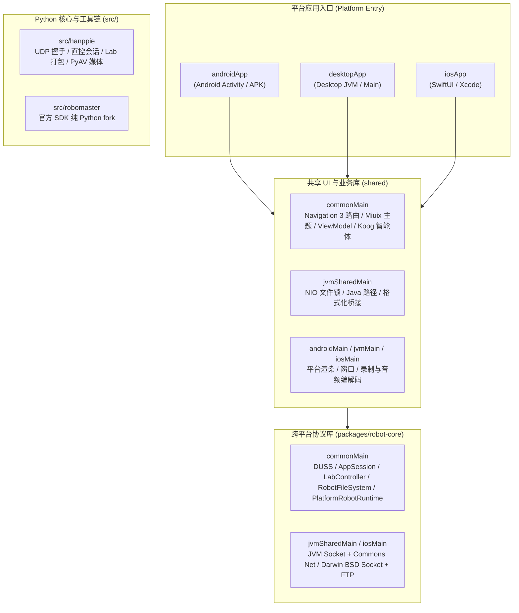
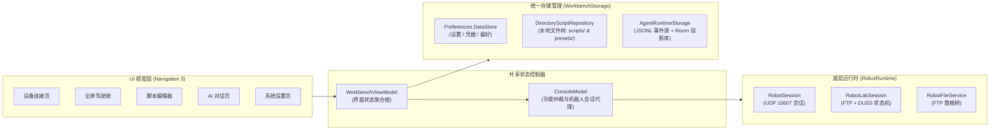
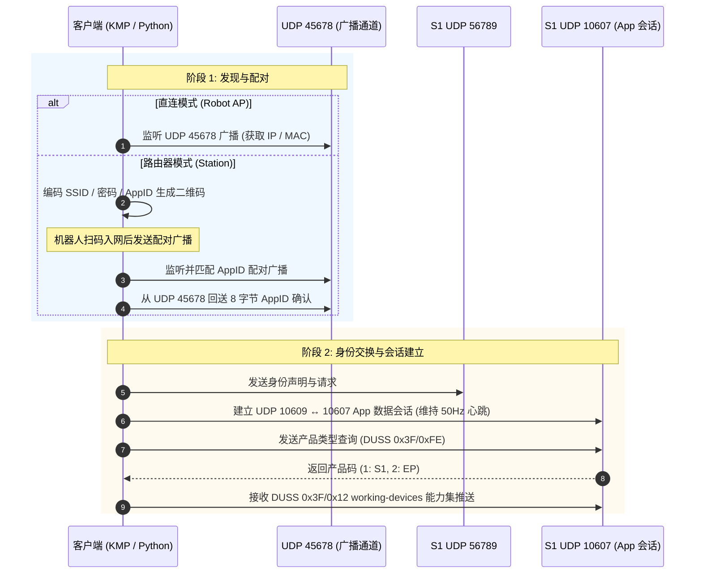
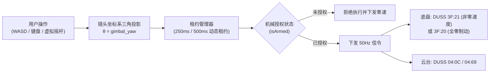
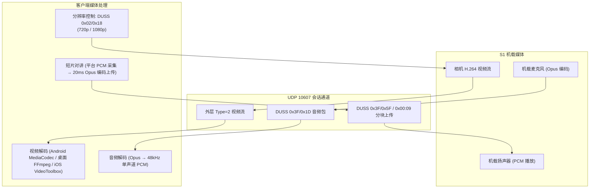
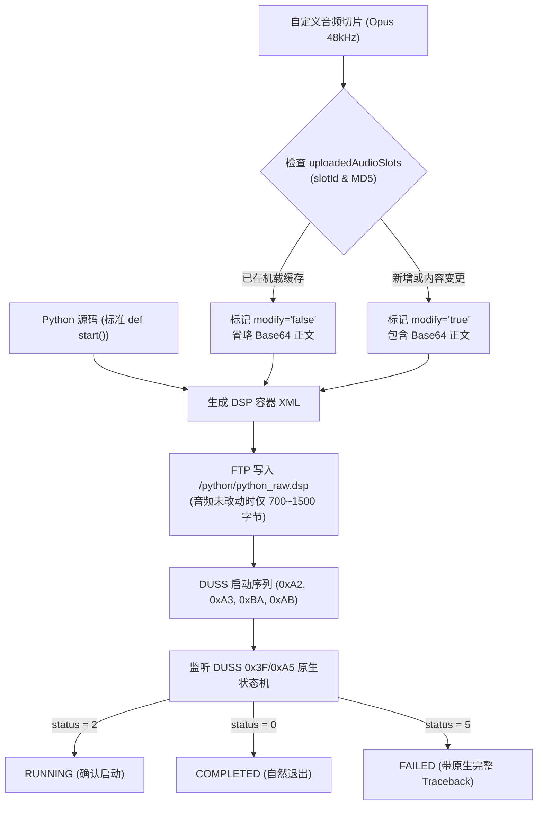
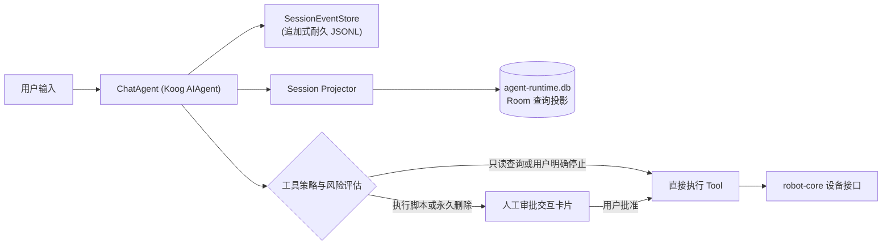
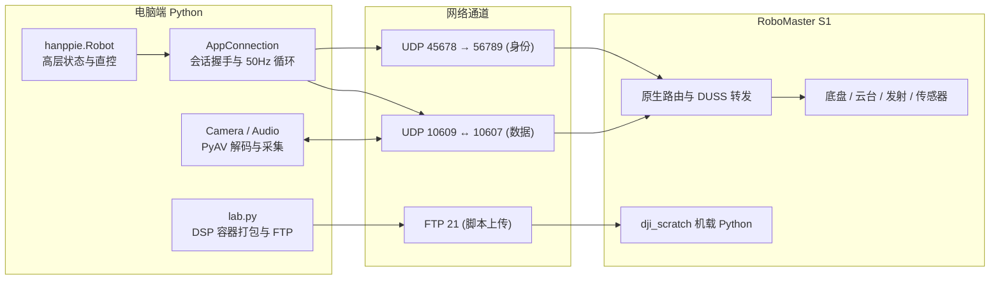
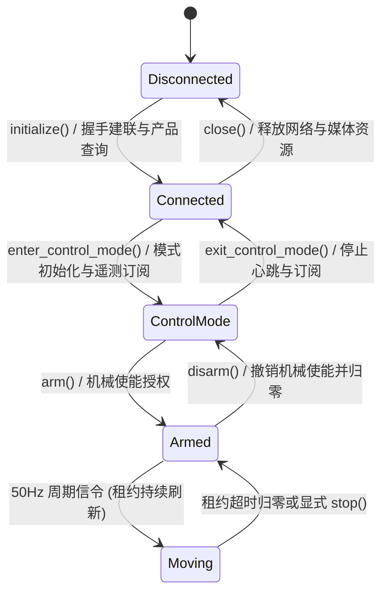

# Hanppie 技术架构

本文维护 Hanppie 当前实现、工作机制、设备能力与安全边界。安装与使用见 [README](../README.md)，源码运行与检查见[开发指南](./development.md)，产品规范见 [DESIGN.md](../DESIGN.md)。RoboMaster 原机硬件、固件和协议由[原生架构与调查](./architecture-robomaster.md)维护；单次实验与历史取舍保留在日期化记录和 Git 历史中。

实机证据来自 RoboMaster S1，固件 `00.06.0521`。本文更新于 2026-10-23。

## 证据标记

为严格区分“代码实现”与“真机可用”，本文使用以下标记：

| 标记      | 含义                                   |
|---------|--------------------------------------|
| **实测**  | 已在固件 `00.06.0521` 的 S1 上观察到协议结果或物理效果 |
| **代码**  | 可由仓库内恢复代码或固定版本上游代码直接确认               |
| **官方**  | 来自 DJI 手册、规格说明或官方 SDK 文档             |
| **推断**  | 由多项证据推导，但尚未直接验证                      |
| **待验证** | 接口或社区实现存在，但本项目尚未完成实机确认               |

能力结论严格遵循四层校验体系：接口存在 → 命令被接受 → 遥测发生变化 → 物理效果得到确认。

---

## 1. Hanppie 项目实现与机制

### 1.1 项目目标与边界

Hanppie 不替换整套 S1 固件，而是在保留原机控制器、相机、云台、底盘和安全机制的前提下，恢复并构建：

- **免手机 App 直连**：电脑与移动端直接与机器人建立原生协议会话；
- **原生协议控制**：Python 工具链与 KMP 客户端均支持可审计的原生报文与 DUSS 直控；
- **带安全约束的操纵**：支持键盘与虚拟摇杆控制，具备租约超时自动归零与机械使能保护；
- **音视频流**：实时视频流（720p/1080p）、机载麦克风下行与短片对讲上行；
- **机载 Lab 脚本支持**：Python 3.6 程序打包、音频增量上传与原生生命周期跟踪；
- **嵌入式对话智能体**：基于 Koog 的对话模型驱动，具备人工审批与工具安全防线。

项目当前**不以**持久 root、替换启动链、提高发射功率或绕过机械安全限制为目标。

设备兼容性按协议入口和能力组合建模，不硬编码单一实机型号。通用客户端、会话、发现结果和 Host API 只表达
RoboMaster 机器人及其可用能力；型号专属差异隔离在具体协议层。当前全部实机结论来自 S1 `00.06.0521`；EP 与
S1 的底层模块复用关系见[原生架构 4.5 节](./architecture-robomaster.md#45-s1-与-ep-的产品边界)。

---

### 1.2 相对原机的改动清单

| 项目增量                       | 发生位置                        | 对原机做了什么                                                                  | 持久性/恢复方式                |
|----------------------------|-----------------------------|--------------------------------------------------------------------------|-------------------------|
| 原生直连与 Lab 控制后端             | Git 仓库与控制终端                 | 实现 UDP `45678/56789` 握手、UDP `10609/10607` 会话、DUSS/control 直控、Lab 部署与音视频流 | 随应用安装；不修改固件             |
| `src/robomaster` SDK fork  | Git 仓库与控制终端                 | 内置官方 `0.1.1.68`/`ff6646e` 纯 Python 源码，保持 `robomaster` 导入兼容；非实机控制主干       | 随应用安装；不修改 S1；Apache-2.0 |
| PyAV 媒体兼容层                 | 控制终端                        | 替代官方 SDK 缺失的 macOS `libmedia_codec` 扩展                                   | 不修改 S1，仅为主机软解           |
| `assets/s1-system/` 原机参考系统 | Git 仓库（`assets/s1-system/`） | 保存逆向恢复的原机库、脚本与配置供参考；不随发布包打包                                              | 只影响仓库；不部署至 S1           |
| 官方基准固件归档                   | `assets/firmware/`          | 归档官方最终完整固件 `00.06.0521.tar`（Git LFS），提供恢复基底                              | Git LFS 存储；不修改实机；原厂二进制  |

Hanppie 不修改 `/init.rc`、原厂启动脚本或 `/system` 分区。Lab DSP 上传写入临时目录 `/data`，不随开机自启。

---

### 1.3 当前实现架构

#### 1.3.1 多平台工程组织与模块划分

仓库采用 Kotlin Multiplatform (KMP) 跨平台架构与 Python 工具链并行的单体结构：

- **`packages/robot-core`**：独立 KMP 协议模块，根包为 `cn.elonzh.hanppie.robot`。按 `protocol`、
  `product`、`session`、`lab`、`remote`、`media`、`telemetry`、`files` 分工。`commonMain` 实现纯 Kotlin
  逻辑（DUSS 封包、CRC8/16、DSP 打包、遥测解析等）、完整连接与 Lab 生命周期、文件管理策略和
  `PlatformRobotRuntime`。平台层只实现 `RobotTransport`、同步原语、随机数、日期和 MD5。Android 保留
  按连接选择的网络路由；iOS 使用 Darwin BSD Socket 与被动 FTP，业务请求保持共享。
- **`shared`**：共享 UI 库，根包为 `cn.elonzh.hanppie.ui`。采用 shared-first
  原则，所有界面、导航、ViewModel、本地持久化与智能体逻辑均位于共享层；平台 source set（`androidMain`、
  `jvmMain`、`iosMain`）仅提供平台能力注入（如 Android `MediaCodec`、桌面 FFmpeg 管道、文件选择器适配等）。
- **`androidApp` / `desktopApp` / `iosApp`**：无业务逻辑的轻量平台入口，负责宿主初始化、窗口管理与应用打包。
- **`src/hanppie`**：纯 Python 实现的直接控制与 Lab 脚本部署库，提供与 KMP 核心对等的协议能力。

---

#### 首页三维展示

共享层 `ui/robot/scene` 使用 Filament KMP 0.7.1（底层 Filament 1.77.2）渲染全幅机器人与车库，连接操作和电量覆盖在场景上；诊断与连接配置从连接状态弹窗进入。鼠标、触摸、方向键和 Home 键用于观察与复位虚拟镜头。网格、材质、坐标与生成方式见[机器人展示素材](../assets/robot-scene/README.md)。

场景只读，不持有控制接口，不根据控制命令假造姿态。在线组件决定外观，型号仅作提示；未知产品使用基础底盘示意。云台、底盘 yaw 与 ESC 轮角来自 10Hz DDS，角度采用最短路径和 100ms 插值；超过 1 秒未更新时保持姿态并报告暂停，断开连接清空状态。底盘 pitch/roll、IMU、LED 和机械臂关节不驱动模型，未标定字段不推导世界轨迹。

`RobotExperience` 在同一容器中协调三维、视频与驾驶输入：

| 环节 | 行为 |
| --- | --- |
| 首页预热 | 已连接、前台且无脚本可能运行时取视频 5 秒，然后停流、释放解码器；不进入遥控、监听或录像 |
| 进入操控 | 固定 1.35 秒运镜，第 1 秒开始 600ms 视频融合，随后 400ms 显示控件；遥控准备与运镜并行 |
| 输入开放 | 最近 500ms 内有实时帧、遥控授权就绪且窗口激活，才接受驾驶输入；显示缓存不能授权操控 |
| 退出 | 先归零，220ms 隐藏控件、600ms 淡出视频、1.15 秒反向运镜；场景覆盖视频后退出遥控，再进行首页预热 |
| 失焦 | 保持画面，立即归零并停止持续发射与对讲，撤销输入授权；重新激活不恢复先前按住的动作 |
| 取消或失联 | 终止进入流程；离开页面释放媒体并退出遥控 |

会话共享 `VideoFrameCache` 只保存最后一帧，同一连接地址跨页面复用，不同地址隔离，关闭应用释放。进入时用缓存衔接，实时帧到达后替换；从未收到画面时保留场景等待。缓存不代表设备当前位置，也不延长固定动画。运镜跟随展示角度，不发送物理回中，虚拟镜头没有实机光学标定。

桌面 FFmpeg 在后台线程创建和关闭，首张完整可用帧即可就绪。损坏包、受损帧及其依赖帧被屏蔽，直到无解码错误的完整 I 帧恢复；期间保留上一张可用画面。Android 使用已渲染帧回调，过渡修订的验证范围见[主页验证记录](./home-scene-validation-2026-09-22.md)。该记录也维护传感器至 GPU 的实机证据，不扩大为全行程角度精度或全部传感器验收。

桌面构建通过 `prepareDesktopFfmpeg` 获取固定版本、匹配宿主系统与架构的独立 FFmpeg 可执行文件，随
Compose 应用资源和许可证一起打包。桌面模块统一为 `JavaExec` 启动任务（含 IDE 注入的 `hotRun`）配置资源准备依赖与
`compose.application.resources.dir`，避免热重载入口遗漏资源。`ui/media/DesktopFfmpeg`
统一解析资源路径，视频解码、录像、对讲、Lab 音频导入与试听共用此入口；源码运行与 JVM 测试使用同一构建产物。默认不依赖系统
PATH，也不在运行时下载。`HANPPIE_FFMPEG`
只用于显式覆盖路径。来源与许可证由[第三方说明](../third-party/ffmpeg/NOTICE.md)维护。

布局遵循[横屏规范](../DESIGN.md#布局与自适应)。Android Activity 请求 `sensorLandscape`，targetSdk 36 使用 `PROPERTY_COMPAT_ALLOW_RESTRICTED_RESIZABILITY`；[Android 官方说明](https://developer.android.com/about/versions/17/changes/ff-restrictions-ignored)指出 targetSdk 37 起大屏会忽略方向限制，因此目标 SDK 升级需重新验证。桌面默认 1120×658、最小 740×480，普通窗口位置保存到 DataStore；最大化、全屏和最小化不覆盖普通位置，原屏幕不可用时交由系统定位。

渲染资源随页面和宿主释放，加载失败保留连接操作与重试。布局测试替换 GPU 表面，真实场景检查用 `HANPPIE_GPU_TESTS=1`。Android 使用 OpenGL ES，iOS 使用 Metal 和非透明 UIKit 场景表面，桌面按目标系统选择 JNI 并通过 GPU 像素回读呈现；升级后的 iOS 渲染及性能结论仍需对应运行证据。

#### 1.3.2 客户端架构与分层设计

客户端采用标准的 MVVM / MVI 分层架构，共享层维持单一状态聚合：

- **状态管理**：`WorkbenchViewModel` 作为各平台共同的顶层状态所有者，管理导航栈、编辑草稿与文件交互；
  `ConsoleModel` 负责连接生命周期、遥控、脚本运行与智能体对话之间的跨模块仲裁。
- **输入布局**：短横屏下共用工作台优先保留设置表单和脚本编辑区，将保存操作收纳到分类标题栏、将脚本返回与操作集中到单行；编辑时暂时收起内嵌日志与光标状态行，窗口恢复后重新显示，执行/停止入口保持可用。
- **统一存储模型 (`WorkbenchStorage`)**：
    1. **配置存储**：基于 Preferences DataStore，保存模型 API Key、控制参数、语言、显示模式、持久 AppID
       及路由器配置；
    2. **脚本库**：基于本地文件系统目录树的 `DirectoryScriptRepository`。将脚本存为独立目录（含
       `manifest.json`、`script.py` 及 `audio/` Opus 音频文件），独立于智能体存储；
    3. **智能体存储**：`AgentRuntimeStorage` 组合独立的追加式 JSONL 文件存储与 Room 3 查询投影库（
       `agent-runtime.db`）。JSONL 语义、幂等、游标和尾部隔离在 commonMain；JVM 用 NIO、iOS 用
       POSIX `fsync` / `flock` 实现 `JournalDirectory`。每个目录使用稳定的 `.sessions.lock`，不会随会话删除重建。

---

#### 1.3.3 网络拓扑与连接生命周期

客户端支持两种原厂网络拓扑，底层协议会话逻辑完全共享：

- **自动恢复与容错**：连接中断后自动进入未连接态，清除活动控制租约与遥控授权；非控制状态发送中性心跳帧，会话持续
  5 秒无数据判定失联并自动触发归零保护。

---

#### 1.3.4 遥控操纵、镜头坐标系与安全联动

遥控操纵依托 50 Hz App control channel 和原生 DUSS 报文，具备多层机械与算法安全防线：

- **镜头坐标系联动**：当云台相对底盘夹角为 $\theta$ 时，用户输入的平移向量经过三角投影转换为底盘物理坐标系速度：
  $$\begin{pmatrix} v_{forward\_robot} \\ v_{right\_robot} \end{pmatrix} = \begin{pmatrix} \cos\theta & -\sin\theta \\ \sin\theta & \cos\theta \end{pmatrix} \begin{pmatrix} v_{forward\_camera} \\ v_{right\_camera} \end{pmatrix}$$
- **云台-底盘智能跟随**：当云台相对角度超过 60° 且用户继续转动时，底盘同向旋转辅助释放机械限位（上限
  60°/s）；云台达到 230° 极限时停止向外输入。
- **失控保护与被动制动**：
    1. 运动指令必须具备有效租约（250 ms）；租约到期自动下发停止帧；
    2. 底盘静止必须使用专用 4 轴转速全零命令（DUSS `3F:20`），避免浮点零带来的怠速转动；
    3. 窗口失焦、切后台或会话失联时，客户端立即注销遥控授权并下发连续停止包。

---

点击控制界面角度指示器后，`GimbalCentering` 使用现有云台速度命令与角度遥测执行回中：俯仰、偏航均以机体相对零度为目标，误差小于等于 1° 停止，速度限于 60°/s，最长 5 秒。任何手动运动输入、失焦、遥控停止或超过 500 ms 的过期反馈都会取消；不新增协议命令，不驱动底盘。该行为复用已验证速度方向，新增回中收敛的实机证据见日期化主页验证记录。

**对象追踪跟随（代码 / 待验证）：** 操控页提供“对象跟随 → 点击画面选目标 → 设备锁定 → 开始跟随”的原生视觉流程，启动前提示机器人会自动移动。协议依据与原生目标能力边界见[原生架构](./architecture-robomaster.md#对象追踪跟随)。这项功能使用机内视觉控制，不在主机运行识别模型，也不上传视频。

`robot-core/tracking` 的 `ObjectTracking` 由 `AppSession` 独占，负责命令序号匹配、响应、设备目标框与生命周期；共享 `ConsoleModel` 和操控页只发出用户意图、显示状态。只有命令成功响应和跟随运行推送均到达，才显示“正在跟随”。窗口失焦、退出、手动方向输入、250 ms 操控租约过期、500 ms 会话数据过期、750 ms 画面过期、1.5 秒视觉状态或命令响应超时、设备报告目标丢失都会结束本轮跟随，不自动恢复。跟随期间暂停手动底盘和云台速度输出，并禁用发射、回中；用户操纵方向会先取消跟随，停止确认后才接受后续手动输入。

停止同时发送视觉取消、关闭识别和执行器零速。关闭识别的成功响应到达之前不交还手动控制，关闭命令每 500 ms 重试，最多三次；仍未确认时显示“尚未确认停止”，保留停止重试入口。断网或关闭应用只能尽力发送停止，不能把客户端状态视为机器人已停止的物理证据。目标选择和目标框共用视频 Fit 变换，忽略黑边点击。所有业务和界面位于共享代码，桌面视频与移动端一致使用 Fit。

当前已完成桌面编译、UDP 回环与共享 UI 验证；真实固件对启停命令的接受情况、自主运动、距离保持、遮挡恢复和物理制动尚未验证。不能将它等同于已完成的官方 App 实机体验。单次实现与验证证据见[离线记录](./object-tracking-validation-2026-10-22.md)。

#### 1.3.5 媒体流管线与音视频交互

Hanppie 构建了端到端的音视频交互管线，无需官方闭源动态库：

- **流媒体与分辨率协商**：图传分辨率由 DUSS `0x02/0x18` 控制，支持 720p 与 1080p 动态切换；
- **扬声器与短片对讲**：扬声器音量由 DUSS `0x3F/0x1B` 统一调节；支持按住录音、松开发送的 Opus
  短片对讲传输，最多保留 15 秒采集，在机内通过 DUSS `0x3F/0xB3` 触发播放。

**原生相机变焦（代码 / 待实机验证）：** 驾驶舱提供 1/4 倍切换，倍率显示来自相机状态推送；设置成功应答和新的匹配倍率均到达后才结束等待。1.5 秒未收到状态时清空倍率并禁用操作，退出或失联后不自动恢复旧倍率。跟随期间隐藏变焦；非正常倍率、正在变焦或变焦结果尚未确认时，连接层拒绝启动跟随。正常倍率的新推送或显式恢复确认解除限制，独立手动驾驶保持原有行为。共享 `CameraZoomController` 只消费会话级 `RobotCameraService`，平台视频实现不复制这段状态和界面。原生依据见[相机变焦与倍率状态](./architecture-robomaster.md#相机变焦与倍率状态)，实机边界与提交见[实施台账 A02](./official-app-capability-implementation.md#a02-验证入口与设备待验)。

**相机抗闪烁与时钟（代码 / 待实机验证）：** “设置 → 音视频 → 机器人相机”提供 50/60 Hz、相机日期读取和本机时间同步，抗闪烁与日期分别反馈错误，写入后回读确认。相机推送的同步标志与读取日期分别显示，不用本机时间或请求成功替代设备报告。连接后只有收到明确未同步的有效状态才自动尝试一次校时，失败不循环重试；用户可显式重试。相机日期不带时区，使用本机本地时间；共享 kotlinx-datetime 校验日历及跨日差值。

`RobotCameraController` 持有连接级状态、独立字段操作和一次校时意图；日期写入串行，频率读取不被日期错误阻塞。断连与重新绑定取消旧任务并按连接版本丢弃晚到结果。设备设置由机器人持有，不加入应用偏好的保存/恢复默认流程。原生字段与读写年份差异见[相机抗闪烁与时钟](./architecture-robomaster.md#相机抗闪烁与时钟)，验证和重置范围待决策见[实施台账 A03](./official-app-capability-implementation.md#a03-验证入口与设备待验)。

**机器人 SD 卡维护（代码 / 待实机验证）：** “设置 → 机器人维护”显示当前连接的插卡、容量、剩余拍录量、满卡、异常、原生拍录占用和格式化状态。数据沿用相机状态的来源校验和 1.5 秒过期规则；无卡或状态过期时隐藏容量。格式化需要当前有效、已插卡且未拍录/格式化的状态，并经过清空全部文件的确认。确认期间状态失效、卡忙或重新连接会关闭确认框；发送前协议层再次检查条件，同一请求不排队或自动重试。

共享 `RobotCameraController` 将格式化请求结果与持续卡状态分别保存；成功应答只显示“格式化请求已确认”，不合成卡状态或文件删除结果。断连清理旧请求，晚到回复不能写回新连接。关闭页面或客户端不表示撤销已经发送到机器人的物理操作。本机拍照/录像按钮仍保存到主机；机内拍录使用下述独立入口。协议依据见[相机 SD 卡状态与格式化](./architecture-robomaster.md#相机-sd-卡状态与格式化)，验证边界见[实施台账 A04](./official-app-capability-implementation.md#a04-验证入口与设备待验)。

**机器人 SD 拍录（代码 / 待实机验证）：** 驾驶舱左上方的“SD 卡拍录”打开独立拍照、开始/停止录像面板，文件目标明确为机器人 SD 卡。打开面板清除当前手动驾驶、发射和对讲输入，关闭后不恢复旧输入。原生录像期间入口显示设备上报秒数；关闭面板不发送停止录像，断连清理显示和请求意图，重连只读取设备当前状态，不重放拍录操作。

拍录与格式化在连接层和共享 `RobotCameraController` 中共用存储任务互斥；开始拍照/录像要求有效且未满、无错误、未拍录/格式化的卡状态，必要时等待相机模式的新推送确认后才发动作，期间卡忙则终止后续动作。录像开始/停止需应答和新的匹配状态共同确认；拍照只确认请求与新的相机状态，不声称文件已经保存。状态未知或上次拍录失败时仍可显式停止录像，停止不依赖有效卡容量。超时不自动重发，请求结果与当前设备状态独立展示。现有主机媒体控制器、快捷键和状态灯策略保持原有范围；两种拍录目的地的统一决策见 C07，状态灯优先级见 C06。协议见[机器人 SD 拍照与录像](./architecture-robomaster.md#机器人-sd-拍照与录像)，离线证据和实机待验见[实施台账 A05](./official-app-capability-implementation.md#a05-验证入口与设备待验)。

**机器人音频设置（代码 / 待实机验证）：** “设置 → 音视频”保留应用音量偏好，并单独显示当前连接返回的机器人音量与语音语言。用户可以显式应用当前音量并回读确认，或直接选择机器人语音语言；只在写入成功应答且回读值一致后显示结果。应用偏好继续按原有策略在连接/保存时下发，不以设备回读覆盖偏好。保存偏好、断连和切换会话均清除旧设备读数；读取失败时提供刷新，不保留看似有效的旧值。

`RobotAudioService` 和 `SpeakerCommands` 位于 robot-core，共享 `RobotAudioController` 持有连接级读数与操作状态。请求由 `AppSession` 在发送锁下注册，按序号、来源/目的节点、命令集、ID 与应答属性匹配，1.5 秒超时；取消、关闭与失联释放等待。设备拒绝、数据格式错误、超时和回读不一致分别反馈。语言编码及节点边界见[上游音频配置协议](./architecture-robomaster.md#机器人音频配置)。实施提交、离线结果和实机待验清单见[独立实施台账](./official-app-capability-implementation.md)。

---

#### 1.3.6 机载 Lab 脚本与增量 DSP 部署

Hanppie 采用纯原生方式打包与管理机内离线 Python 3.6 算法：

- **秒级增量上传机制**：通过槽位与 MD5 追踪已上传音频。未变更的音频在 DSP 中仅保留元数据节点并省略
  Base64 内容，将上传耗时缩短至数十毫秒；
- **原生生命周期驱动**：原样上传用户代码，完全由固件原厂 `0x3F/0xA5`
  状态机接管执行、完成与异常 Traceback 追踪。

---

#### 1.3.7 智能体运行时架构

Hanppie 嵌入基于 Koog 的对话智能体运行时，以 **Agent Session** 作为聚合根：

- **耐久事件源架构**：每个 Session 独立维护一个 JSONL 文件作为唯一事实源，具备严格的进程锁、文件锁、末事件游标检查与
  fsync 机制；同一会话目录的读写、删除共用固定的 `.sessions.lock`，锁文件数量不随会话增长。
  启动时清理旧的 `<session-id>.lock`；升级前须退出所有旧版进程，不支持新旧版本同时访问同一数据目录。
  目录锁串行化各会话的文件操作，不覆盖模型请求或工具执行；Room SQLite 数据库仅作为可全量重建的高速查询投影；
- **确定性工具注册表**：组合八个具名 class-based Koog
  工具（状态查询、技能读取、脚本库增删查改、脚本执行与停止），高危机械与文件副作用必须经过持久化审批卡片确认。

---

#### 1.3.8 Python 直控与工具链

Python 主干是独立轻量的控制通道，完全复现原生 App 协议栈：

| 功能通道        | 网络协议与路径                               | 说明                        |
|-------------|---------------------------------------|---------------------------|
| 发现与身份握手     | Host UDP `45678` → S1 UDP `56789`     | 确认会话认领与连接绑定               |
| App 数据与遥测会话 | Host UDP `10609` ↔ S1 UDP `10607`     | 维持 50Hz 双向心跳，接收 10Hz 遥测推送 |
| 底盘控制        | App control channel (50Hz 周期续发)       | 具备短租约校验与零速制动              |
| 云台控制        | DUSS `0x04/0x69` (50Hz 周期续发)          | 具备短租约校验与自动归零              |
| 装甲灯、枪口灯、音效  | DUSS 请求 / 同序号 ACK 应答                  | 确定性双向报文交互                 |
| 视频与机载麦克风    | UDP `10607` (H.264 外层 Type=2 / Opus)  | PyAV 解码与实时呈现              |
| 机载 Lab 算法部署 | 匿名 FTP `21` (`python/python_raw.dsp`) | 离线 Python 3.6.6 容器打包与上传   |

---

#### 1.3.9 原生直连与机载 Lab 程序的职责边界

- **原生直连 (Direct Control)**：基于 UDP `10607` 会话，直接向机载底盘、云台、发射机构与外设下发信令并收取遥测，
  **无需向机内上传任何常驻脚本**；
- **机载 Lab 程序**：仅用于需要脱离主机通信、在机载系统（Android 4.4 / Python 3.6.6）本地闭环运行的离线算法。

---

#### 1.3.10 为什么官方 SDK 不是当前控制后端

| 维度        | 官方 DJI SDK 路径                    | Hanppie 原生直连路径                       |
|-----------|----------------------------------|--------------------------------------|
| 机器人端入口    | EP SDK proxy (UDP `30030`)       | 原生 App 控制端口 (UDP `56789` / `10607`)  |
| 会话模型      | SDK route / SDK mode / heartbeat | AppID 握手 / AppEnvelope 会话机制          |
| 原厂 S1 兼容性 | **原厂 S1 不开放 SDK proxy 端口**       | **S1 出厂自带且默认开放**                     |
| 项目代码定位    | `src/robomaster` 仅作源码参考与离线分析     | `src/hanppie` 与 `robot-core` 为唯一控制主干 |

---

#### 1.3.11 网络与传输边界

- 后端仅需 Station 模式（局域网）或 AP 直连模式下的 IP 网络双向互通；
- 控制、视频与音频均在 Wi-Fi 局域网上完成，**日常控制不需要连接 USB 线**；
- USB 仅在固件维护、底层镜像备份或故障救援时作为 ADB/RNDIS 通道使用。

---

#### 1.3.12 iOS 平台能力与分发

iOS 与其他客户端共用导航、设置、脚本库、AI 工具及审批、JSONL/Room 会话与机器人生命周期。平台能力由
`IosPlatformServices` 注入，Swift 不维护机器人业务或另一套 UI。HTTP 使用 Ktor Darwin；密钥保存在应用
私有 Preferences DataStore，日志不包含密钥。

- 宿主限定左右横屏，使用安全区域；共享输入布局通过 `imePadding` 处理软键盘，iOS 宿主关闭 Compose UIKit 的聚焦自动平移，避免重复位移将输入栏推离窗口。最低系统版本为 iOS 18.5，跟随当前渲染依赖的最低边界。
- 宿主在模型后台任务启动前读取系统语言，并一次性初始化中英文不可变资源目录。目录加载时临时覆盖 Foundation 参数域并立即恢复；后续语言切换和后台诊断只读取目录，避免并发覆盖 `AppleLanguages` 或将应用语言误记为系统语言。
- 本地网络权限用于 UDP/FTP。自动发现涉及广播，需要签名配置包含 Apple 批准的
  `com.apple.developer.networking.multicast` entitlement；手动 IPv4 不能替代系统局域网权限。Wi-Fi 引导使用公开系统设置操作，不依赖私有 URL scheme。
- H.264 接收队列最多 4 个待处理 Access Unit，丢包后等待关键帧；下行 Opus 使用 Apple 编解码器，播放最多排队 25 帧。照片与 MP4 保存只申请相册添加权限；监听打开时录像包含收到的音频。
- 录音与语音输入共享单个麦克风所有者，权限回调带取消代次，后台释放采集、播放及解码资源。识别服务可在线处理音频，首次启动先展示说明；识别文本回填草稿，不自动发送。对讲松手后编码上传，取消或后台不发送。
- 发布工作流先通过版本/CHANGELOG 校验和平台测试，再发布 APK、DMG、MSI、未签名 xcarchive 与 SHA-256 校验文件。未签名 iOS 归档不是可安装 IPA。

Apple 的 [本地网络隐私说明](https://developer.apple.com/documentation/technotes/tn3179-understanding-local-network-privacy)
是权限与广播能力的上游依据。外部模型/系统识别的数据行为由用户选定服务决定；隐私清单不表示这些服务离线运行。

---

### 1.4 包边界

| 路径                     | 核心职责                                      |
|------------------------|-------------------------------------------|
| `packages/robot-core/` | 跨平台协议核心（DUSS 编解码、会话维护、Lab 打包、遥测解析、FTP 抽象） |
| `shared/`              | 跨平台 UI、ViewModel、本地存储聚合、Koog 智能体与媒体管道     |
| `androidApp/`          | Android 宿主入口、权限配置与原生打包                    |
| `desktopApp/`          | 桌面 JVM 宿主入口与多平台分发打包                       |
| `iosApp/`              | SwiftUI 宿主、Apple 媒体与权限服务、Xcode 打包与 XCTest |
| `src/hanppie/`         | Python 核心协议与直接控制库                         |
| `src/robomaster/`      | 官方 Python SDK 纯源码归档与导入兼容层                 |
| `assets/s1-system/`    | 逆向提取的原机系统文件与参考脚本（不随包分发）                   |
| `assets/firmware/`     | 官方基准固件包归档（Git LFS 存储）                     |

---

### 1.5 SDK 打包与 Python 边界

- `pyproject.toml` 构建产物同时包含 `hanppie` 与 `robomaster` 两个顶层包；
- **运行环境约束**：
    - S1 机载 Lab 环境固定为 Python 3.6.6；
    - 主机端 Python 开发与 CI 基准为 Python 3.10+；
    - Kotlin 跨平台层使用共享 Kotlin 与平台能力适配，无 Python 运行时依赖。

---

### 1.6 原生直连与 Robot 状态生命周期

客户端状态机严格管理生命周期与机械权限：

| 状态操作                   | 核心行为                           | 安全边界              |
|------------------------|--------------------------------|-------------------|
| `initialize()`         | 建立 UDP 身份握手与 App 基础数据会话        | 仅建立通信，不产生动作       |
| `enter_control_mode()` | 发送控制模式序列，启动 10Hz 遥测订阅与 50Hz 心跳 | 机械控制的前置必要条件       |
| `arm()`                | 标记机械使能有效，清零当前速度寄存器             | 未 arm 状态下丢弃所有运动命令 |
| `drive_speed()`        | 写入平移与旋转速度，刷新 250ms 租约          | 租约到期底层自动归零        |
| `disarm()`             | 立即撤销授权，发送 neutral/stop 停止帧     | 软件急停主干操作          |
| `close()`              | 终止音视频流，发送停止序列并关闭 Socket        | 保证对端连接彻底释放        |

---

### 1.7 内置 SDK fork 的边界

`src/robomaster` 保留官方 API 结构供离线测试与代码参考。Hanppie 的核心 `Robot` 控制器不继承、不包装、亦不委托官方
SDK。

---

### 1.8 媒体兼容与编解码

- **视频流**：相机视频流采用 H.264 格式，分辨率通过 DUSS `0x02/0x18` 在 720p 与 1080p 间切换。Android
  端通过 `MediaCodec` 解码至合成表面；桌面端通过 FFmpeg 软解为 BGRA 帧；iOS 由共享 AnnexB / Access Unit
  解析器分包，再通过 VideoToolbox 解码、UIKit 显示，并将采样 PNG 帧交给共享缓存；
- **音频下行**：机身麦克风音频通过 DUSS `0x3F/0x1E` 请求，S1 返回 Opus 编码流（DUSS `0x3F/0x1D`），解码为
  48 kHz 单声道 PCM 后输出至系统音频；
- **音频上行（对讲）**：本地麦克风采集音频并编码为 20ms Opus 帧，通过 DUSS `0x3F/0x5F` 与 `0x00/0x09`
  分块传输至 S1 扬声器播放；扬声器音量由 DUSS `0x3F/0x1B` 统一同步。

---

### 1.9 质量保证与测试边界

1. **静态分析与代码规范**：Python 端强制要求类型注解、相对路径导入及显式静态 `__all__` 声明；使用
   `ruff` 与 `prek` 门禁；
2. **自动化测试**：覆盖协议封包、CRC 校验、产品识别、DSP 容器构建及媒体编解码，核心逻辑要求 70% 以上覆盖率；
3. **分层构建验证**：Kotlin 协议与共享业务回归、平台构建、UI 运行、设备连接与物理动作分别记录；
   Android 验证遵循 AGENTS.md 的功能确认门槛。iOS 流水线分别执行 iPhone/iPad 媒体契约与横屏 UI 测试，
   以及未签名设备归档。

---

### 1.10 当前能力矩阵

下表总结既有机器人证据，实机均来自 S1；这些证据不自动证明新增 iOS 平台的网络、媒体或物理动作。iOS 当前已通过原生编译、未签名设备归档、模拟器协议与媒体契约，以及 iPhone/iPad 横屏 UI 测试；真机权限、机器人连接、音视频与机械动作仍待验证。单次证据见 [2026-10-02 iOS 交付记录](./ios-delivery-2026-10-02.md)。

| 能力分类        | 核心模块                                    | 验证状态        | 架构说明                                           |
|-------------|-----------------------------------------|-------------|------------------------------------------------|
| S1 App 会话握手 | `AppConnection` / `packages/robot-core` | **实测通过**    | UDP `45678/56789` 身份交换与 UDP `10609/10607` 会话维持 |
| 原生直接控制      | `Robot` / `packages/robot-core`         | **实测通过**    | 50Hz 周期控制与底盘/云台零速制动                            |
| 机载 Lab 脚本部署 | `hanppie.lab` / `RobotLabSession`       | **实测通过**    | XML 容器构建、秒级增量 Opus 缓存上传及原生状态机监听                |
| 实时遥测订阅      | `Robot` / `packages/robot-core`         | **实测通过**    | 10Hz 解析电量、姿态角及底盘/云台原始遥测                        |
| 实时视频与分辨率切换  | `Camera` / `RemoteMediaController`      | **实测通过**    | 720p/1080p DUSS 动态协商与双端流畅解码呈现                  |
| 机身麦克风下行     | `Audio` / `RemoteMediaController`       | **实测通过**    | Opus 解码为 48kHz 单声道 PCM 播放                      |
| 扬声器短片对讲     | `Audio` / `RemoteMediaController`       | **实测通过**    | 本地 Opus 编码、分块传输与机载原厂播放序列                       |
| 扬声器音量调节     | `Robot` / `ConsoleModel`                | **实测通过**    | DUSS `0x3F/0x1B` 设置与 `0x3F/0x1C` 查询            |
| 发射机构与灯效     | `Robot` / `ConsoleModel`                | **实测通过**    | 红外发射脉冲、水弹发射时序与装甲/枪口 LED 状态控制                   |
| 智能体安全对话     | `ChatAgent` / Koog Runtime              | **代码/离线验证** | 耐久 JSONL 事件源、高危动作人工审批及工具安全执行闭环                 |
| 官方 SDK 导入兼容 | `src/robomaster`                        | **离线代码验证**  | 保留官方导入接口，不参与实机直接控制                             |

---

### 1.11 远程控制当前边界

- 目前所有验证均基于局域网或 AP 点对点连接；
- 项目不提供公网网关、中继隧道或跨外网控制安全审计；
- **禁止**直接将机器人 UDP 端口或 FTP 端口暴露于公网、端口映射或无鉴权的虚拟专网。

---

### 1.12 安全与恢复模型

1. **机械安全**：
    - 自动化测试默认禁止机械动作；
    - 底盘测试必须悬空车轮或置于水平安全地面；
    - 运动命令必须附加短租约（250ms），会话中断或异常必须触发底层自动归零与 disarm。
2. **网络与凭证安全**：
    - Wi-Fi 凭证与模型 API Key 仅保存在本地私有 DataStore，绝不写入日志、诊断上报或 Session 历史；
    - 禁止在机载文件系统中残留私有凭据或明文密钥。
3. **固件基底恢复**：
    - 仓库在 `assets/firmware/` 归档已校验的原厂固件包 `00.06.0521.tar`，仅作为灾难恢复与校验的技术基底，不参与日常自动更新。

---

## 2. 已知未知项与验证方法

| 课题          | 验证方法                           | 验收目标                    |
|-------------|--------------------------------|-------------------------|
| 底盘物理速度与位移标定 | 外部物理标尺与原生 `0x48/0x08` 推定数据交叉比对 | 建立精确的平移与旋转物理量化比例        |
| 云台物理角度闭环    | 结合外部测量核对四个 raw 角度值在全机械行程中的线性度  | 确认物理角度映射与稳定回中逻辑         |
| 极端断网失联制动表现  | 模拟硬拔天线、瞬时丢包与 Session 抢占场景      | 确保各场景下机器人均能在规定租约内实现物理停车 |
| 移动端真实录制性能   | 在多样化 Android 实机上测试持续录制与音画同步    | 保证多分辨率下连续录制无断流与音画漂移     |

---

## 3. 文档维护规则

以下场景必须同步更新本文：

1. Kotlin 多平台模块边界、核心依赖或应用架构发生调整；
2. 机器人协议封包、通信端口、会话生命周期或安全租约发生变更；
3. 媒体管线或 Lab 脚本部署机制发生变动；
4. 能力矩阵中的实现或验证状态发生迁移。

更新时严禁将单次调试日志、微观 UI 数值或代码演进流水账混入本文。原生 S1 固件与硬件调查统一维护在 [
`architecture-robomaster.md`](./architecture-robomaster.md)。

---

## 参考与证据

- [RoboMaster S1 原生架构、协议与调查](./architecture-robomaster.md)
- [视觉、交互与产品设计规范](../DESIGN.md)
- [智能体运行时技术方案](./agent-runtime-plan.md)
- [对话智能体产品设计](./conversation-agent-product-design.md)
- [真机联调与官方 SDK 恢复记录](./s1-live-debug-2026-08-29.md)
- [AppEnvelope 直控真机联调记录](./s1-direct-control-2026-08-31.md)

水弹准星反馈由发射指令发送回调驱动，不等待 400 ms 枪口灯收尾；回调仅证明指令已发送，不证明物理激发或命中。连续反馈以最新事件重启动画，避免排队滞后。

普通界面的 Wi-Fi 信号使用共享分档文案（强、中、弱、未知），沿用此前信号条的 UI 阈值：小于 20 为弱，20–39 为中，其余有效原始值为强；该分档未经链路质量标定，不代表吞吐或连接可靠性保证。原始 `0x07:0x09` 无符号字节不解释为 dBm 或百分比，在调试遥测中展示；状态工具字段为 `signalQualityRaw`。操控状态条只使用信号档位图标，不展示信号文字或原始数值；图标占位恒定 20dp，无障碍描述保留本地化等级。状态组之间统一 16dp，组内图标文字为 6dp，夹角数值左对齐。

桌面从主页起通过同一个原生窗口尺寸监听持续保持视频宽高比，计算时扣除标题栏和边框；横向或纵向拖动都按同一比例调整，并保留最小可操作尺寸。进出操控不更换监听、不调整窗口尺寸，避免场景因窗口变化而跳动。视频表面采用填充裁切，消除系统缩放回调期间的短暂比例差造成的黑边。
