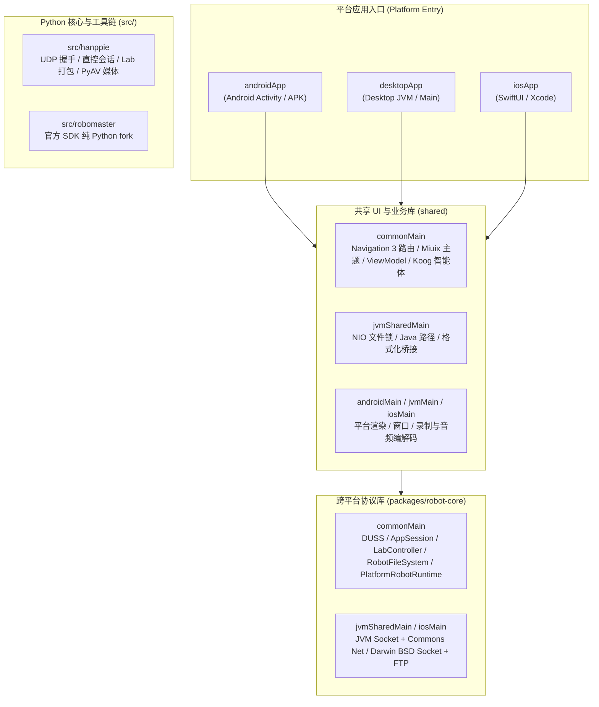
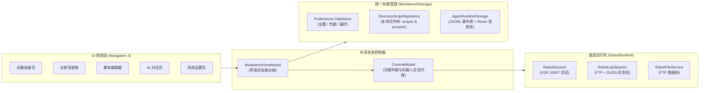
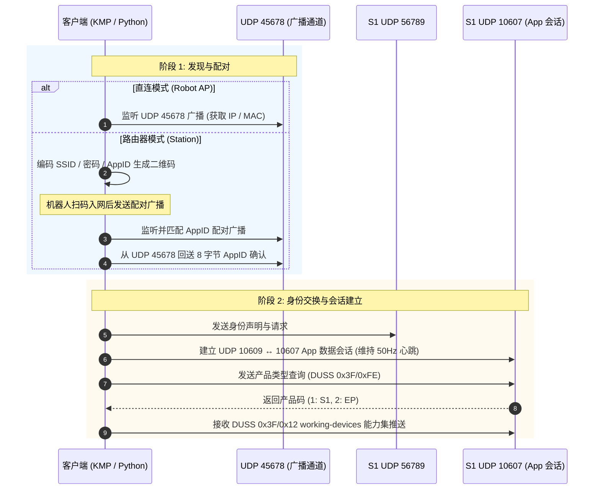
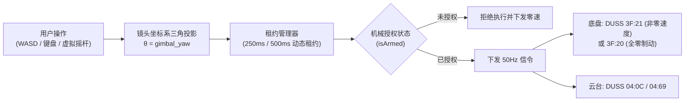
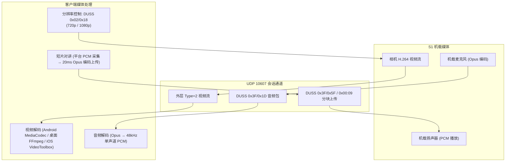
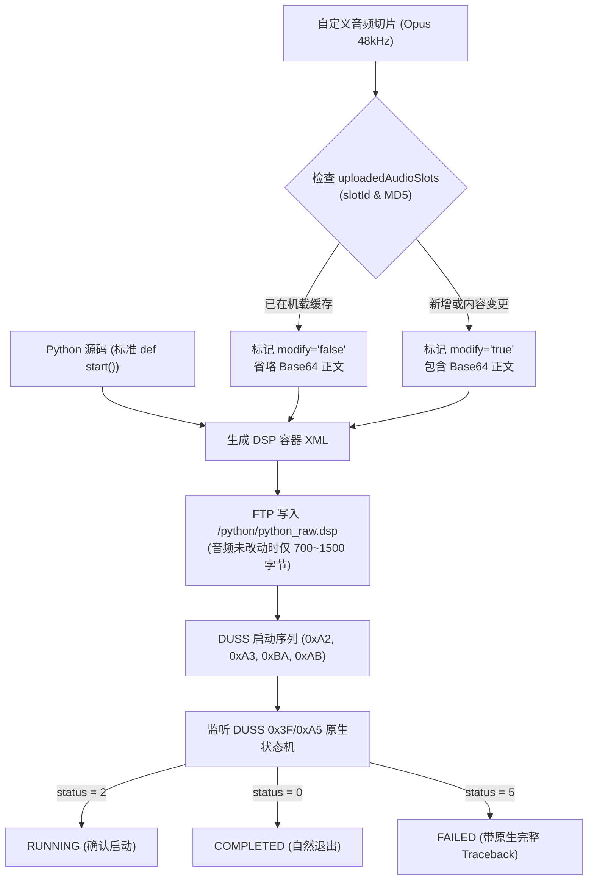
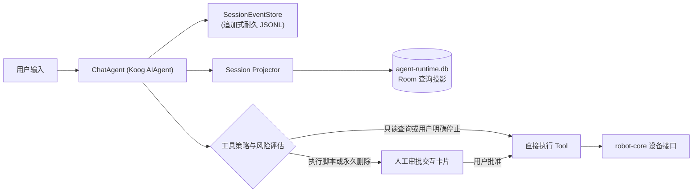
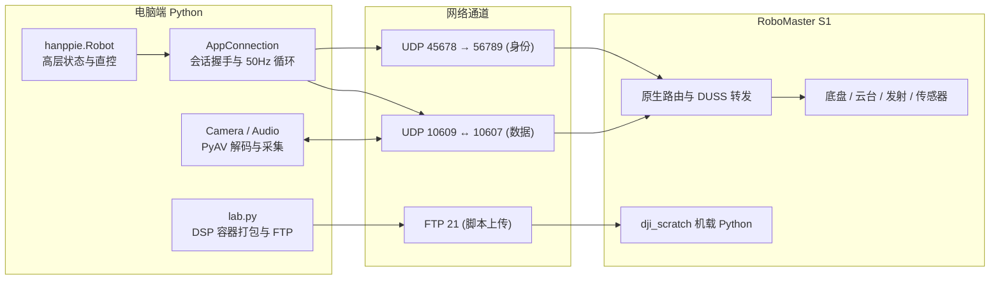
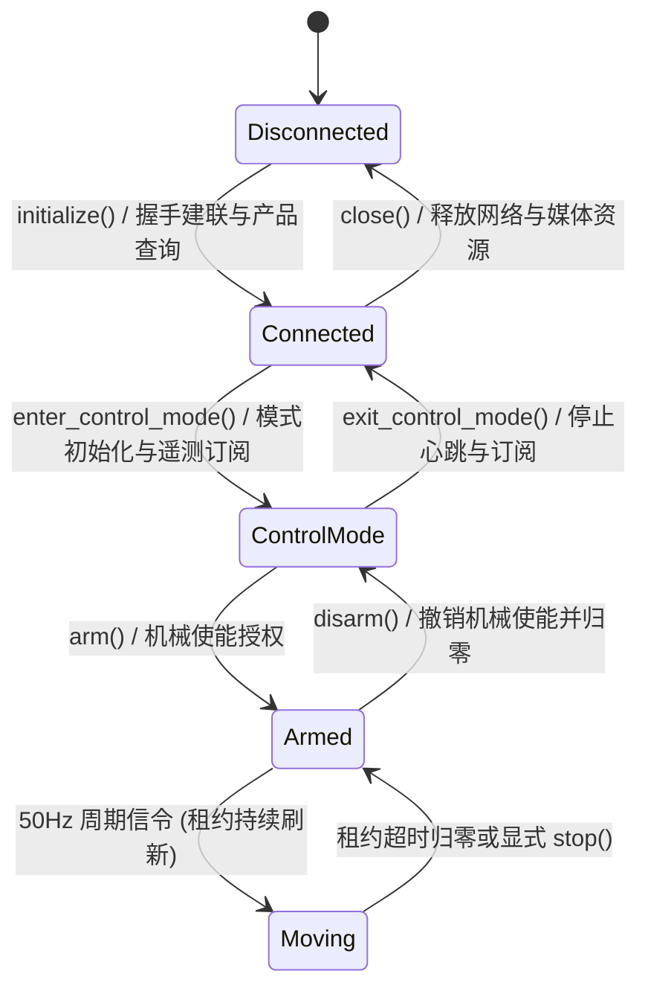

# Hanppie 技术架构

本文维护 Hanppie 当前实现、工作机制、设备能力与安全边界。安装与使用见 [README](../README.md)，源码运行与检查见[开发指南](./development.md)，产品规范见 [DESIGN.md](../DESIGN.md)。RoboMaster 原机硬件、固件和协议由[原生架构与调查](./architecture-robomaster.md)维护；单次实验与历史取舍保留在日期化记录和 Git 历史中。

实机证据来自 RoboMaster S1，固件 `00.06.0521`。本文更新于 2026-10-23。

## 证据标记

为严格区分“代码实现”与“真机可用”，本文使用以下标记：

| 标记      | 含义                                   |
|---------|--------------------------------------|
| **实测**  | 已在固件 `00.06.0521` 的 S1 上观察到协议结果或物理效果 |
| **代码**  | 可由仓库内恢复代码或固定版本上游代码直接确认               |
| **官方**  | 来自 DJI 手册、规格说明或官方 SDK 文档             |
| **推断**  | 由多项证据推导，但尚未直接验证                      |
| **待验证** | 接口或社区实现存在，但本项目尚未完成实机确认               |

能力结论严格遵循四层校验体系：接口存在 → 命令被接受 → 遥测发生变化 → 物理效果得到确认。

---

## 1. Hanppie 项目实现与机制

### 1.1 项目目标与边界

Hanppie 不替换整套 S1 固件，而是在保留原机控制器、相机、云台、底盘和安全机制的前提下，恢复并构建：

- **免手机 App 直连**：电脑与移动端直接与机器人建立原生协议会话；
- **原生协议控制**：Python 工具链与 KMP 客户端均支持可审计的原生报文与 DUSS 直控；
- **带安全约束的操纵**：支持键盘与虚拟摇杆控制，具备租约超时自动归零与机械使能保护；
- **音视频流**：实时视频流（720p/1080p）、机载麦克风下行与短片对讲上行；
- **机载 Lab 脚本支持**：Python 3.6 程序打包、音频增量上传与原生生命周期跟踪；
- **嵌入式对话智能体**：基于 Koog 的对话模型驱动，具备人工审批与工具安全防线。

项目当前**不以**持久 root、替换启动链、提高发射功率或绕过机械安全限制为目标。

设备兼容性按协议入口和能力组合建模，不硬编码单一实机型号。通用客户端、会话、发现结果和 Host API 只表达
RoboMaster 机器人及其可用能力；型号专属差异隔离在具体协议层。当前全部实机结论来自 S1 `00.06.0521`；EP 与
S1 的底层模块复用关系见[原生架构 4.5 节](./architecture-robomaster.md#45-s1-与-ep-的产品边界)。

---

### 1.2 相对原机的改动清单

| 项目增量                       | 发生位置                        | 对原机做了什么                                                                  | 持久性/恢复方式                |
|----------------------------|-----------------------------|--------------------------------------------------------------------------|-------------------------|
| 原生直连与 Lab 控制后端             | Git 仓库与控制终端                 | 实现 UDP `45678/56789` 握手、UDP `10609/10607` 会话、DUSS/control 直控、Lab 部署与音视频流 | 随应用安装；不修改固件             |
| `src/robomaster` SDK fork  | Git 仓库与控制终端                 | 内置官方 `0.1.1.68`/`ff6646e` 纯 Python 源码，保持 `robomaster` 导入兼容；非实机控制主干       | 随应用安装；不修改 S1；Apache-2.0 |
| PyAV 媒体兼容层                 | 控制终端                        | 替代官方 SDK 缺失的 macOS `libmedia_codec` 扩展                                   | 不修改 S1，仅为主机软解           |
| `assets/s1-system/` 原机参考系统 | Git 仓库（`assets/s1-system/`） | 保存逆向恢复的原机库、脚本与配置供参考；不随发布包打包                                              | 只影响仓库；不部署至 S1           |
| 官方基准固件归档                   | `assets/firmware/`          | 归档官方最终完整固件 `00.06.0521.tar`（Git LFS），提供恢复基底                              | Git LFS 存储；不修改实机；原厂二进制  |

Hanppie 不修改 `/init.rc`、原厂启动脚本或 `/system` 分区。Lab DSP 上传写入临时目录 `/data`，不随开机自启。

---

### 1.3 当前实现架构

#### 1.3.1 多平台工程组织与模块划分

仓库采用 Kotlin Multiplatform (KMP) 跨平台架构与 Python 工具链并行的单体结构：

- **`packages/robot-core`**：独立 KMP 协议模块，根包为 `cn.elonzh.hanppie.robot`。按 `protocol`、
  `product`、`session`、`lab`、`remote`、`media`、`telemetry`、`files` 分工。`commonMain` 实现纯 Kotlin
  逻辑（DUSS 封包、CRC8/16、DSP 打包、遥测解析等）、完整连接与 Lab 生命周期、文件管理策略和
  `PlatformRobotRuntime`。平台层只实现 `RobotTransport`、同步原语、随机数、日期和 MD5。Android 保留
  按连接选择的网络路由；iOS 使用 Darwin BSD Socket 与被动 FTP，业务请求保持共享。
- **`shared`**：共享 UI 库，根包为 `cn.elonzh.hanppie.ui`。采用 shared-first
  原则，所有界面、导航、ViewModel、本地持久化与智能体逻辑均位于共享层；平台 source set（`androidMain`、
  `jvmMain`、`iosMain`）仅提供平台能力注入（如 Android `MediaCodec`、桌面 FFmpeg 管道、文件选择器适配等）。
- **`androidApp` / `desktopApp` / `iosApp`**：无业务逻辑的轻量平台入口，负责宿主初始化、窗口管理与应用打包。
- **`src/hanppie`**：纯 Python 实现的直接控制与 Lab 脚本部署库，提供与 KMP 核心对等的协议能力。

---

#### 首页三维展示

共享层 `ui/robot/scene` 使用 Filament KMP 0.7.1（底层 Filament 1.77.2）渲染全幅机器人与车库，连接操作和电量覆盖在场景上；诊断与连接配置从连接状态弹窗进入。鼠标、触摸、方向键和 Home 键用于观察与复位虚拟镜头。网格、材质、坐标与生成方式见[机器人展示素材](../assets/robot-scene/README.md)。

场景只读，不持有控制接口，不根据控制命令假造姿态。在线组件决定外观，型号仅作提示；未知产品使用基础底盘示意。云台、底盘 yaw 与 ESC 轮角来自 10Hz DDS，角度采用最短路径和 100ms 插值；超过 1 秒未更新时保持姿态并报告暂停，断开连接清空状态。底盘 pitch/roll、IMU、LED 和机械臂关节不驱动模型，未标定字段不推导世界轨迹。

`RobotExperience` 在同一容器中协调三维、视频与驾驶输入：

| 环节 | 行为 |
| --- | --- |
| 首页预热 | 已连接、前台且无脚本可能运行时取视频 5 秒，然后停流、释放解码器；不进入遥控、监听或录像 |
| 进入操控 | 固定 1.35 秒运镜，第 1 秒开始 600ms 视频融合，随后 400ms 显示控件；遥控准备与运镜并行 |
| 输入开放 | 最近 500ms 内有实时帧、遥控授权就绪且窗口激活，才接受驾驶输入；显示缓存不能授权操控 |
| 退出 | 先归零，220ms 隐藏控件、600ms 淡出视频、1.15 秒反向运镜；场景覆盖视频后退出遥控，再进行首页预热 |
| 失焦 | 保持画面，立即归零并停止持续发射与对讲，撤销输入授权；重新激活不恢复先前按住的动作 |
| 取消或失联 | 终止进入流程；离开页面释放媒体并退出遥控 |

会话共享 `VideoFrameCache` 只保存最后一帧，同一连接地址跨页面复用，不同地址隔离，关闭应用释放。进入时用缓存衔接，实时帧到达后替换；从未收到画面时保留场景等待。缓存不代表设备当前位置，也不延长固定动画。运镜跟随展示角度，不发送物理回中，虚拟镜头没有实机光学标定。

桌面 FFmpeg 在后台线程创建和关闭，首张完整可用帧即可就绪。损坏包、受损帧及其依赖帧被屏蔽，直到无解码错误的完整 I 帧恢复；期间保留上一张可用画面。Android 使用已渲染帧回调，过渡修订的验证范围见[主页验证记录](./home-scene-validation-2026-09-22.md)。该记录也维护传感器至 GPU 的实机证据，不扩大为全行程角度精度或全部传感器验收。

桌面构建通过 `prepareDesktopFfmpeg` 获取固定版本、匹配宿主系统与架构的独立 FFmpeg 可执行文件，随
Compose 应用资源和许可证一起打包。桌面模块统一为 `JavaExec` 启动任务（含 IDE 注入的 `hotRun`）配置资源准备依赖与
`compose.application.resources.dir`，避免热重载入口遗漏资源。`ui/media/DesktopFfmpeg`
统一解析资源路径，视频解码、录像、对讲、Lab 音频导入与试听共用此入口；源码运行与 JVM 测试使用同一构建产物。默认不依赖系统
PATH，也不在运行时下载。`HANPPIE_FFMPEG`
只用于显式覆盖路径。来源与许可证由[第三方说明](../third-party/ffmpeg/NOTICE.md)维护。

布局遵循[横屏规范](../DESIGN.md#布局与自适应)。Android Activity 请求 `sensorLandscape`，targetSdk 36 使用 `PROPERTY_COMPAT_ALLOW_RESTRICTED_RESIZABILITY`；[Android 官方说明](https://developer.android.com/about/versions/17/changes/ff-restrictions-ignored)指出 targetSdk 37 起大屏会忽略方向限制，因此目标 SDK 升级需重新验证。桌面默认 1120×658、最小 740×480，普通窗口位置保存到 DataStore；最大化、全屏和最小化不覆盖普通位置，原屏幕不可用时交由系统定位。

渲染资源随页面和宿主释放，加载失败保留连接操作与重试。布局测试替换 GPU 表面，真实场景检查用 `HANPPIE_GPU_TESTS=1`。Android 使用 OpenGL ES，iOS 使用 Metal 和非透明 UIKit 场景表面，桌面按目标系统选择 JNI 并通过 GPU 像素回读呈现；升级后的 iOS 渲染及性能结论仍需对应运行证据。

#### 1.3.2 客户端架构与分层设计

客户端采用标准的 MVVM / MVI 分层架构，共享层维持单一状态聚合：

- **状态管理**：`WorkbenchViewModel` 作为各平台共同的顶层状态所有者，管理导航栈、编辑草稿与文件交互；
  `ConsoleModel` 负责连接生命周期、遥控、脚本运行与智能体对话之间的跨模块仲裁。
- **输入布局**：短横屏下共用工作台优先保留设置表单和脚本编辑区，将保存操作收纳到分类标题栏、将脚本返回与操作集中到单行；编辑时暂时收起内嵌日志与光标状态行，窗口恢复后重新显示，执行/停止入口保持可用。
- **统一存储模型 (`WorkbenchStorage`)**：
    1. **配置存储**：基于 Preferences DataStore，保存模型 API Key、控制参数、语言、显示模式、持久 AppID
       及路由器配置；
    2. **脚本库**：基于本地文件系统目录树的 `DirectoryScriptRepository`。将脚本存为独立目录（含
       `manifest.json`、`script.py` 及 `audio/` Opus 音频文件），独立于智能体存储；
    3. **智能体存储**：`AgentRuntimeStorage` 组合独立的追加式 JSONL 文件存储与 Room 3 查询投影库（
       `agent-runtime.db`）。JSONL 语义、幂等、游标和尾部隔离在 commonMain；JVM 用 NIO、iOS 用
       POSIX `fsync` / `flock` 实现 `JournalDirectory`。每个目录使用稳定的 `.sessions.lock`，不会随会话删除重建。

---

#### 1.3.3 网络拓扑与连接生命周期

客户端支持两种原厂网络拓扑，底层协议会话逻辑完全共享：

- **自动恢复与容错**：连接中断后自动进入未连接态，清除活动控制租约与遥控授权；非控制状态发送中性心跳帧，会话持续
  5 秒无数据判定失联并自动触发归零保护。

**AP 网络管理（代码 / 桌面离线验证）：** “设置 → 机器人维护 → 机器人 Wi-Fi”查询连接方式与网络名称；仅 AP 模式读取密码并提供修改。路由器模式不查询路由器密码，未知模式不按 AP 处理。页面输入沿原生界面的名称/密码边界校验，密码默认隐藏；保存与重启分别确认，名称和密码的成功应答单独展示，不把两字段写入当作原子操作或实际生效证明。

会话的 `RobotWifiService` 由 `robot-core/network/WifiCommands` 实现，复用请求匹配、超时与断连清理；操作不排队，写入前重新查询模式，取消后不继续写下一字段。App 层修改/重启占用控制模式锁，拒绝遥控、跟随或机载运行争用。共享 `RobotWifiController` 持有当前连接读数、草稿、各字段回执，以及用户主动修改/重启后的临时恢复信息；`ConsoleModel` 在操作前拒绝执行中脚本、对讲、SD 拍录/存储任务和聊天任务，停止并退出手动遥控，之后不自动恢复运动。

AP 凭据流程只有用户显式重启才开始预期断连；断线或超时不自动重发设置、重启或回滚。恢复页保留上次查询值与本次填写值，用户自行在系统中加入网络，再显式连接原 `RobotTarget`，不扫描选择其他设备。候选会话回读并匹配模式、SSID、AP 密码后，才发布已连接状态、绑定服务和保存连接历史；不匹配则关闭候选并允许重试。两字段只部分生效时，可结束流程后按普通方式连接并重新查询。该核对不构成 MAC/物理设备身份验证，也不保证网络切换后原 IP 仍可达。

预期无线断连保留内存恢复信息；普通显式断连、结束流程或关闭清除它们。AP 管理凭据不写入 DataStore、导航保存状态或 AI 会话；相关 DTO 的字符串表示脱敏，诊断帧对 SSID、密码及扫码配网命令族整段隐藏。既有路由器二维码、连接偏好与固定国家代码保持原范围。原生依据见[Wi-Fi AP 协议](./architecture-robomaster.md#wi-fi-ap-配置与无线重启)，设备边界与待验状态见[实施台账 N01](./official-app-capability-implementation.md#n01-验证入口与设备待验)。

**信道与干扰（代码 / 桌面离线验证）：** 同一页面的“信道与干扰”栏查询设备当前信道、自动/手动选择方式及可用列表。AP 模式可显式确认切换方式或手动信道；路由器和未知连接方式只读。列表由当前设备返回，不用客户端静态频段编码表生成可用信道；编码未知的条目保留显示，不提供猜测写入。它与普通状态条的 `signalQualityRaw` 是独立数据，不共享量纲或质量阈值。

信道写入沿用根任务检查和会话模式锁；写前重新查询 AP 模式，指定信道还检查新鲜的手动选择状态与设备列表。写入 ACK 后回读匹配才显示确认；明确拒绝或有效回读不一致允许重新查询。请求已发出但结果不明时，关闭当前会话并保留目标选择方式/信道，进入同一显式重连流程；候选必须额外回读匹配目标后才能发布连接。没有自动重发、重启、回滚或恢复运动，也不保存并重放旧信道偏好。

`WifiCommands` 解析信道报告和干扰推送，分别在 1.5 秒无更新后置为未知；未知枚举、重复条目和有符号报告值保留，界面按信道使用最后一条报告。未确认报告单位，界面只标“报告值”，不标 dBm、百分比或推算最佳信道。共享控制器仅在当前页面显示手动 AP 信道且没有恢复任务时启用报告；离页、切回网络信息/自动模式、重绑或关闭后关闭报告，已发出的启用仍会执行关闭清理。订阅请求不占配置查询互斥锁，失败后由用户显式重试；切断连接后能否送达关闭命令仍需设备确认。原生字段与客户端差异见[信道协议](./architecture-robomaster.md#wi-fi-信道选择与干扰报告)，离线结果及设备待验见[实施台账 N02](./official-app-capability-implementation.md#n02-验证入口与设备待验)。

**SDR 配置（代码 / 桌面离线验证）：** `RobotSdrService` 与 Wi-Fi 服务分开建模，复用 App 会话的请求匹配和网络修改模式锁。共享 `RobotSdrController` 在每次绑定后做一次只读探测；只有链路明确报告 SDR 模式且配置解析成功，“设置 → 机器人维护”才显示 SDR 区域。没有按型号判断支持，也不把探测失败或当前非 SDR 模式当作设备永久不支持；未取得正向证据时不显示调参入口，重连可重新探测。

界面显示上次查询的选择方式、带宽、频段与频率，未知编码保留原值；提供自动/手动切换，手动模式下按双频标志显示频段选择、带宽和精确的频率输入。步长和范围来自固定原生客户端的手动控件，不是设备返回的可用列表或地区许可。当前没有可靠的国家代码/合法频点范围回读，因此该范围的设备/地区适用性仍待确认；不会新增国家代码写入口或改动 C02。

每项写入单独确认，使用新鲜链路和配置检查；自动模式不能写手动频点/频段/带宽，不支持双频时不能写 5.8 GHz，未知配置不推断范围。成功 ACK 后再次读取，匹配目标才显示“已回读核对”；有效回读不一致与明确拒绝保留重查路径。已发出但结果不明则关闭会话，保留原目标及本次变更，用户检查链路后显式重连；候选回读匹配后才发布连接和保存连接历史，不扫描其他设备。普通断开、结束或关闭清除恢复信息，取消查询与重连不接纳晚到结果。

根层的网络修改检查和重连原子占用由 Wi-Fi/SDR 复用：拒绝活动脚本、聊天、对讲、SD 任务等争用，修改前停止并退出手动遥控，写入后不恢复运动；一个流程有待核对变更时不允许另一流程追加写入。没有新增依赖、自动轮询、信道偏好存储、自动重发或回滚。现有 App UDP 传输能否在实际 SDR 拓扑中路由至原生目标节点尚未验证；本项不构成 SDR 硬件、传输接入或射频效果的实测支持声明。协议与内部工具差异见[SDR 原生依据](./architecture-robomaster.md#sdr-链路配置)，验证记录见[实施台账 N03](./official-app-capability-implementation.md#n03-验证入口与设备待验)。

**模块健康（代码 / 桌面离线验证）：** `RobotHealthStore` 接收现有 App 会话中的模块报告和组合电池遥测，`RobotHealthController` 只向界面发布当前会话的数据；换连接、失联、显式断开和关闭清理状态，不接纳旧服务的后续更新。没有新健康轮询、重复订阅、型号清单或 SDK 依赖。

“设置 → 机器人维护”显示模块报告年龄、警告/错误、可展开的普通提示与完整模块列表，保留未知设备和异常码；模块缺席只标“本次未报告在线”，未收到报告与空报告分别显示，均不当作设备正常。异常按原生严重度排序，底盘转报的电池/云台/电机异常关联到相应组件；数据仍保留上报模块和原始状态字。首页和驾驶舱有有效警告/错误时显示异常计数，点击先归零输入并停止发射，再直接进入维护页；沿用现有退出驾驶舱和媒体清理，不自动恢复动作。不复制云端统计、全局弹窗和自动故障重置。

模块推送的周期尚无可靠依据，因此保留本连接最后一次完整报告并显示距今秒数，后续完整报告替换它；报告中没有警告不等于物理健康认证。电池使用现有 1 Hz 组合订阅的首个 UID，温度/电流保留有符号值，电量范围外显示未知，3 秒未更新后清除读数；不把电压、温度、电流的原始值标成未经确认的 V、℃ 或 A。已有首页/HUD 电量继续使用同一个解析值，不改变限速、发射、跟随、原生保护或现有冲突决策。机械臂专用 BlockedFlag/位置/限位由 E01 扩展服务持有，不混入云台异常字解释；当前接入进度见下文及[实施台账](./official-app-capability-implementation.md#e01-安装操控与设备待验)。

原始布局和消息目录来源见[模块健康与电池报告](./architecture-robomaster.md#模块健康与电池报告)，离线证据和设备待验见[实施台账 H01](./official-app-capability-implementation.md#h01-验证入口与设备待验)。

**设备信息（代码 / 桌面离线验证）：** `RobotInformationService` 提供子模块固件版本和激活状态的只读查询，并发布 `RobotSystemStatus` 系统快照，供里程/驾驶时长和待机状态共用解析与报告年龄。`RobotInformationController` 属于当前连接：主系统、系统 CAN 和程序运行时为基础查询；其余版本按当前 WorkingDevices 报告选择原生地址，包括相机、底盘、电池、云台及电机、装甲、发射器、舵机、ToF、适配板和爪，图传模块的报告同时开放视觉/感知进程查询。报告缺席时移除相应行，未知组件不猜测地址；这不是型号支持清单，也不由版本结果开启能力。

“设置 → 机器人维护 → 设备信息”显示已查询的产品名、机器人统计及其年龄；展开版本/激活后按需查询全部或单项重试。查询最多四项并发，错误互相独立；可取消等待，取消和断开后不接纳晚到结果，重连后清空旧值。版本不写入偏好，不自动轮询，不作为固件兼容性或升级许可。尚无报告的里程/时长显示等待，负值显示未知，有效零保留；只显示机器人上报的计数，不依据主机时间递增，不保存账号累计值。

该服务没有激活写入、服务器令牌、序列号采集或云端统计；诊断帧对整个激活命令族隐藏载荷。手柄连接状态尚未接入，因此手柄版本入口随 I02 补齐；没有独立机械臂固件查询证据，控制器/舵机版本不冒充机械臂版本。Wi-Fi 的版本 key 没有对应原生 getter 或客户端使用证据，不提供占位版本行。原生地址、两种版本格式、只读激活选择子和计数布局见[设备版本与机器人统计](./architecture-robomaster.md#设备版本与机器人统计)，各设备待验状态见[实施台账 H02](./official-app-capability-implementation.md#h02-验证入口与设备待验)。

**电源与编程节能（代码 / 桌面离线验证）：** `RobotPowerService` 区分编程节能策略读取/写入、立即进入/退出待机，以及电池关机/重启；策略写后回读核对，不保存应用端默认策略，不用主机计时模拟设备休眠。维护页展示来自同一系统快照的“上次报告”与年龄，查询原生编程节能设置后可选择客户端已有的四个时限或关闭节能；非预设返回值照实展示，不取近似档。每次修改和显式电源动作独立确认，读取可以取消，已发出的动作不提供撤回或自动重发。

根层的 `changeDevice` 为 Wi-Fi、SDR 和电源修改共用任务准入、连接身份检查与停止遥控流程。活动/状态不明程序、对讲、已知机内拍录、存储/相册任务和网络恢复会阻止电源修改；不会自动结束这些任务。core 再通过模式锁、存储锁和新鲜链路检查约束写入，显式电源动作前停止媒体。进入待机/关机/重启请求确认或结果不明后结束当前会话；明确拒绝保留检查/重试路径。退出待机收到应答后保留连接，等待设备新报告，不把 ACK 当作已唤醒或恢复旧输入。

请求发出前后的首页媒体预热不能覆盖电源状态：队列核对当前会话和动作阶段，core 的电源过渡标志也拒绝媒体启动、重新进入遥控或 Lab；明确拒绝后解除限制，退出待机结束后解除，其余可能已发出的电源动作保持安静直至会话关闭。已确认/未确认的操作反馈在断线后保留，策略和报告清空；暂停连接取消等待后保留未确认结果并结束忙碌态，开始新连接或关闭模型清除旧反馈。没有自动重连、重发、唤醒或恢复机械动作。

官方自动节能的用户场景是 Lab 编程，进入 Lab 时发送 Lab/Coding AppStatus；Hanppie 当前只在 Lab 上传/运行序列进入相应模式，编辑器生命周期不切换模式。H03 不增加此联动，也不把配置宣称为所有场景的无操作倒计时；这项流程差异保留为[冲突 C14](./official-app-capability-implementation.md#冲突记录保持现状留待决策)。当前 Lab 上传前的既有退出低功耗报文保持不变。原生契约见[电源与编程节能](./architecture-robomaster.md#电源与编程节能)，硬件待验见[实施台账 H03](./official-app-capability-implementation.md#h03-验证入口与设备待验)。

---

#### 1.3.4 遥控操纵、镜头坐标系与安全联动

遥控操纵依托 50 Hz App control channel 和原生 DUSS 报文，具备多层机械与算法安全防线：

- **镜头坐标系联动**：当云台相对底盘夹角为 $\theta$ 时，用户输入的平移向量经过三角投影转换为底盘物理坐标系速度：
  $$\begin{pmatrix} v_{forward\_robot} \\ v_{right\_robot} \end{pmatrix} = \begin{pmatrix} \cos\theta & -\sin\theta \\ \sin\theta & \cos\theta \end{pmatrix} \begin{pmatrix} v_{forward\_camera} \\ v_{right\_camera} \end{pmatrix}$$
- **云台-底盘智能跟随**：当云台相对角度超过 60° 且用户继续转动时，底盘同向旋转辅助释放机械限位（上限
  60°/s）；云台达到 230° 极限时停止向外输入。
- **失控保护与被动制动**：
    1. 运动指令必须具备有效租约（250 ms）；租约到期自动下发停止帧；
    2. 底盘静止必须使用专用 4 轴转速全零命令（DUSS `3F:20`），避免浮点零带来的怠速转动；
    3. 窗口失焦、切后台或会话失联时，客户端立即注销遥控授权并下发连续停止包。

---

点击控制界面角度指示器后，`GimbalCentering` 使用现有云台速度命令与角度遥测执行回中：俯仰、偏航均以机体相对零度为目标，误差小于等于 1° 停止，速度限于 60°/s，最长 5 秒。任何手动运动输入、失焦、遥控停止或超过 500 ms 的过期反馈都会取消；不新增协议命令，不驱动底盘。该行为复用已验证速度方向，新增回中收敛的实机证据见日期化主页验证记录。

**对象追踪跟随（离线实现，设备待验）：** 操控页沿用“对象跟随 → 点击候选框 → 设备锁定 → 开始跟随”的原生视觉流程，启动前提示机器人会自动移动。界面只允许选择设备当前报告的候选，不提供任意空白选点；选中后等待设备确认，用户再次明确开始才请求跟随。这项功能使用机内视觉控制，不在主机运行识别模型，也不上传视频；原生字段、绘制动作与能力边界见[原生架构](./architecture-robomaster.md#对象追踪跟随)。

`robot-core/tracking` 的 `ObjectTracking` 由 `AppSession` 独占，负责命令序号匹配、响应、报告、新鲜度、候选过滤与生命周期；共享 `ConsoleModel` 和操控页只发出用户意图、显示状态。解析层分别接受人体候选与跟随报告，保留可解析目标的完整 `Info`、报告类型、状态和异常码，不承诺归档完整原始数据包。跟随上下文中 `Info` 的 0/1/2/3 分别表示无动作、候选、待开始和运行目标，不复用标签识别的 ID/距离解释。页面、状态机、协议与显示几何均在 `commonMain`，平台层不复制业务规则。

人体候选与跟随报告分别维护新鲜度。合并显示时保留跟随框，剔除与第一跟随框交集达到其面积一半的候选，其余候选仍可显示；选择只接受搜索或待开始阶段、750 ms 内的新鲜 `Info=1` 候选，确认只接受 750 ms 内的新鲜 `Info=2` 待开始目标。状态已知且无异常的人体候选报告中，`Info=0` 或未知值保留原值并以弱化轮廓显示，不开放动作。只有启动命令成功响应和带有效 `Info=3` 目标的运行报告均到达，才显示“正在跟随”。

目标显示与选点共用视频 Fit 变换，忽略黑边和非动作区域点击；当前保持视频左上原点的归一化约定。候选使用虚线轮廓，待开始目标使用实线轮廓，运行目标以源框像素宽度作边长，并将中心向上移动源框高度的四分之一，显示为方框；边界裁切限于视频区域。点击候选发送其中心选点，点击待开始目标请求确认，点击运行目标停止；无障碍自定义动作提供相同意图。顶部现有 HUD 按阶段呈现明确的开始、确认、停止与适用的重试动作，状态文本随阶段替换。Unity 的显示/点击映射、实际视频纵轴与设备接受的选点方向仍待设备核对，静态几何不证明物理选点正确。

窗口失焦、退出、手动方向输入、250 ms 操控租约过期、500 ms 会话数据过期、750 ms 画面过期、1.5 秒视觉状态或命令响应超时、设备报告目标丢失都会结束本轮跟随，不自动恢复或重新搜索。跟随期间暂停手动底盘和云台速度输出，并禁用发射、回中；用户操纵方向会先取消跟随，停止确认后才接受后续手动输入。距离输入与官方自动重新搜索的既有取舍继续由[实施台账 C03/C05](./official-app-capability-implementation.md#冲突记录保持现状留待决策)维护。

任一来源报告非零设备异常、任一报告出现未知状态，或非空的待确认/运行跟随报告缺少对应 `Info=2/3` 时，都会清除当前可操作目标并结束本轮。设备异常保留报告来源类型和原始异常码，未知报告保留状态与 `Info`；不为未建立含义表的异常码编造原因，也不统一称为目标丢失。命令拒绝另外记录被拒命令及无符号应答码，与设备推送异常分开。HUD 区分目标丢失、拒绝、超时、设备异常、无法识别的报告和停止未确认；安全停止确认后可明确“重新跟随”，停止未确认时只保留“停止跟随”重试，不自动重放选点或启动。

停止同时发送视觉取消、关闭识别和执行器零速。关闭识别的成功响应到达之前不交还手动控制，关闭命令每 500 ms 重试，最多三次；仍未确认时显示“尚未确认停止”，保留停止重试入口。迟到推送不能恢复已经停止的本轮任务。断网或关闭应用只能尽力发送停止，不能把客户端状态视为机器人已停止的物理证据。

当前已完成桌面编译、合成 UDP 回环、共享 UI 与横屏多尺寸/大字体验验证，核心和共享层通过 iOS Simulator 编译；这些证据分别记录于[实施台账 V01](./official-app-capability-implementation.md#v01-跟随报告与设备待验)。Android、iOS 运行及真实设备验收均未执行；真实固件对启停命令的接受情况、Info/状态与错误码、坐标方向、自主运动、距离保持、遮挡恢复和物理制动仍待验证，不能等同于已完成的官方 App 实机体验。

**辅助瞄准与标签（离线实现，设备待验）：** 操控页保留对象跟随，旁边“瞄准与标签”展开机器人瞄准和只读标签识别。准备、运行、停止与失败状态替换选择入口；识别框使用视频 Fit 坐标，标签显示编号/已定义的数字字母和原生厘米距离，未知编号不猜测图案含义。文字按实际字形和 HUD 边界在附近空位放置，避开任务栏、操控区、弹药和遥测，识别框仍保留真实几何。标签框不触发机载 PID 瞄准；激光、AR 和自动锁定没有已建立的原生生产路径，因此不增加入口。上游依据见[辅助瞄准与标签](./architecture-robomaster.md#辅助瞄准标签与通用视觉-key-的边界)。

共享 `robot-core/vision` 持有普通矩形几何、原始 Info/状态/错误、位图与严格报文校验；`tracking` 依赖这一公共解码器，继续独立解释人体跟随 Info 及其绘制动作，不再维护第二套矩形解码。`AppSession` 独占 `VisionControl`；根 `ConsoleModel` 只绑定当前连接状态、发出用户意图并处理准入，不在 UI 中实现协议。新模式先读取位图，非零时拒绝占用且不重置其他资源；随后关闭、启用并以位图回读核对，只有应答与实际模式一致才进入运行。机器人瞄准使用位 8/报告类型 3，标签使用位 32/类型 5，不能用 SDK 的机器人检测位/类型代替。

瞄准占有云台期间，普通云台速度定时器停止输出，镜头坐标平移换算保留，但不叠加手动云台驱动的底盘辅助偏航。确认运行后保留新鲜的手动底盘和显式发射；手动云台输入先结束瞄准，等待关闭确认后再接受后续输入。只读标签不占有运动执行器，普通手动操控保持可用。瞄准阶段切换清除按住的按键、摇杆和发射状态，避免准备/停止结束后恢复旧输入；已有正常驾驶路径、跟随接管和发射策略不变。跟随、相机变焦/切换、机械臂、Lab 和维护入口按会话规则协调，未确认释放前不能开始另一视觉任务。

取消发送检测关闭并回读零位图；应答本身不释放资源。每 500 ms 可重试关闭，最多 3 次，仍未知时保留“重试停止”，机器人瞄准继续保留云台占有并阻止手动速度；只读标签的未知释放仍阻止新视觉任务，不冒充运动控制权。请求/报告超时、目标丢失、未知自瞄 Info/状态或设备异常结束本轮，保留报告原值；不为未建立含义表的错误码编造原因。报告 750 ms 后隐藏旧框，运行报告 1.5 秒未更新或启用后 3 秒无首个报告即停止；操控/会话/画面新鲜度、失焦、退出和断连沿既有租约清理，重连/恢复画面不自动重启。关闭会话只能尽力关闭检测和归零，不证明实体停止。

V02 的桌面协议/UDP/共享入口、横屏合成渲染及设备待验统一见[实施台账](./official-app-capability-implementation.md#v02-辅助瞄准标签识别与设备待验)。核心与共享层通过 iOS Simulator 编译，未执行 iOS 运行、Android 或真实设备验收。标签机载 PID 瞄准涉及 C04 的底盘模式/执行器冲突，继续保留已有 Lab API 与决策依据，未在本功能中复制或替换。

**部件编址（离线实现，设备待验）：** 设置 → 机器人维护 → 部件编址提供电机、装甲、舵机、ToF 和传感器转接板五种流程。共享页面沿用现有 Miuix 组件和 Graphite Orange 主题，按准备、进行中、核对、结束与中断恢复呈现有效动作；任务期间隐藏常规导航，页面返回与导航返回共用结束确认，转接板引导则直接关闭。`RobotSession.addressing` 由当前 App 会话独占，`robot-core/maintenance/AddressingCommands` 持有任务阶段、模块报告、占用/保留编号、装甲事件去重、单轮测试与识别灯期限。原生字节契约统一由 `ModuleAddressingProtocol` 编码，确认结束与连接关闭时的尽力清理共用结束报文，防止测试轮速节点与原遥控节点混用。上游原始依据见[部件编址调查](./architecture-robomaster.md#部件编址原生协议与硬件步骤)。

开始编址须退出遥控/脚本、没有已知拍录或存储占用，并具有新近的会话数据；期间拒绝新遥控、Lab 模式、网络/电源修改、新拍录和推流。电机流程先要求架空四轮，再按右前、左前、左后、右后手动转轮；装甲按后、前、左、右引导敲击，跳过须确认当前步骤。同时收到跳过与敲击时进入未确认状态，不推算两个步骤都成功。

舵机/ToF 发现复用当前工作模块报告，必须先观察本轮的静默报告，再接收单个逻辑编号；分别只允许分配 1–3 与 1–4，排除已占用、机械臂保留和本轮已写入编号。检测到机械臂但占号未知时拒绝开始。写号确认绑定当前候选，候选变化后不能沿用旧确认；结束编号后须收到新的工作模块报告，才开放在线模块的识别灯与人工核对。工作模块报告不能证明没有物理重号。转接板只提供板载按键约 3 秒进入、逐次切号、静置约 5 秒保存的操作引导、编号 1–6 的四灯组合及在线编号核对，不发送远程写号指令，也不把关闭引导解释为撤销硬件更改。

单轮核对只有在编码结束、测试模式和零轮速请求应答后才开放；触摸、鼠标与键盘按住测试，释放或失焦停止，无障碍激活执行限时脉冲。按压意图由主机会话 tick 执行，250 ms 租约、500 ms 会话新鲜度和独立 1 秒期限均限制输出，过期续约不会重新启动。测试过的命令与操作者核对的轮位分开记录。识别灯只针对叶模块，约 3 秒后请求同色常亮；这不是恢复此前灯色。结束应答、模块在线、识别指令与人工确认分开呈现；所有期限只证明主机停止/恢复请求的条件，不证明真实硬件已执行。

共享 `RobotAddressingController` 管理意图、按压代次及连接中断上下文；根连接验证目标服务身份并停止旧输入，保留原目标的恢复任务。连接、候选或装甲步骤变化使旧确认失效。重新连接不重放开始/写号，用户核对原连接目标后显式恢复只发送结束/归零/释放，结束应答失败继续阻止控制。此状态保留限当前模型生命周期，连接参数一致也不能证明是同一台物理设备。共享页面与导航已接入；真实固件对报文来源、属性和启停指令的接受情况、编号持久性、识别灯与物理动作均待设备验收，Android 验证尚未执行。桌面验证证据与设备检查项见[实施台账 M01](./official-app-capability-implementation.md#m01-实施进度与设备待验)。

**校准（离线实现，设备待验）：** 设置 → 机器人维护 → 设备校准提供 IMU/云台组合、独立云台和机械臂确认流程。共享 `RobotCalibrationPage` 沿用 Miuix、Graphite Orange 主题与横屏布局，按准备、报告、结果与中断恢复呈现当前有效动作；任务页隐藏常规导航，页面返回与导航返回共用退出确认。`RobotSession.calibration` 的 `CalibrationCommands` 持有原生任务状态，`CalibrationProtocol` 统一字段与报文，IMU 复用已有组合遥测；App 会话负责准入、拍录/媒体/网络/电源/遥控互斥、接收、tick 与关闭清理。共享 `RobotCalibrationController` 管理用户意图、自动续接与原连接恢复上下文；根控制器通过类型化 `MaintenanceOwner` 统一部件编址与校准的互斥判定。原生依据见[校准调查](./architecture-robomaster.md#校准imu云台与机械臂)。

任务保留原始进度、面索引和位掩码，显示五面报告及当前/下一面提示，不以全亮位掩码或缓存空闲判定本轮完成。IMU 完成后，水平报告新鲜且稳定约 2 秒才自动续接云台；离开页面或切到后台会暂停续接，返回后须明确继续。IMU 可请求原生停止；云台没有已建立的独立取消契约，未知或超时继续阻止操控，允许确认离页并继续后台观测，不推断机内过程已停止；在线未知/超时页直接展示物理重启、重连与显式观测的恢复指引，重启确认仍只在重连观测上下文开放。机械臂由操作者手动摆至两级限位后确认，结果不明时仅经显式重试再次写入。连接代次变化使旧确认失效；重连原目标后须明确恢复观测，不重放开始或校准指令。机内报告、请求应答、操作者物理重启确认与真实校准结果分别记录；重启确认不能替代原生停止应答，矛盾的进行态报告优先并重新建立恢复上下文。恢复状态仅保留于当前模型生命周期，连接参数一致不能证明是同一台物理设备。固件对节点、属性和启停指令的接受情况、物理动作、校准精度与持久性均待实机验收，离线界面和合成报文不构成硬件结果；Android 验证尚未执行。当前交付进度与设备检查项见[实施台账 M02](./official-app-capability-implementation.md#m02-实施进度与设备待验)。

**本地固件维护（离线实现，设备待验）：** 设置 → 机器人维护 → 本地固件维护已接共享 `RobotFirmwarePage`、路由、返回保护和实际文件选择回调。页面沿用 Miuix、Graphite Orange 与横屏维护流程，固定标题、滚动任务内容，并按当前阶段保留安装、停止本地传输或核对安装版本的底部动作；任务页隐藏常规导航。`WorkbenchViewModel.importRobotFirmware` 借用用户选择的本地 TAR 文件来源，不另建私有固件缓存；共享 `RobotFirmwareController` 管理检查、重新检查、用户意图与连接恢复上下文，文件、配置、连接或前置条件变化使旧确认失效。

`RobotSession.firmware` 的会话级 `FirmwareCommands` 持有原生任务与传输状态，负责配置分段查询、loader、协商 FTP 上传、传输完成与报告观测。`FirmwareArchive` 按块检查未压缩的平铺 TAR、文件集合、大小和 MD5，不解包到文件系统；仅含时间字段的 PAX 元数据可读取，链接、路径/大小覆盖、稀疏或压缩归档不接受。XMLUtil core 解析共享清单，模块按 `(id, hardwareType)` 保留，发布属性按原值保留在清单模型中；界面展示任务所需的版本、产品与模块批次。JVM/Apple 平台只提供增量摘要能力。元数据比对不等于设备验签，签名和回滚策略仍由设备执行。原生依据见[固件升级链路](./architecture-robomaster.md#564-机内打包与刷写链路)。

开始前重新核对归档和当前设备配置，再检查产品、整体版本、模块批次、电源和已知编址冲突；缺失电机需确认当前缺失集合，未检测到在线电池时需明确确认供电。FTP 只能写向本 App 会话目标的 IPv4，端口和路径来自原生应答；上传时再次核对完整长度与摘要，变化的文件不提交传输完成。任务与遥控、程序、校准、编址、网络、电源、相机拍录/格式化及新媒体启动互斥；诊断文件任务忙时不能开始固件维护，固件占用时也不能开始新的通用文件操作。继续当前固件任务时不重复发送相机停流操作。设备主动报告正在升级时也会占用控制，退出已有遥控输入并清理活动的本地文件任务，不自动恢复；重连时重新绑定文件能力。

进入 loader 后，丢应答、中断本地传输、关闭或断连均不能证明设备已停止刷写；控制占用和恢复上下文保留。传输接受、当前轮次的进行/终态报告、重启通知和版本回读分别记录；缓存终态、`f7` 接受或 100% 进度不能合成升级完成。只有已观察当前轮次进行态后的成功终态，加新读取的整体与模块版本匹配，才记录 `VERIFIED`。主机 30 秒无进行报告会标为未知并继续占用，不当成设备失败或停止。原生失败可由操作者显式重试，不自动重放。

不同会话的恢复只能在用户核对原连接目标后显式观测，不重放安装；已有新连接报告优先于旧快照，当前连接的任务不能当作自己的重连上下文。根控制器统一准入与原目标显式重连，恢复确认前再次读取配置。操作者确认要求新读取的配置、没有当前进行态，以及确认机器人已完成重启/自检，单独记录为 `RECOVERED`，不冒充设备升级成功；矛盾的新进行态会重新占用控制。恢复状态仅保留于当前模型生命周期，连接参数一致不能证明是同一台物理设备。关闭使状态保持终止，原生迟到应答不能重新打开任务，平台 FTP 关闭在共享会话锁之外执行。桌面已完成真实维护入口、根连接专项用例、合成设备回环及四组横屏界面验收；这些证据不证明真实机器人 FTP、固件接受、刷写或断电恢复。Android 构建与界面验证尚未执行，iOS 未做固件界面运行验证。桌面/平台编译、离线回环与设备验收分别记录于[实施台账 M03](./official-app-capability-implementation.md#m03-实施进度与设备待验)。

**机械臂与爪（离线实现，设备待验）：** 设置 → 机器人维护 → 机械臂与爪提供安装引导、主/副舵机绑定、解除绑定与带载模式管理；共享 `RobotArmPage` 沿用 Miuix、Graphite Orange 与横屏滚动布局，保留固定返回/标题并隐藏常规导航。安装引导进入既有部件编址流程，绑定后单独进入设备校准；不把绑定确认当作编号或零点正确的证明。主、副舵机从当前在线的 1–3 号中分别选择且不能重复，可亮绿灯识别 3 秒；识别灯命令与 M01 共用 `ModuleIdentification`。机械爪只提供接线引导和在线核对，没有虚构安装写命令；仅爪在线也可独立操控。位置 X/Y、标志、模式原值与数据年龄只在主动展开的“部件数据”中显示。

`RobotSession.arm` 暴露共享 `RobotArmService`；机械臂域的 `ArmCommands` 持有当前连接的绑定、请求应答、带载模式报告、专用订阅和手势租约，`ArmServoBinding` 与解码也由该域维护，编址任务复用同一模型读取占号。在线能力来自当前完整工作模块报告，不以产品型号或历史能力集推断。共享 `RobotArmController` 持有可见性意图、连接/确认代次、按住令牌与未核对写入提示；根导航控制观察生命周期，App 会话负责服务身份、准入互斥、收包、tick 和关闭清理。页面、状态、工作流与协议均在 `commonMain`，平台层只接入运行时服务，不复制业务规则。

绑定、解除绑定和带载切换均要求显式确认；连接、当前绑定、在线编号、模式或选择变化会使旧确认失效。绑定写入前重读当前值，实际发包时再次核对在线舵机，成功应答后回读；界面分别呈现应答已接受、等待核对、回读一致、拒绝与未知，不自动重放结果未知的写入。带载写入应答与独立模式报告分别记录，没有独立 getter；启用确认说明持续输出扭矩，关闭前要求托住机械臂并卸载，输入归零不改变带载模式。配置/识别与现有程序、跟随、维护、媒体、网络和电源任务按根准入及会话规则互斥；修改期间页面返回和导航返回共用离开确认，离开仅结束本地等待，未核对修改保留原目标提示。

FPV 顶部“臂 / 爪”切换到下方六个按住动作：前伸、后收、上抬、下压、张开、闭合；保留画面、顶部遥测与媒体入口，并清空、隔离原底盘/云台及发射输入。触摸、鼠标、Enter/Space 按住共用手势租约，无障碍点击产生 150 毫秒有界动作；旧释放与重复按键不能控制新手势，切换输入区后须释放旧按键再重新按下。状态 HUD 呈现等待新数据、暂停、受阻/限位与爪报告，操控需当前连接、前台、实时画面、有效观察和对应部件的新鲜报告；机械臂另需有效绑定。直接操控沿用普通原生 mode=0，客户端方向依据与未验物理语义见[原生机械臂调查](./architecture-robomaster.md#机械臂与机械爪安装直接操控与专用报告)。

臂/爪分别订阅 10/5 Hz 主题，完整接受后等待新样本；部分启用失败清理两个主题，退出先立即停止本地消费，再尝试退订，退订发送不等于设备确认。观察已启用但报告过期时，HUD 等待新报告并要求更新后重新按住；观察未启用或失败时提供只读“重试状态接收”，重新启用观察并按需读取绑定，不写绑定或带载模式，也不宣称绑定读取刷新全部遥测。原生模式/爪警告观察器没有已建立的发送节点过滤，保留来源与原值；DDS 限定当前会话的图传节点与本机消息 ID。

每次手势绑定当前服务实例；输入 250 毫秒未续期、链接 500 毫秒不新鲜、正在使用的臂位置 500 毫秒或爪数据 1 秒未刷新、模块集合变化、跟随/程序/维护接管、离页、失焦或显式停止都会撤销输入。归零发送失败仍立即撤销本地输入、记录结果未知，并只重试归零；等待请求在退出订阅或关闭后不能发布晚到状态或继续下发。回到前台、恢复报告或重连可恢复只读观察，不能恢复旧按住、确认或写入；发送或回环测试不构成物理停止证明。桌面合成界面与状态/手势验证、iOS 共享代码编译已经完成；Android、iOS 运行时、机器人接线/编址/绑定持久性、坐标方向与量纲、行程/阻挡、带载和实体停止效果均未验收。交付证据与设备检查项见[台账 E01](./official-app-capability-implementation.md#e01-安装操控与设备待验)。

**常规扩展数据（代码 / 待实机验证）：** “设置 → 机器人维护 → 扩展部件”由 commonMain 的 `RobotExtensionRoute`、`RobotExtensionPage` 和 `RobotExtensionController` 提供。用户先选择舵机、ToF 或传感器转接板，再显式选择当前在线编号；列表只来自当前完整健康报告，舵机 1–4、ToF 1–4、转接板 1–6 是协议身份范围，不是已验证型号列表。固定标题保留所选部件身份，详情按需展开报告原值；固件版本复用 H02 的 `RobotInformationController` 和连接级快照，接线与编号恢复进入既有 M01 部件编址流程，机械臂管理仍由 E01 承担。

`RobotSession.extensions` 的共享连接级服务持有在线集合、单族 10 Hz DDS 订阅、类型化读数、报告年龄和标识灯期限；控制器只持有族别、选择和可见流程意图。根 `Console` 以实际导航栈顶和前台状态决定是否观察，页面不建立第二套订阅生命周期。切换选择、离开页面或进入后台时停止观察和标识灯，并立即退役本地样本；在途请求保持占用直至结束，晚到应答不能重新激活旧意图。所选模块离线时清除选择，断连或新连接替换时清除旧绑定与读数。回到前台且条件满足时可以恢复只读观察，标识灯写入必须再次显式发起。

观察与标识灯使用根 `ConsoleModel` 的当前连接和任务准入，标识灯写入经过统一维护通道，与遥控、脚本、对话、拍录、编址、校准和固件等任务协调；`AppSession` 在协议入口再次检查连接与维护条件。其他任务接管和关闭会退役扩展状态；固件 loader 可能已接管时只退役本地状态，不发送清理命令。机械臂与常规扩展复用 DDS 封包和来源校验，分别持有业务状态。

订阅成功应答后必须收到新的匹配报告才有读数，年龄小于 1 秒才标为新鲜；无报告、已过期、接收失败和离线分别表达，过期记录保留时明确显示年龄，接收失败提供显式重试。舵机有效位与新鲜度独立：有效时按官方客户端公式显示角度、保留速度原值，无效时隐藏角度和速度显示，但仍可主动查看有效位及原始字段。ToF 显示毫米距离并保留三字节原始头；转接板按两个端口显示 IO/ADC 原值，不补电压或布尔解释。

单模块标识灯复用 M01/E01 的 `ModuleIdentification`，转接板使用原生 host22 路由；请求绿色闪烁 3 秒后转同色常亮，也可主动结束，不表示恢复先前颜色或已证明物理灯效。未增加独立舵机速度写入界面，原生 setter 尚无托管客户端用户流程依据。原生报文与量纲依据见[常规扩展原生调查](./architecture-robomaster.md#舵机tof-与传感器适配板常规模块数据)。共享流程已完成桌面合成服务验收；Android、iOS UI 和真实设备行为均未验证，具体离线证据和设备待验见[台账 E02](./official-app-capability-implementation.md#e02-实施进度与设备待验)。

#### 1.3.5 媒体流管线与音视频交互

Hanppie 构建了端到端的音视频交互管线，无需官方闭源动态库：

- **流媒体与分辨率协商**：图传分辨率由 DUSS `0x02/0x18` 控制，支持 720p 与 1080p 动态切换；
- **扬声器与短片对讲**：扬声器音量由 DUSS `0x3F/0x1B` 统一调节；支持按住录音、松开发送的 Opus
  短片对讲传输，最多保留 15 秒采集，在机内通过 DUSS `0x3F/0xB3` 触发播放。

**原生相机变焦（代码 / 待实机验证）：** 驾驶舱提供 1/4 倍切换，倍率显示来自相机状态推送；设置成功应答和新的匹配倍率均到达后才结束等待。1.5 秒未收到状态时清空倍率并禁用操作，退出或失联后不自动恢复旧倍率。跟随期间隐藏变焦；非正常倍率、正在变焦或变焦结果尚未确认时，连接层拒绝启动跟随。正常倍率的新推送或显式恢复确认解除限制，独立手动驾驶保持原有行为。共享 `CameraZoomController` 只消费会话级 `RobotCameraService`，平台视频实现不复制这段状态和界面。原生依据见[相机变焦与倍率状态](./architecture-robomaster.md#相机变焦与倍率状态)，实机边界与提交见[实施台账 A02](./official-app-capability-implementation.md#a02-验证入口与设备待验)。

**相机抗闪烁与时钟（代码 / 待实机验证）：** “设置 → 音视频 → 机器人相机”提供 50/60 Hz、相机日期读取和本机时间同步，抗闪烁与日期分别反馈错误，写入后回读确认。相机推送的同步标志与读取日期分别显示，不用本机时间或请求成功替代设备报告。连接后只有收到明确未同步的有效状态才自动尝试一次校时，失败不循环重试；用户可显式重试。相机日期不带时区，使用本机本地时间；共享 kotlinx-datetime 校验日历及跨日差值。

`RobotCameraController` 持有连接级状态、独立字段操作和一次校时意图；日期写入串行，频率读取不被日期错误阻塞。断连与重新绑定取消旧任务并按连接版本丢弃晚到结果。设备设置由机器人持有，不加入应用偏好的保存/恢复默认流程。原生字段与读写年份差异见[相机抗闪烁与时钟](./architecture-robomaster.md#相机抗闪烁与时钟)，验证和重置范围待决策见[实施台账 A03](./official-app-capability-implementation.md#a03-验证入口与设备待验)。

**机器人 SD 卡维护（代码 / 待实机验证）：** “设置 → 机器人维护”显示当前连接的插卡、容量、剩余拍录量、满卡、异常、原生拍录占用和格式化状态。数据沿用相机状态的来源校验和 1.5 秒过期规则；无卡或状态过期时隐藏容量。格式化需要当前有效、已插卡且未拍录/格式化的状态，并经过清空全部文件的确认。确认期间状态失效、卡忙或重新连接会关闭确认框；发送前协议层再次检查条件，同一请求不排队或自动重试。

共享 `RobotCameraController` 将格式化请求结果与持续卡状态分别保存；成功应答只显示“格式化请求已确认”，不合成卡状态或文件删除结果。断连清理旧请求，晚到回复不能写回新连接。关闭页面或客户端不表示撤销已经发送到机器人的物理操作。本机拍照/录像按钮仍保存到主机；机内拍录使用下述独立入口。协议依据见[相机 SD 卡状态与格式化](./architecture-robomaster.md#相机-sd-卡状态与格式化)，验证边界见[实施台账 A04](./official-app-capability-implementation.md#a04-验证入口与设备待验)。

**机器人 SD 拍录（代码 / 待实机验证）：** 驾驶舱左上方的“SD 卡拍录”打开独立拍照、开始/停止录像面板，文件目标明确为机器人 SD 卡。打开面板清除当前手动驾驶、发射和对讲输入，关闭后不恢复旧输入。原生录像期间入口显示设备上报秒数；关闭面板不发送停止录像，断连清理显示和请求意图，重连只读取设备当前状态，不重放拍录操作。

拍录与格式化在连接层和共享 `RobotCameraController` 中共用存储任务互斥；开始拍照/录像要求有效且未满、无错误、未拍录/格式化的卡状态，必要时等待相机模式的新推送确认后才发动作，期间卡忙则终止后续动作。录像开始/停止需应答和新的匹配状态共同确认；拍照只确认请求与新的相机状态，不声称文件已经保存。状态未知或上次拍录失败时仍可显式停止录像，停止不依赖有效卡容量。超时不自动重发，请求结果与当前设备状态独立展示。现有主机媒体控制器、快捷键和状态灯策略保持原有范围；两种拍录目的地的统一决策见 C07，状态灯优先级见 C06。协议见[机器人 SD 拍照与录像](./architecture-robomaster.md#机器人-sd-拍照与录像)，离线证据和实机待验见[实施台账 A05](./official-app-capability-implementation.md#a05-验证入口与设备待验)。

**机器人音频设置（代码 / 待实机验证）：** “设置 → 音视频”保留应用音量偏好，并单独显示当前连接返回的机器人音量与语音语言。用户可以显式应用当前音量并回读确认，或直接选择机器人语音语言；只在写入成功应答且回读值一致后显示结果。应用偏好继续按原有策略在连接/保存时下发，不以设备回读覆盖偏好。保存偏好、断连和切换会话均清除旧设备读数；读取失败时提供刷新，不保留看似有效的旧值。

`RobotAudioService` 和 `SpeakerCommands` 位于 robot-core，共享 `RobotAudioController` 持有连接级读数与操作状态。请求由 `AppSession` 在发送锁下注册，按序号、来源/目的节点、命令集、ID 与应答属性匹配，1.5 秒超时；取消、关闭与失联释放等待。设备拒绝、数据格式错误、超时和回读不一致分别反馈。语言编码及节点边界见[上游音频配置协议](./architecture-robomaster.md#机器人音频配置)。实施提交、离线结果和实机待验清单见[独立实施台账](./official-app-capability-implementation.md)。

**机器人收音与播放（代码 / 桌面离线验证）：** “设置 → 音视频 → 机器人收音与播放”可查询机器人收音开关，并按“上次查询”显示快照；它不替代本机监听或麦克风权限状态。防啸叫选择发送独立原生请求，只显示开启/关闭请求的应答结果，不假定存在回读或已验证声学效果。没有在进入设置、连接恢复或保存应用偏好时自动应用防啸叫配置。

`SpeakerCommands` 仍持有音量/语言请求，新增独立收音查询、防啸叫请求及 `RobotSpeakerPlayback` 只读推送。接收过滤 CRC、节点 `0x09` → App、attr `00`、`3f:b4` 与最小 7 字节，保留任务号、sound ID、原始状态及进度；超过 1.5 秒无新播放推送显示未知，关闭后清理并拒绝晚到推送。百分比仅显示 0–100，非播放状态显示“已停止”，不显示“播放成功”。它表示最近收到的设备任务状态，没有关联本次对讲文件或改变既有音频任务生命周期。

共享 `RobotAudioController` 用连接绑定持有音量/语言、收音查询、防啸叫请求和播放推送；前三类操作分别互斥且不排队，某个查询失败不抹掉其他配置或播放状态。重绑、失联与关闭取消旧订阅/请求，晚到结果不能污染新绑定。既有监听开关、推流、短片录音上传/播放及固定播放载荷保持原有语义，原生开关控制权与任务号策略见实施台账 C12/C13；本轮没有增加连续上行或全双工路径。协议证据见[机器人收音、防啸叫与播放任务](./architecture-robomaster.md#机器人收音防啸叫与播放任务)，离线覆盖和设备待验见[实施台账 A08](./official-app-capability-implementation.md#a08-验证入口与设备待验)。

**画面与拍摄配置（代码 / 桌面离线验证）：** “设置 → 音视频 → 画面与拍摄”显示设备当前视频格式和照片尺寸，复用相机状态的来源过滤与 1.5 秒失效规则。未知格式保持未知；无状态时不提供尺寸与来源选择。照片尺寸可选原生 720p/1080p/1440p 三档，变更等待应答和新的匹配推送，不修改既有视频分辨率偏好。参考客户端报告多相机时才显示画面来源选择；单相机只显示当前来源，通用 UI 不依赖型号。切换在协议层再次检查最新硬件能力、未拍录/格式化，并与 SD 传输互斥；App 会话同时阻止跟随、Lab 和变焦竞争，操作完成后仍需新来源状态确认。

码率提供参考客户端的 2.4/3.4/6 Mbps 显式请求，结果仅保存在当前连接的请求状态，不伪造设备回读或覆盖应用偏好；“恢复视频画面”发送原生关键帧请求，应答仅显示“刷新请求已确认，请查看视频画面”，没有把它当解码成功。两类视频请求互斥且不排队；照片尺寸、相机切换与原拍录/格式化共用相机任务互斥。错误可显式重试，断连/重绑清理请求与状态，晚到结果不能写入新连接，也不自动重放配置或关键帧请求。既有推流初始化、分辨率保存与应用默认重置保持原范围；偏好和实际视频不一致时分别显示，决策见实施台账 C10/C11。协议依据和离线/实机层级见[相机格式、传输码率与画面来源](./architecture-robomaster.md#相机格式传输码率与画面来源)及[实施台账 A07](./official-app-capability-implementation.md#a07-验证入口与设备待验)。

**机器人媒体相册（代码 / 桌面离线验证）：** 驾驶舱“SD 卡拍录 → 浏览媒体”及“设置 → 机器人维护 → 浏览媒体”打开同一个相册子页面。机器人页读取 SD 索引，点选后获取缩略图，可独立重试预览或下载原文件；缩略图失败不阻断原文件下载。宽窗口并排显示列表与详情，紧凑或大字窗口依次浏览，返回列表及下载/打开/导出操作保持可达。下载显示已收/总字节，可显式取消；连接恢复不会重放原文件下载。已下载页在未连接时仍可浏览和删除本地副本，删除前确认且不会向设备发送删除命令。

`robot-core` 的 `RobotAlbumService` 由 App 会话中的 `NativeAlbum` 实现，独立于现有 FTP 文件管理。列表按原生记录边界解析，保留索引、大小和格式码；当前只确认格式码 0 表示照片，其他条目显示“媒体”，不编造文件名、拍摄日期或视频时长。传输有请求 ID 隔离、乱序窗口 128、重复处理、缺口/畸形/超量拒绝和 3 秒分片等待期限；列表限制 32 MiB、缩略图限制 8 MiB，原文件流式写入并核对声明大小和列表大小。最终确认完成后才发布已下载文件。传输与格式化共用连接层存储访问锁，界面同时说明格式化禁用原因；原生停止录像仍可独立执行。无卡、格式化或错误状态中止当前读取并清除远端索引，普通状态过期不作为已证实的拔卡。

共享 `RobotAlbumController` 持有连接内的索引、选中项、进度和最多 64 张解码缩略图；连接变化丢弃旧结果，同一数字索引不会跨连接复用。完成文件放在 FileKit 应用私有目录 `robot-media/`，先写 `.part`，完整传输后原子更名；异常或取消清理未完成文件。持久列表从本应用生成的文件名恢复，所显示时间是下载时间；文件类型由 JPEG/PNG 标记或已知 MP4/QuickTime 容器品牌识别，未知内容保存为 `.bin`。本地照片不超过 32 MiB 时可内嵌预览，其他内容可通过系统默认应用打开；视频的“播放”复用 FileKit 的系统打开能力，没有新增内嵌视频播放器。导出使用系统保存对话框并复制完成文件。导出取消不报错，打开/导出失败可见；系统关联、真实视频解码和跨平台打开行为仍需对应平台验收。

媒体数据包诊断只保留长度与 10 字节传输头，不把照片或视频内容写入帧日志。协议来源与未确认的链路、ID/序号、属性和确认行为见[相册索引与媒体传输](./architecture-robomaster.md#相册索引与媒体传输)，离线验证及设备清单见[实施台账 A06](./official-app-capability-implementation.md#a06-验证入口与设备待验)。本地完成文件不证明已取到真实机器人文件，回环与界面用例也不证明系统播放器已成功解码。

---

#### 1.3.6 机载 Lab 脚本与增量 DSP 部署

Hanppie 采用纯原生方式打包与管理机内离线 Python 3.6 算法：

- **秒级增量上传机制**：通过槽位与 MD5 追踪已上传音频。未变更的音频在 DSP 中仅保留元数据节点并省略
  Base64 内容，将上传耗时缩短至数十毫秒；
- **原生生命周期驱动**：原样上传用户代码，完全由固件原厂 `0x3F/0xA5`
  状态机接管执行、完成与异常 Traceback 追踪。

---

#### 1.3.7 智能体运行时架构

Hanppie 嵌入基于 Koog 的对话智能体运行时，以 **Agent Session** 作为聚合根：

- **耐久事件源架构**：每个 Session 独立维护一个 JSONL 文件作为唯一事实源，具备严格的进程锁、文件锁、末事件游标检查与
  fsync 机制；同一会话目录的读写、删除共用固定的 `.sessions.lock`，锁文件数量不随会话增长。
  启动时清理旧的 `<session-id>.lock`；升级前须退出所有旧版进程，不支持新旧版本同时访问同一数据目录。
  目录锁串行化各会话的文件操作，不覆盖模型请求或工具执行；Room SQLite 数据库仅作为可全量重建的高速查询投影；
- **确定性工具注册表**：组合八个具名 class-based Koog
  工具（状态查询、技能读取、脚本库增删查改、脚本执行与停止），高危机械与文件副作用必须经过持久化审批卡片确认。

---

#### 1.3.8 Python 直控与工具链

Python 主干是独立轻量的原生 App 控制通道，覆盖已接入的会话、遥测、运动、媒体与 Lab 路径；不代表官方全部指令和用户功能已经实现。逐领域覆盖与差异见[官方能力实施台账](./official-app-capability-implementation.md)：

| 功能通道        | 网络协议与路径                               | 说明                        |
|-------------|---------------------------------------|---------------------------|
| 发现与身份握手     | Host UDP `45678` → S1 UDP `56789`     | 确认会话认领与连接绑定               |
| App 数据与遥测会话 | Host UDP `10609` ↔ S1 UDP `10607`     | 维持 50Hz 双向心跳，接收 10Hz 遥测推送 |
| 底盘控制        | App control channel (50Hz 周期续发)       | 具备短租约校验与零速制动              |
| 云台控制        | DUSS `0x04/0x69` (50Hz 周期续发)          | 具备短租约校验与自动归零              |
| 装甲灯、枪口灯、音效  | DUSS 请求 / 同序号 ACK 应答                  | 确定性双向报文交互                 |
| 视频与机载麦克风    | UDP `10607` (H.264 外层 Type=2 / Opus)  | PyAV 解码与实时呈现              |
| 机载 Lab 算法部署 | 匿名 FTP `21` (`python/python_raw.dsp`) | 离线 Python 3.6.6 容器打包与上传   |

---

#### 1.3.9 原生直连与机载 Lab 程序的职责边界

- **原生直连 (Direct Control)**：基于 UDP `10607` 会话，直接向机载底盘、云台、发射机构与外设下发信令并收取遥测，
  **无需向机内上传任何常驻脚本**；
- **机载 Lab 程序**：仅用于需要脱离主机通信、在机载系统（Android 4.4 / Python 3.6.6）本地闭环运行的离线算法。

---

#### 1.3.10 为什么官方 SDK 不是当前控制后端

| 维度        | 官方 DJI SDK 路径                    | Hanppie 原生直连路径                       |
|-----------|----------------------------------|--------------------------------------|
| 机器人端入口    | EP SDK proxy (UDP `30030`)       | 原生 App 控制端口 (UDP `56789` / `10607`)  |
| 会话模型      | SDK route / SDK mode / heartbeat | AppID 握手 / AppEnvelope 会话机制          |
| 原厂 S1 兼容性 | **原厂 S1 不开放 SDK proxy 端口**       | **S1 出厂自带且默认开放**                     |
| 项目代码定位    | `src/robomaster` 仅作源码参考与离线分析     | `src/hanppie` 与 `robot-core` 为唯一控制主干 |

---

#### 1.3.11 网络与传输边界

- 后端仅需 Station 模式（局域网）或 AP 直连模式下的 IP 网络双向互通；
- 控制、视频与音频均在 Wi-Fi 局域网上完成，**日常控制不需要连接 USB 线**；
- USB 仅在固件维护、底层镜像备份或故障救援时作为 ADB/RNDIS 通道使用。

---

#### 1.3.12 iOS 平台能力与分发

iOS 与其他客户端共用导航、设置、脚本库、AI 工具及审批、JSONL/Room 会话与机器人生命周期。平台能力由
`IosPlatformServices` 注入，Swift 不维护机器人业务或另一套 UI。HTTP 使用 Ktor Darwin；密钥保存在应用
私有 Preferences DataStore，日志不包含密钥。

- 宿主限定左右横屏，使用安全区域；共享输入布局通过 `imePadding` 处理软键盘，iOS 宿主关闭 Compose UIKit 的聚焦自动平移，避免重复位移将输入栏推离窗口。最低系统版本为 iOS 18.5，跟随当前渲染依赖的最低边界。
- 宿主在模型后台任务启动前读取系统语言，并一次性初始化中英文不可变资源目录。目录加载时临时覆盖 Foundation 参数域并立即恢复；后续语言切换和后台诊断只读取目录，避免并发覆盖 `AppleLanguages` 或将应用语言误记为系统语言。
- 本地网络权限用于 UDP/FTP。自动发现涉及广播，需要签名配置包含 Apple 批准的
  `com.apple.developer.networking.multicast` entitlement；手动 IPv4 不能替代系统局域网权限。Wi-Fi 引导使用公开系统设置操作，不依赖私有 URL scheme。
- H.264 接收队列最多 4 个待处理 Access Unit，丢包后等待关键帧；下行 Opus 使用 Apple 编解码器，播放最多排队 25 帧。照片与 MP4 保存只申请相册添加权限；监听打开时录像包含收到的音频。
- 录音与语音输入共享单个麦克风所有者，权限回调带取消代次，后台释放采集、播放及解码资源。识别服务可在线处理音频，首次启动先展示说明；识别文本回填草稿，不自动发送。对讲松手后编码上传，取消或后台不发送。
- 发布工作流先通过版本/CHANGELOG 校验和平台测试，再发布 APK、DMG、MSI、未签名 xcarchive 与 SHA-256 校验文件。未签名 iOS 归档不是可安装 IPA。

Apple 的 [本地网络隐私说明](https://developer.apple.com/documentation/technotes/tn3179-understanding-local-network-privacy)
是权限与广播能力的上游依据。外部模型/系统识别的数据行为由用户选定服务决定；隐私清单不表示这些服务离线运行。

---

### 1.4 包边界

| 路径                     | 核心职责                                      |
|------------------------|-------------------------------------------|
| `packages/robot-core/` | 跨平台协议核心（DUSS 编解码、会话维护、Lab 打包、遥测解析、FTP 抽象） |
| `shared/`              | 跨平台 UI、ViewModel、本地存储聚合、Koog 智能体与媒体管道     |
| `androidApp/`          | Android 宿主入口、权限配置与原生打包                    |
| `desktopApp/`          | 桌面 JVM 宿主入口与多平台分发打包                       |
| `iosApp/`              | SwiftUI 宿主、Apple 媒体与权限服务、Xcode 打包与 XCTest |
| `src/hanppie/`         | Python 核心协议与直接控制库                         |
| `src/robomaster/`      | 官方 Python SDK 纯源码归档与导入兼容层                 |
| `assets/s1-system/`    | 逆向提取的原机系统文件与参考脚本（不随包分发）                   |
| `assets/firmware/`     | 官方基准固件包归档（Git LFS 存储）                     |

---

### 1.5 SDK 打包与 Python 边界

- `pyproject.toml` 构建产物同时包含 `hanppie` 与 `robomaster` 两个顶层包；
- **运行环境约束**：
    - S1 机载 Lab 环境固定为 Python 3.6.6；
    - 主机端 Python 开发与 CI 基准为 Python 3.10+；
    - Kotlin 跨平台层使用共享 Kotlin 与平台能力适配，无 Python 运行时依赖。

---

### 1.6 原生直连与 Robot 状态生命周期

客户端状态机严格管理生命周期与机械权限：

| 状态操作                   | 核心行为                           | 安全边界              |
|------------------------|--------------------------------|-------------------|
| `initialize()`         | 建立 UDP 身份握手与 App 基础数据会话        | 仅建立通信，不产生动作       |
| `enter_control_mode()` | 发送控制模式序列，启动 10Hz 遥测订阅与 50Hz 心跳 | 机械控制的前置必要条件       |
| `arm()`                | 标记机械使能有效，清零当前速度寄存器             | 未 arm 状态下丢弃所有运动命令 |
| `drive_speed()`        | 写入平移与旋转速度，刷新 250ms 租约          | 租约到期底层自动归零        |
| `disarm()`             | 立即撤销授权，发送 neutral/stop 停止帧     | 软件急停主干操作          |
| `close()`              | 终止音视频流，发送停止序列并关闭 Socket        | 保证对端连接彻底释放        |

---

### 1.7 内置 SDK fork 的边界

`src/robomaster` 保留官方 API 结构供离线测试与代码参考。Hanppie 的核心 `Robot` 控制器不继承、不包装、亦不委托官方
SDK。

---

### 1.8 媒体兼容与编解码

- **视频流**：相机视频流采用 H.264 格式，分辨率通过 DUSS `0x02/0x18` 在 720p 与 1080p 间切换。Android
  端通过 `MediaCodec` 解码至合成表面；桌面端通过 FFmpeg 软解为 BGRA 帧；iOS 由共享 AnnexB / Access Unit
  解析器分包，再通过 VideoToolbox 解码、UIKit 显示，并将采样 PNG 帧交给共享缓存；
- **音频下行**：机身麦克风音频通过 DUSS `0x3F/0x1E` 请求，S1 返回 Opus 编码流（DUSS `0x3F/0x1D`），解码为
  48 kHz 单声道 PCM 后输出至系统音频；
- **音频上行（对讲）**：本地麦克风采集音频并编码为 20ms Opus 帧，通过 DUSS `0x3F/0x5F` 与 `0x00/0x09`
  分块传输至 S1 扬声器播放；扬声器音量由 DUSS `0x3F/0x1B` 统一同步。

---

### 1.9 质量保证与测试边界

1. **静态分析与代码规范**：Python 端强制要求类型注解、相对路径导入及显式静态 `__all__` 声明；使用
   `ruff` 与 `prek` 门禁；
2. **自动化测试**：覆盖协议封包、CRC 校验、产品识别、DSP 容器构建及媒体编解码，核心逻辑要求 70% 以上覆盖率；
3. **分层构建验证**：Kotlin 协议与共享业务回归、平台构建、UI 运行、设备连接与物理动作分别记录；
   Android 验证遵循 AGENTS.md 的功能确认门槛。iOS 流水线分别执行 iPhone/iPad 媒体契约与横屏 UI 测试，
   以及未签名设备归档。

---

### 1.10 当前能力矩阵

下表总结既有机器人证据，实机均来自 S1；这些证据不自动证明新增 iOS 平台的网络、媒体或物理动作。iOS 当前已通过原生编译、未签名设备归档、模拟器协议与媒体契约，以及 iPhone/iPad 横屏 UI 测试；真机权限、机器人连接、音视频与机械动作仍待验证。单次证据见 [2026-10-02 iOS 交付记录](./ios-delivery-2026-10-02.md)。

| 能力分类        | 核心模块                                    | 验证状态        | 架构说明                                           |
|-------------|-----------------------------------------|-------------|------------------------------------------------|
| S1 App 会话握手 | `AppConnection` / `packages/robot-core` | **实测通过**    | UDP `45678/56789` 身份交换与 UDP `10609/10607` 会话维持 |
| 原生直接控制      | `Robot` / `packages/robot-core`         | **实测通过**    | 50Hz 周期控制与底盘/云台零速制动                            |
| 机载 Lab 脚本部署 | `hanppie.lab` / `RobotLabSession`       | **实测通过**    | XML 容器构建、秒级增量 Opus 缓存上传及原生状态机监听                |
| 实时遥测订阅      | `Robot` / `packages/robot-core`         | **实测通过**    | 10Hz 解析电量、姿态角及底盘/云台原始遥测                        |
| 实时视频与分辨率切换  | `Camera` / `RemoteMediaController`      | **实测通过**    | 720p/1080p DUSS 动态协商与双端流畅解码呈现                  |
| 机身麦克风下行     | `Audio` / `RemoteMediaController`       | **实测通过**    | Opus 解码为 48kHz 单声道 PCM 播放                      |
| 扬声器短片对讲     | `Audio` / `RemoteMediaController`       | **实测通过**    | 本地 Opus 编码、分块传输与机载原厂播放序列                       |
| 扬声器音量调节     | `Robot` / `ConsoleModel`                | **实测通过**    | DUSS `0x3F/0x1B` 设置与 `0x3F/0x1C` 查询            |
| 发射机构与灯效     | `Robot` / `ConsoleModel`                | **实测通过**    | 红外发射脉冲、水弹发射时序与装甲/枪口 LED 状态控制                   |
| 智能体安全对话     | `ChatAgent` / Koog Runtime              | **代码/离线验证** | 耐久 JSONL 事件源、高危动作人工审批及工具安全执行闭环                 |
| 官方 SDK 导入兼容 | `src/robomaster`                        | **离线代码验证**  | 保留官方导入接口，不参与实机直接控制                             |

---

### 1.11 远程控制当前边界

- 目前所有验证均基于局域网或 AP 点对点连接；
- 项目不提供公网网关、中继隧道或跨外网控制安全审计；
- **禁止**直接将机器人 UDP 端口或 FTP 端口暴露于公网、端口映射或无鉴权的虚拟专网。

---

### 1.12 安全与恢复模型

1. **机械安全**：
    - 自动化测试默认禁止机械动作；
    - 底盘测试必须悬空车轮或置于水平安全地面；
    - 运动命令必须附加短租约（250ms），会话中断或异常必须触发底层自动归零与 disarm。
2. **网络与凭证安全**：
    - 路由器配网凭据与模型 API Key 保存在本地私有 DataStore；AP 管理的临时恢复信息见[连接生命周期](#133-网络拓扑与连接生命周期)。任何凭据均不得写入日志、诊断上报或 Session 历史；
    - 禁止在机载文件系统中残留私有凭据或明文密钥。
3. **固件基底恢复**：
    - 仓库在 `assets/firmware/` 归档已校验的原厂固件包 `00.06.0521.tar`，仅作为灾难恢复与校验的技术基底，不参与日常自动更新。

---

## 2. 已知未知项与验证方法

| 课题          | 验证方法                           | 验收目标                    |
|-------------|--------------------------------|-------------------------|
| 底盘物理速度与位移标定 | 外部物理标尺与原生 `0x48/0x08` 推定数据交叉比对 | 建立精确的平移与旋转物理量化比例        |
| 云台物理角度闭环    | 结合外部测量核对四个 raw 角度值在全机械行程中的线性度  | 确认物理角度映射与稳定回中逻辑         |
| 极端断网失联制动表现  | 模拟硬拔天线、瞬时丢包与 Session 抢占场景      | 确保各场景下机器人均能在规定租约内实现物理停车 |
| 移动端真实录制性能   | 在多样化 Android 实机上测试持续录制与音画同步    | 保证多分辨率下连续录制无断流与音画漂移     |

---

## 3. 文档维护规则

以下场景必须同步更新本文：

1. Kotlin 多平台模块边界、核心依赖或应用架构发生调整；
2. 机器人协议封包、通信端口、会话生命周期或安全租约发生变更；
3. 媒体管线或 Lab 脚本部署机制发生变动；
4. 能力矩阵中的实现或验证状态发生迁移。

更新时严禁将单次调试日志、微观 UI 数值或代码演进流水账混入本文。原生 S1 固件与硬件调查统一维护在 [
`architecture-robomaster.md`](./architecture-robomaster.md)。

---

## 参考与证据

- [RoboMaster S1 原生架构、协议与调查](./architecture-robomaster.md)
- [视觉、交互与产品设计规范](../DESIGN.md)
- [智能体运行时技术方案](./agent-runtime-plan.md)
- [对话智能体产品设计](./conversation-agent-product-design.md)
- [真机联调与官方 SDK 恢复记录](./s1-live-debug-2026-08-29.md)
- [AppEnvelope 直控真机联调记录](./s1-direct-control-2026-08-31.md)

水弹准星反馈由发射指令发送回调驱动，不等待 400 ms 枪口灯收尾；回调仅证明指令已发送，不证明物理激发或命中。连续反馈以最新事件重启动画，避免排队滞后。

普通界面的 Wi-Fi 信号使用共享分档文案（强、中、弱、未知），沿用此前信号条的 UI 阈值：小于 20 为弱，20–39 为中，其余有效原始值为强；该分档未经链路质量标定，不代表吞吐或连接可靠性保证。原始 `0x07:0x09` 无符号字节不解释为 dBm 或百分比，在调试遥测中展示；状态工具字段为 `signalQualityRaw`。操控状态条只使用信号档位图标，不展示信号文字或原始数值；图标占位恒定 20dp，无障碍描述保留本地化等级。状态组之间统一 16dp，组内图标文字为 6dp，夹角数值左对齐。

桌面从主页起通过同一个原生窗口尺寸监听持续保持视频宽高比，计算时扣除标题栏和边框；横向或纵向拖动都按同一比例调整，并保留最小可操作尺寸。进出操控不更换监听、不调整窗口尺寸，避免场景因窗口变化而跳动。视频表面采用填充裁切，消除系统缩放回调期间的短暂比例差造成的黑边。
