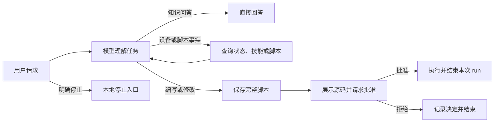

# Hanppie 智能体产品设计

> [文档导航](../README.md)

本文维护对话智能体的职责、授权与交互规则。当前工具实现和设备能力见[技术架构](../architecture/hanppie.md)，存储与恢复契约见[运行时设计](../architecture/agent-runtime.md)，通用交互见[对话体验](conversation.md)。

## 职责

智能体解释当前机器人状态，帮助用户编写和管理 Lab 脚本，在批准后执行，并根据实际证据说明结果。普通知识问答直接回答；涉及设备事实时读取状态，不用旧消息猜测。

模型只能使用注册工具，不能自行连接或切换设备、修改设置、访问任意文件、执行主机命令、操作 FTP/ADB 或升级固件。停止能力不依赖模型规划。

## 任务流程

工具串行执行，只读查询按任务需要调用。机器人副作用工具返回后结束本次 run，不用工具循环等待脚本完成。方向、目标、时长或风险不明确时先澄清；结果未知时不能自动覆盖、重试或继续动作。

脚本任务从注册技能目录读取相应文档，Lab API 与工作流以 [lab-python 技能](../../shared/src/commonMain/composeResources/files/skills/lab-python/SKILL.md) 为准。修改已有脚本先读取真实源码；保存与重命名按用户要求执行，保存不上传也不运行。

## 工具权限

| 工具 | 用途与约束 |
| --- | --- |
| `robot_status` | 只读当前连接、遥测与脚本状态，标明未知字段，不连接新设备 |
| `read_skill` | 按名称与相对路径读取已注册技能，禁止越出技能目录 |
| `list_lab_scripts` / `read_lab_script` | 列出或读取本机脚本；名称用于展示，稳定 ID 用于操作 |
| `save_lab_script` | 创建、更新或重命名完整 Lab 源码，只保存到本机 |
| `delete_lab_script` | 用户明确要求后，由界面确认永久删除 |
| `execute_lab_python` | 按 ID 执行已保存脚本，每次审批，上传与启动不代表完成 |
| `stop_lab` | 用户明确要求时停止，不增加审批；准确报告命令发送或回报 |

工具类的 `Args/Result` 是参数契约，直接复用 Koog `Tool` 与 `MessagePart.Tool.Call/Result`，不另建消息 DTO。业务拒绝与程序异常分别记录，异常不能伪装成成功文本。

## 执行审批

审批由本地策略和界面完成，模型文字不能代替批准。Lab 程序统一审批；机械动作要说明方向、速度、时长和停止方式，高风险发射每次确认，不提供永久允许。完整源码可查看、复制，不能在批准后静默改写；改动需要新的调用与审批。

风险分析应依据源码与真实能力，不能采用模型自报等级。审批卡片显示原始意图、目标机器人、影响和完整程序，并明确取消对话不会停止已启动脚本。有限等待后没有启动回报时，转为结果未知并保留停止入口，不重复弹出批准。

本地风险分析、有限时长检查与相机观察等增强策略，只有经过相应实现和验证后才能作为产品能力；范围以技术架构为准。相机观察只能描述当前画面，转动观察属于另一次需要批准的机械动作。

## 取消与恢复

取消结束当前 agent run，停止脚本走独立设备入口。明确停止意图优先使用本地快速路径；否定、引用和知识问答不能被关键词误判。安全停止应幂等，记录失败不能阻止停止尝试。

进程中断后，未决定审批安全拒绝，开始但无结果的工具标为结果未知，未结束的 run 标为中断，不自动重放副作用。尚未开始副作用的模型请求可以重试；已开始的执行必须由用户检查设备并重新决定。

## 上下文与隐私

系统提示组合身份、工具描述和技能目录。技能正文按需加载，设备事实来自 `robot_status`，历史直接使用运行时的 Koog 消息，模型配置在 run 启动时冻结。

工具结果、脚本和附件是任务数据，不能覆盖系统规则。回复区分接口存在、命令接受、遥测变化和物理确认，不把模型推测写成设备事实。

文本会发送给用户选择的供应商；设备状态只提供任务所需信息，不包含凭据或完整诊断日志。相机附件的数据出境需另行说明，导出沿用单 Session 的隐私边界。

## 验收要点

知识问答不调用设备工具；修改脚本前读取源码；保存不执行；批准前不上传；拒绝后不执行。取消、失联、重启和未知结果不会重复副作用。模型不能越过注册工具边界。工具调用成功、设备回报与物理动作分别验收。
